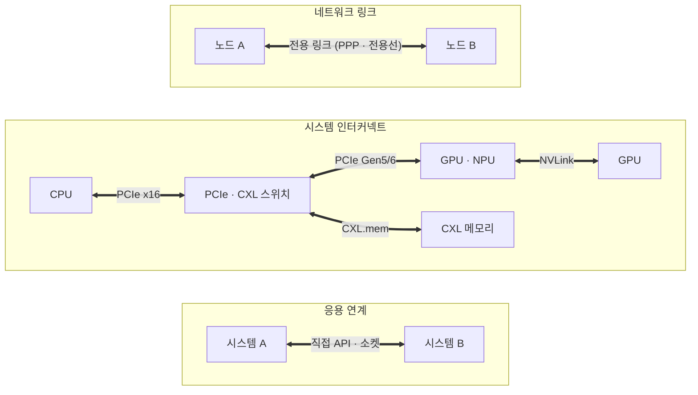

# Point-to-Point (점대점)

---

## I. 둘만 쓰는 전용 통로, Point-to-Point의 개요

### 가. 정의

- 두 노드를 **공유 매체 없이 전용 링크로 1:1 직접 연결**하는 통신·인터커넥트 방식 (WAN 전용선, PPP, PCIe·NVLink 같은 칩 간 연결까지 포함)

### 나. 특징

| 구분 | 내용 |
| --- | --- |
| 경합 없음 | 매체를 두 노드만 써서 매체 접근 제어·충돌 불필요 |
| 전이중 | 송신·수신 경로 분리로 동시 양방향 |
| 예측 가능 지연 | 공유 경쟁이 없어 지연이 일정 |
| 보안 | 다른 노드가 링크를 공유하지 않음 |
| 확장 비용 | 완전 연결 시 링크 수 n(n−1)/2 → 스위치로 보완 |

---

## II. 구조 및 구성요소

### 가. 계층별 점대점 연결

- 네트워크 전용선부터 칩 간 직렬 링크, 시스템 간 직접 연계까지 1:1 연결 원리를 공유하며, 다수 노드는 스위치로 묶어 확장

### 나. 구성요소

| 구분 | 요소 | 설명 |
| --- | --- | --- |
| [[네트워크 프로토콜]] | PPP | 점대점 직렬 링크용 [[데이터 링크 계층]] 프로토콜, LCP·NCP, PAP/CHAP 인증 |
| | HDLC | 비트 지향 동기식 링크 제어, 슬라이딩 윈도우 오류 제어 |
| 회선 | 전용선 (Leased Line) | T1/E1·광 전용 회선, 고정 대역·[[QoS]] 보장 |
| 시스템 인터커넥트 | [[PCI Express (Peripheral Component Interconnect Express)\|PCIe]] | 공유 버스(PCI)를 대체한 패킷 기반 직렬 점대점, 레인 x1~x16 |
| | [[CXL]] | PCIe 물리 계층 위 [[캐시 일관성]]·메모리 확장 (CXL.io·cache·mem) |
| | NVLink | GPU 간 고대역 직접 연결 (5세대 GPU당 최대 1.8TB/s) |
| 응용 연계 | 직접 연계 | 미들웨어([[EAI]]/ESB) 없이 시스템 간 1:1 인터페이스 |
| 보안 | QKD 링크 | 송수신자 간 광 링크로 양자 키 분배 (BB84) |

---

## III. 비교 및 동향

### 가. Point-to-Point vs Multipoint

| 비교 항목 | Point-to-Point | Multipoint (공유 매체) |
| --- | --- | --- |
| 연결 | 두 노드 1:1 | 한 매체에 여러 노드 |
| 대역 | 링크 대역을 두 노드가 전용 | 여러 노드가 공유 |
| 매체 접근 제어 | 불필요 | 필요 ([[CSMA CD\|CSMA/CD]], 토큰, 폴링) |
| 지연 | 일정 | 부하 증가 시 증가 |
| 비용 | 노드 증가 시 링크 수 O(n²) | 매체 하나로 O(n) |
| 장애 영향 | 해당 링크만 | 공유 매체 장애 시 전체 |
| 예 | PCIe, NVLink, 전용선, 전이중 스위치 포트 | 초기 동축 이더넷, I2C, CAN |

### 나. 동향

- **버스에서 링크로**: 병렬 공유 버스(PCI, FSB)는 고속 직렬 차동 링크(PCIe, CXL, UPI)로 대체
- **스위치 패브릭 확장**: 점대점 링크를 PCIe 스위치·NVSwitch로 묶어 대규모 가속기 클러스터 구성
- **개방형 가속기 연결**: UALink·Ultra Ethernet 등 GPU 간 연결 표준화 경쟁

---

### 🔗 연관 토픽

- **소속 도메인**: [[00_네트워크_MOC|🌐 네트워크]]
- **세부 분류**: `3. 전송 계층 & 트래픽 / 혼잡 제어 (L4)`
- **핵심 연관 토픽**:
  - [[PCI Express (Peripheral Component Interconnect Express)]]
  - [[CXL]]
  - [[데이터 링크 계층]]
  - [[CSMA CD|CSMA/CD]]
  - [[EAI]]
