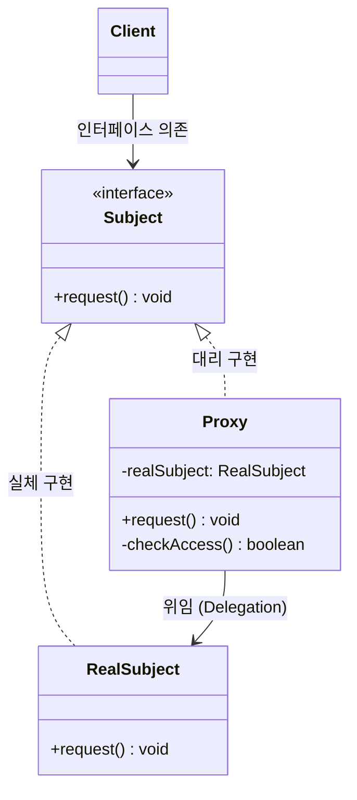

# 프록시 패턴 (Proxy Pattern)

---

## I. 객체 접근 제어와 대리인을 위한 디자인 패턴, 프록시 패턴의 개요

타겟 객체에 대한 직접적인 접근을 제어하거나 부가 기능을 투명하게 제공하기 위해, 타겟 객체와 동일한 인터페이스를 구현한 대리인(Proxy) 객체를 두어 클라이언트의 요청을 대신 중계하는 GoF 구조 디자인 패턴이다.

| 구분 | 주요 내용 |
| --- | --- |
| **개념** | 클라이언트와 실제 객체(RealSubject) 사이에 위치하여, 객체 생성 지연(Lazy Loading), 접근 권한 제어, 캐싱, 원격 호출 등을 대리 수행하는 패턴 |
| **등장 배경** | 생성 비용이 막대한 대용량 객체나 원격 네트워크에 위치한 자원에 매번 직접 접근할 때 발생하는 성능 저하 및 보안 통제 한계 극복 필요 |
| **핵심 특징** | 동일 인터페이스 구현을 통한 클라이언트 투명성(Transparency), 원본 비즈니스 코드 수정 없는 부가 기능 확장, 개방-폐쇄 원칙(OCP) 준수 |

---

## II. 프록시 패턴의 아키텍처 및 핵심 구성요소

### 가. 프록시 패턴의 클래스 다이어그램 및 동작 구조

클라이언트는 `Subject` 인터페이스에만 의존하며, `Proxy` 객체는 내부적으로 권한 검증이나 지연 로딩을 수행한 후 실제 비즈니스 로직을 `RealSubject`의 메서드로 위임(Delegation)한다.

### 나. 프록시의 주요 유형 및 세부 역할

| 분류 | 프록시 유형 (키워드) | 세부 설명 및 주요 활용 사례 |
| --- | --- | --- |
| **성능 최적화** | 가상 프록시 (Virtual Proxy) | 생성 비용이 큰 고용량 객체의 생성을 실제로 필요한 시점까지 미루는 **지연 로딩(Lazy Loading)** 수행 |
| **보안 통제** | 보호 프록시 (Protection Proxy) | 클라이언트의 접근 권한(Role)을 검증하여 인가된 요청만 원본 객체의 비즈니스 메서드로 전달 |
| **위치 투명성** | 원격 프록시 (Remote Proxy) | 서로 다른 주소 공간이나 원격 서버에 위치한 객체를 로컬 객체처럼 호출할 수 있도록 통신 대리 (RPC, gRPC Stub) |
| **응답 가속** | 캐싱 프록시 (Caching Proxy) | 연산 비용이 크거나 반복되는 쿼리 결과를 프록시 캐시에 저장해 두고, 동일 요청 시 원본 호출 없이 즉시 반환 |
| **횡단 관심사** | 로깅/트랜잭션 프록시 | 원본 메서드 실행 전후로 실행 시간 측정, 로깅, 트랜잭션 커밋/롤백 등 부가 기능을 투명하게 주입 ([[AOP (Aspect Oriented Programming)|AOP]]) |

---

## III. 유사 디자인 패턴 비교 및 최신 동향

### 가. 구조 패턴 비교 (Proxy vs Decorator vs Adapter)

| 비교 항목 | 프록시 패턴 (Proxy) | 데코레이터 패턴 (Decorator) | [[어댑터 패턴]] (Adapter) |
| --- | --- | --- | --- |
| **핵심 목적** | **접근 제어 및 대리** (Access Control) | **새로운 책임 동적 추가** (Extension) | **이기종 인터페이스 변환** (Conversion) |
| **인터페이스** | 타겟 객체와 **동일한 인터페이스** 구현 | 타겟 객체와 **동일한 인터페이스** 구현 | **호환되지 않는 새로운 인터페이스**로 변환 |
| **객체 관계** | 대리인이 원본 객체의 생명주기를 통제 | 원본 객체를 감싸서 기능을 동적으로 덧붙임 | 호환되지 않는 두 시스템을 중계하여 연결 |
| **주요 초점** | 접근 통제, 지연 로딩, 원격 대리 | 런타임 기능 확장, 서브클래싱 대체 | 레거시 또는 타사 라이브러리의 재사용 |

### 나. 최신 기술 동향 및 발전 방향

* **프레임워크 런타임 동적 프록시(Dynamic Proxy) 내재화**: Spring 프레임워크의 `@Transactional` 및 보안 어노테이션 처리를 위해, 개발자가 프록시 코드를 직접 짜지 않아도 바이트코드 조작(CGLIB)이나 JDK Dynamic Proxy를 통해 동적 프록시를 자동 주입하는 구조가 표준화됨.
* **분산 네트워크 레벨의 거대 프록시(API Gateway/Sidecar) 확장**: 마이크로서비스 환경에서 외부 인입 트래픽을 통제하는 [[API Gateway]]와 서비스 간 통신을 대리하는 Service Mesh 사이드카(Envoy)는 프록시 패턴이 네트워크 인프라 레벨로 진화한 대표적 사례임.

---

### 🔗 연관 토픽

- **소속 도메인**: [[00_소프트웨어공학_MOC|🏗️ 소프트웨어공학]]
- **세부 분류**: `5. 디자인 패턴`
- **핵심 연관 토픽**:
  - [[AOP (Aspect Oriented Programming)]]
  - [[디자인 패턴]]
  - [[어댑터 패턴]]
  - [[API Gateway]]
  - [[재사용]]
