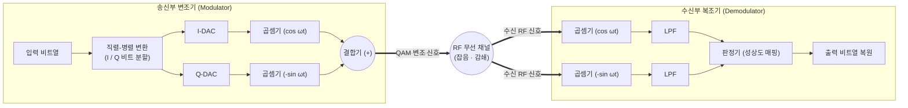

# QAM (Quadrature Amplitude Modulation)

---

## I. 진폭과 위상의 결합을 통한 주파수 효율 극대화, QAM의 개요

### 가. 정의

- 위상이 서로 90도 직교하는 두 개의 반송파(In-phase, Quadrature)에 **진폭 변조(ASK)와 위상 변조(PSK)를 동시에 적용하여, 하나의 심볼(Symbol)에 다중 비트를 실어 전송하는 고효율 디지털 변조 기술**

### 나. 특징 및 필요성

| 구분 | 내용 |
| --- | --- |
| 스펙트럼 효율성 | 동일 주파수 대역폭 내에서 심볼당 전송 비트 수($\log_2 M$)를 획기적으로 증대 |
| 고차 변조 진화 | 16-QAM(4비트), 64-QAM(6비트), 256-QAM(8비트)을 거쳐 최신 4096-QAM(12비트)으로 고도화 |
| 채널 환경 민감성 | 성상도(Constellation)의 신호점 간 간격이 좁아질수록 잡음과 페이딩에 취약하여 높은 SNR 필수 요구 |
| 주요 적용 분야 | Wi-Fi 7(802.11be), 5G-Advanced 이동통신, 디지털 케이블 방송(DOCSIS 4.0), 마이크로웨이브 통신 |

---

## II. 개념도 및 핵심 구성요소

### 가. 개념도 (송수신 변복조 아키텍처)

- 송신단에서 입력 비트를 I 채널과 Q 채널로 나누어 직교 반송파와 곱해 전송하고, 수신단에서 국부 발진기와 LPF를 거쳐 성상도 좌표 판정을 통해 비트열을 복원

### 나. 핵심 기술 요소

| 구분 | 요소 | 설명 |
| --- | --- | --- |
| 신호 축 | I/Q 채널 | 90도 위상 차이를 갖는 두 직교 반송파 성분 ($s(t) = I(t)\cos(\omega_c t) - Q(t)\sin(\omega_c t)$) |
| 표현 도구 | 성상도 (Constellation) | 2차원 평면(I축, Q축) 상에 각 심볼의 진폭과 위상 좌표를 점으로 표시한 신호 공간 다이어그램 |
| 부호화 | 그레이 코딩 (Gray Coding) | 인접한 성상도 신호점 간에 단 1비트만 차이나도록 매핑하여 심볼 오판 시 비트 오차율(BER) 최소화 |
| 채널 적응 | 적응형 변조 및 코딩 (AMC) | 수신 단말의 채널 품질(CQI/SNR)에 따라 QPSK $\rightarrow$ 64-QAM $\rightarrow$ 4096-QAM으로 실시간 전환 |
| 수신 보정 | 등화기 (Equalizer) | 다중 경로 페이딩이나 진폭·위상 왜곡으로 인해 흩어진 성상도 좌표를 원래 위치로 보정 |
| 하드웨어 요구 | 전력 증폭기(PA) 선형성 | 고차 QAM으로 갈수록 첨두전력비(PAPR)가 커지므로 비선형 왜곡을 억제하는 고선형성 전력 증폭기 필수 |

---

## III. 변조 차수별 비교 및 동향

### 가. 16-QAM vs 256-QAM vs 4096-QAM

| 비교 항목 | 16-QAM | 256-QAM | 4096-QAM (4K-QAM) |
| --- | --- | --- | --- |
| 심볼당 비트 수 | 4 비트 ($2^4$) | 8 비트 ($2^8$) | **12 비트** ($2^{12}$) |
| 성상도 신호점 수 | 16 개 | 256 개 | **4,096 개** |
| 주파수 이용 효율 | 보통 ($4 \text{ bps/Hz}$) | 높음 ($8 \text{ bps/Hz}$) | **매우 높음 ($12 \text{ bps/Hz}$)** |
| 요구 SNR 환경 | 낮음 (잡음 환경 강인) | 중간 수준 | **매우 높음 (간섭 없는 근거리 필수)** |
| Wi-Fi 6 대비 증속 | - | 기준 규격 | **전송 속도 약 20% 향상** |
| 주요 표준 및 응용 | LTE 상향링크, 레거시 통신 | Wi-Fi 5/6, 5G 상용망 | **Wi-Fi 7 (802.11be), 5G-Advanced, DOCSIS 4.0** |

### 나. 동향

- **Wi-Fi 7(802.11be) 4096-QAM 상용화**: 채널 대역폭 320MHz와 4096-QAM을 결합하여 무선 AP-단말 간 단일 링크에서 최대 40Gbps급 초고속 통신 구현
- **AI 기반 신경망 수신기(Neural Receiver)**: 신호점이 극도로 조밀해진 고차 QAM 환경에서 채널 추정과 등화를 딥러닝 인공신경망으로 대체하여 BER 성능 획기적 개선
- **디지털 전치왜곡(DPD) 기술 발전**: RF 전력 증폭기의 비선형 왜곡을 디지털 단에서 사전 보상하여 전력 효율을 유지하면서 고차 QAM 신호 완벽 송출

---

### 🔗 연관 토픽

- **소속 도메인**: [[00_네트워크_MOC|🌐 네트워크]]
- **세부 분류**: `4. 무선 및 차세대 이동통신 (5G/6G/Wi-Fi)`
- **핵심 연관 토픽**:
  - [[Wi-Fi 7]]
  - [[다중화]]
  - [[비직교 다중접속]]
  - [[5G 특화망]]
  - [[QoS]]
