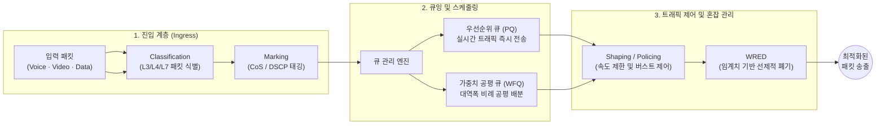

# QoS (Quality of Service)

---

## I. 서비스 특성별 차등 전송 성능 보장, QoS의 개요

### 가. 정의

- 네트워크 대역폭이 제한된 환경에서 음성, 영상, 데이터 등 트래픽의 중요도와 지연 민감도에 따라 우선순위를 차등 부여하여 **일정한 전송 성능(대역폭, 지연, 지터, 패킷 손실률)을 보장하는 네트워크 제어 기술 체계**

### 나. 특징 및 필요성

| 구분 | 내용 |
| --- | --- |
| Best-Effort 한계 극복 | 모든 패킷을 차별 없이 선착순(FIFO) 처리하여 발생하는 실시간 트래픽 품질 저하 방지 |
| 실시간성 보장 | VoIP, 화상회의, 온라인 게임, 원격 의료 등 지연에 극도로 민감한 트래픽의 품질 최우선 보장 |
| 네트워크 혼잡 완화 | 트래픽 폭주 시 비인가 대용량 패킷을 선제 차단하고 중요 비즈니스 패킷의 전송 완결성 유지 |
| 다단계 제어 체계 | 분류(Classification), 마킹(Marking), 큐잉(Queuing), 쉐이핑/폴리싱(Shaping/Policing) 기능 통합 수행 |

---

## II. 개념도 및 핵심 구성요소

### 가. 개념도 (QoS 트래픽 제어 파이프라인)

- 패킷이 유입되면 헤더와 페이로드를 분석해 분류·마킹하고, 스케줄링 큐(PQ/WFQ)와 혼잡 제어(WRED), 대역폭 제한(Shaping/Policing)을 거쳐 차등 송출

### 나. 핵심 기술 요소

| 구분 | 요소 | 설명 |
| --- | --- | --- |
| 분류 및 마킹 | Classification | 출발지/목적지 IP, 포트 번호, 프로토콜, 애플리케이션 특성을 기반으로 패킷의 서비스 등급 식별 |
| | Marking (DSCP / CoS) | L2 이더넷 헤더(802.1p CoS, 3비트) 또는 L3 IP 헤더(ToS 필드의 DSCP, 6비트)에 클래스 값 기록 |
| 큐잉 / 스케줄링 | FIFO | 도착 순서대로 처리하는 기본 큐. 트래픽 차등화 불가 |
| | Priority Queuing (PQ) | 상위 우선순위 큐의 패킷이 모두 소진될 때까지 하위 큐는 대기 (기아 현상 주의) |
| | Weighted Fair Queuing (WFQ) | 각 플로우별 대역폭 가중치에 따라 공평하게 분할 전송하여 하위 큐 기아 방지 |
| 혼잡 회피 | WRED (Weighted RED) | 큐가 만석이 되기 전에 트래픽 중요도에 따라 패킷을 선제적으로 무작위 드롭하여 TCP 혼잡 제어 유도 |
| 대역폭 조절 | [[Traffic Policing (트래픽 정책처리)\|Traffic Policing]] | 설정된 임계 대역폭을 초과하는 트래픽을 즉각 폐기(Drop)하거나 마킹 다운 (버스트 억제) |
| | [[Traffic Shaping (트래픽 쉐이핑)\|Traffic Shaping]] | 초과 트래픽을 버퍼 메모리에 잠시 보관 후 일정 속도로 매끄럽게 지연 전송 (속도 평활화) |

---

## III. QoS 모델 비교 및 동향

### 가. IntServ vs DiffServ

| 비교 항목 | IntServ (Integrated Services) | DiffServ (Differentiated Services) |
| --- | --- | --- |
| 기본 철학 | **플로우(Flow) 단위** 개별 예약 및 보장 | **클래스(Class) 단위** 그룹별 차등 대우 |
| 자원 예약 | RSVP 프로토콜로 경로 상 모든 라우터에 자원 사전 예약 | 사전 예약 없음 (홉 단위 홉별 행동, PHB 적용) |
| 상태 정보 관리 | 모든 라우터가 수천~수만 개 세션 상태(State) 유지 | 상태 미유지 (Stateless, 패킷 헤더 DSCP만 참조) |
| 네트워크 확장성 | 낮음 (백본망 대규모 세션 수용 불가) | **매우 높음 (글로벌 인터넷 백본 표준)** |
| 적합 환경 | 소규모 폐쇄망, 실시간 전용 회선망 | 대규모 엔터프라이즈, ISP 백본망, 5G 코어망 |

### 나. 동향

- **5G/6G 네트워크 슬라이싱 연계**: 네트워크 슬라이스별로 전용 5QI(5G QoS Identifier)를 매핑하여 초저지연(URLLC), 초광대역(eMBB) 요구사항을 완벽히 격리 보장
- **AI 기반 트래픽 예측형 자율 QoS**: 머신러닝으로 트래픽 피크와 지연을 사전 예측하고, 소프트웨어 정의 네트워크([[SDN(Software Defined Network)|SDN]])와 연계하여 대역폭을 동적으로 오토스케일링
- **사용자 체감 품질(QoE) 중심으로 전환**: 단순 패킷 손실/지연 지표를 넘어 실제 사용자가 느끼는 동영상 버퍼링 시간, 음성 MOS(Mean Opinion Score) 점수를 최적화하는 QoE 기반 제어로 진화

---

### 🔗 연관 토픽

- **소속 도메인**: [[00_네트워크_MOC|🌐 네트워크]]
- **세부 분류**: `3. 라우팅 프로토콜 & 패킷 전달 (L3)`
- **핵심 연관 토픽**:
  - [[Traffic Policing (트래픽 정책처리)|Traffic Policing]]
  - [[Traffic Shaping (트래픽 쉐이핑)|Traffic Shaping]]
  - [[TCP 혼잡제어]]
  - [[네트워크 슬라이싱]]
  - [[Queue]]
