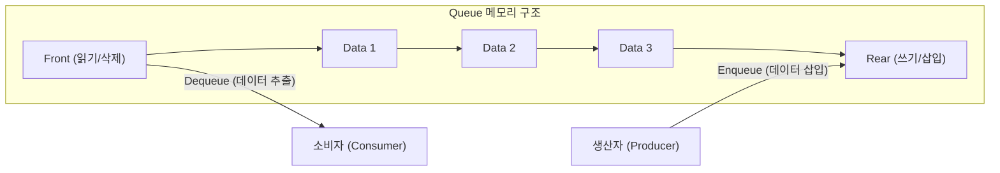

# Queue (큐)

---

## I. 선입선출 기반의 선형 자료구조, Queue의 개요

### 가. 정의

- 데이터 삽입은 후단(Rear)에서, 삭제는 전단(Front)에서 수행되어 먼저 입력된 데이터가 먼저 출력되는 **선입선출([[FIFO]]) 기반의 선형 자료구조이자 비동기 버퍼**

### 나. 특징 및 필요성

| 구분 | 내용 |
| --- | --- |
| 순서 보장 | 작업 요청 및 이벤트의 발생 순서를 엄격하게 유지하여 공정성 보장 |
| 속도 차이 완충 | 생산자(Producer)와 소비자(Consumer) 간의 처리 속도 불일치로 인한 병목 완화 |
| 구조적 확장 | 선형 큐의 공간 낭비를 해결한 원형 큐(Circular Queue), 양방향 입출력이 가능한 데크(Deque)로 확장 |
| 시스템 적용 | OS 프로세스/스레드 스케줄링, 입출력 버퍼링, 네트워크 패킷 큐 등 전 영역 활용 |

---

## II. 개념도 및 핵심 구성요소

### 가. 개념도

- Enqueue 연산 시 Rear 포인터가 증가하고, Dequeue 연산 시 Front 포인터가 증가하여 순차적인 FIFO 흐름을 유지

### 나. 핵심 구성요소 및 파생 구조

| 구분 | 요소 | 설명 |
| --- | --- | --- |
| 기본 연산 | Enqueue | 큐의 Rear 위치에 새로운 데이터를 삽입하는 연산 ($O(1)$) |
| | Dequeue | 큐의 Front 위치에서 데이터를 추출하고 제거하는 연산 ($O(1)$) |
| 포인터 | Front / Rear | 데이터의 추출 위치(Front)와 삽입 위치(Rear)를 가리키는 인덱스 또는 포인터 |
| 구조 최적화 | Circular Queue | 선형 큐에서 발생한 앞쪽 빈 공간 낭비를 해결하기 위해 배열 양 끝을 모듈로 연산($(i+1) \pmod N$)으로 연결 |
| | Deque (Double-Ended) | 양쪽 끝(Front, Rear) 모두에서 삽입과 삭제가 자유롭게 수행 가능한 양방향 큐 |
| 성능 최적화 | Ring Buffer | 고정 크기 메모리를 순환 재할당 없이 재사용하여 캐시 친화적 성능을 제공하는 고속 버퍼 |
| | Lock-Free Queue | 멀티스레드 환경에서 Mutex 없이 CAS(Compare-And-Swap) 원자 연산으로 동시성을 보장 |
| 확장 형태 | Priority Queue | FIFO 대신 우선순위가 높은 데이터가 먼저 추출되는 [[힙]] 기반 큐 |
| | Message Queue | 서비스 간 비동기 결합도 완화를 위한 분산 메시징 미들웨어 (Kafka, RabbitMQ) |

---

## III. 자료구조 비교 및 동향

### 가. Stack vs Queue

| 비교 항목 | Stack (스택) | Queue (큐) |
| --- | --- | --- |
| 입출력 규칙 | LIFO (Last-In, First-Out, 후입선출) | FIFO (First-In, First-Out, 선입선출) |
| 삽입·삭제 위치 | 단일 지점 (Top)에서만 수행 | 양 지점 분리 (삽입: Rear, 삭제: Front) |
| 주요 연산 | Push, Pop, Peek | Enqueue, Dequeue, Front |
| 대표적 구현 | 단일 인덱스 기반 배열 또는 단방향 리스트 | 원형 배열, 연결 리스트, 링 버퍼 |
| 탐색 및 활용 | 깊이 우선 탐색(DFS), 함수 호출 스택, Undo | 너비 우선 탐색(BFS), 프로세스 스케줄러, 인쇄 대기열 |

### 나. 동향

- **분산 이벤트 스트리밍([[EDA]]) 표준화**: 마이크로서비스([[MSA (Micro Service Architecture)|MSA]]) 간의 결합도를 낮추고 데이터 일관성을 유지하기 위해 Kafka, Pulsar 등 분산 큐를 활용한 이벤트 소싱 보편화
- **초저지연 Lock-Free 링 버퍼 확산**: 금융 고빈도 매매(HFT) 및 게임 서버 엔진 등 초저지연 트래픽 환경에서 락 경합과 컨텍스트 스위칭 비용을 제거한 LMAX Disruptor 패턴 적용
- **하드웨어 큐 가속**: 고속 네트워크 인터페이스 카드(SmartNIC) 및 NVMe 스토리지 컨트롤러에서 하드웨어 기반 멀티 큐(Multi-Queue)를 통해 CPU 개입 없이 직접 패킷 처리

---

### 🔗 연관 토픽

- **소속 도메인**: [[00_컴퓨터구조_MOC|💻 컴퓨터구조]]
- **세부 분류**: `4. 기본 자료구조 (Data Structures)`
- **핵심 연관 토픽**:
  - [[Stack]]
  - [[FIFO]]
  - [[힙|힙 (Heap)]]
  - [[트리 순회|트리 순회 (Tree Traversal)]]
  - [[스케줄링]]
