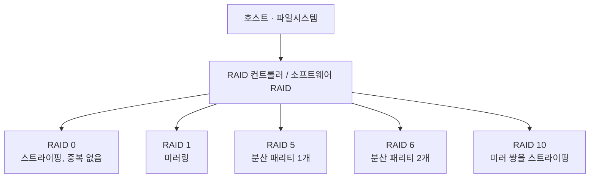

# RAID (Redundant Array of Independent Disks)

---

## I. 여러 디스크를 하나처럼, RAID의 개요

### 가. 정의

- 여러 물리 디스크를 **하나의 논리 볼륨으로 묶어 스트라이핑으로 성능을, 미러링·패리티로 장애 허용을 제공**하는 디스크 배열 기술 (Patterson 등, 1988)

### 나. 필요성 및 특징

| 구분 | 내용 |
| --- | --- |
| 성능 | 여러 디스크에 나눠 병렬 입출력 |
| 가용성 | 디스크 장애 시에도 데이터 보존·서비스 지속 ([[HA(High Availability)\|HA]]) |
| 용량 | 여러 디스크를 하나의 큰 볼륨으로 사용 |
| 한계 | 백업 대체 불가 (삭제·랜섬웨어·논리 오류는 그대로 복제) |

---

## II. 구조 및 구성요소

### 가. 주요 레벨 구조

- 컨트롤러가 레벨 규칙에 따라 데이터를 나누거나(스트라이핑) 복제·패리티를 계산해 디스크에 분산

### 나. 구성요소

| 구분 | 요소 | 설명 |
| --- | --- | --- |
| 기본 기법 | 스트라이핑 | 데이터를 스트라이프 단위로 나눠 여러 디스크에 분산 |
| | 미러링 | 같은 데이터를 두 디스크 이상에 기록 |
| | 패리티 | XOR(RAID 5) 또는 XOR + 리드-솔로몬 계열(RAID 6)로 복구 정보 계산 |
| 레벨 | RAID 0 | 최소 2개, 용량 100%, 장애 허용 없음 |
| | RAID 1 | 최소 2개, 용량 50%, 1개 장애 허용 |
| | RAID 5 | 최소 3개, 용량 (N-1)/N, 1개 장애 허용, 쓰기 시 패리티 갱신 부담 |
| | RAID 6 | 최소 4개, 용량 (N-2)/N, 2개 장애 허용 |
| | RAID 10 | 최소 4개, 용량 50%, 미러 쌍마다 1개 장애 허용 |
| | RAID 2·3·4 | 해밍 코드·바이트 단위 전용 패리티·블록 단위 전용 패리티 (현재는 거의 미사용) |
| 운영 | 핫 스페어 | 장애 시 자동 투입되어 리빌드 시작하는 예비 디스크 |
| 구현 | 하드웨어 RAID | 전용 컨트롤러·캐시, 배터리·플래시 백업으로 쓰기 캐시 보호 |
| | 소프트웨어 RAID | OS [[커널]]에서 구현 (Linux mdadm, ZFS RAID-Z) |

---

## III. 비교 및 동향

### 가. RAID vs 이레이저 코딩

| 비교 항목 | RAID 5·6 | [[이레이저 코딩]] |
| --- | --- | --- |
| 적용 범위 | 한 서버·스토리지 어레이 안의 디스크 | 분산 클러스터의 노드·랙 |
| 저장 효율 | (N-1)/N, (N-2)/N | k/(k+m), 예: 8+4는 67% |
| 장애 허용 | 디스크 1~2개 | 패리티 수 m만큼, 노드·랙 단위 |
| 리빌드 | 대용량 디스크는 수 시간~수일, 그동안 추가 장애 위험 | 여러 노드에 분산해 병렬 복구 |

### 나. 동향

- **대용량 디스크 리빌드 위험**: 수십 TB HDD에서 RAID 5 리빌드 중 추가 장애·URE 위험이 커져 RAID 6·RAID 10, 분산 RAID 선호
- **NVMe 환경**: 하드웨어 컨트롤러가 병목이 되어 소프트웨어 RAID·GPU 가속 RAID(예: GRAID) 등장
- **분산 스토리지**: 클라우드 규모에서는 이레이저 코딩·복제가 디스크 RAID를 대체

---

### 🔗 연관 토픽

- **소속 도메인**: [[00_컴퓨터구조_MOC|💻 컴퓨터구조]]
- **세부 분류**: `2. 캐시 & 메모리 계층 구조 · 스토리지`
- **핵심 연관 토픽**:
  - [[이레이저 코딩|이레이저 코딩(erasure coding)]]
  - [[NAS]]
  - [[스토리지 유형|스토리지 유형 (블록, 파일, 오브젝트 스토리지)]]
  - [[HA(High Availability)]]
  - [[결함허용 컴퓨터|결함허용 컴퓨터(FTS)]]
