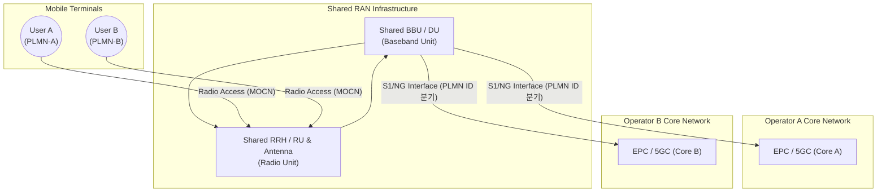

# RAN (Radio Access Network) Sharing

---

## I. 무선 인프라 비용 절감과 투자 효율화, RAN Sharing의 개요

무선 접속망(Radio Access Network) 인프라를 복수의 이동통신 사업자가 공동으로 구축·운용하여 설비 투자비(CAPEX)와 운용비(OPEX)를 절감하고 커버리지를 신속히 확보하는 무선망 공유 기술이다.

| 구분 | 주요 내용 |
| --- | --- |
| **개념** | 기지국 안테나, 철탑, 무선 장비(RU), 기저대역(DU/CU) 및 주파수를 둘 이상의 통신 사업자가 상호 공유하여 활용하는 네트워크 기술 |
| **등장 배경** | 5G 전국망 구축 비용 급증, 도농 간 무선 커버리지 격차 해소, 희소한 주파수 자원의 활용 극대화 및 중복 투자 방지 필요 |
| **핵심 특징** | 수동적(Passive) 인프라 공유부터 주파수 및 코어 연동(Active) 공유까지 단계적 적용 가능, PLMN ID 기반 트래픽 분기 지원 |

---

## II. RAN Sharing의 아키텍처 및 핵심 기술 요소

### 가. RAN Sharing의 아키텍처 및 동작 원리

다수의 사업자 단말(UE A, UE B)이 동일한 물리 무선 접속망(Shared RAN)에 접속하며, 기지국 레벨에서 PLMN ID(Public Land Mobile Network ID)를 기반으로 트래픽을 각 사업자의 코어 네트워크로 분기 라우팅한다.

### 나. RAN Sharing의 핵심 기술 요소 및 구성

| 분류 | 요소기술 (키워드) | 세부 설명 |
| --- | --- | --- |
| **공유 유형** | Passive Sharing | 철탑(Tower), 전신주, 국사, 전력 및 냉방 설비 등 물리적 공간과 부대시설만 공유 |
| **공유 유형** | Active Sharing (MORAN) | 안테나, 철탑, RU 장비를 공유하되, 사업자별 주파수 대역은 독립적으로 분할 사용하는 방식 |
| **공유 유형** | Active Sharing (MOCN) | 기지국 장비(DU/RU) 및 주파수 대역까지 전면 공동 공유하며 PLMN ID로 트래픽을 분기 제어 |
| **공유 유형** | GWCN (Gateway Core) | MOCN 구조에서 코어 네트워크의 제어 노드(MME/AMF 등)까지 공동으로 연동·공유하는 방식 |
| **제어 기술** | PLMN ID 브로드캐스팅 | 단말 접속 시 기지국이 복수 사업자의 망 식별자를 방송하여 올바른 코어망과 세션 연결 지원 |
| **자원 할당** | 동적 대역 할당 ([[DSA]]) | 사업자 간 트래픽 수요 변화에 맞춰 무선 자원 블록(PRB)을 실시간 유연하게 재할당 |
| **차세대 연계** | [[O-RAN]] 연동 | 개방형 프론트홀 및 RIC(RAN Intelligent Controller)를 통해 다중 사업자 가상화 무선망 통합 제어 |
| **기대 효과** | CAPEX / OPEX 절감 | 중복 설비 투자 방지로 기지국 구축 비용 대폭 절감 및 [[유지보수]] 운용 효율 극대화 |

---

## III. RAN Sharing 유형 비교 및 향후 동향

### 가. Active RAN Sharing 주요 방식 비교 (MORAN vs MOCN)

| 비교 항목 | MORAN (Multi-Operator RAN) | MOCN (Multi-Operator Core Network) |
| --- | --- | --- |
| **주파수 공유** | **사업자별 개별 주파수 독립 할당/운용** | **단일 주파수 대역을 복수 사업자가 공동 활용** |
| **공유 장비 범위** | 안테나, 철탑, 전파 송수신부(RU) 공유 | DU/BBU 및 RU, 주파수 자원 전면 공유 |
| **간섭 및 제어** | 주파수가 분리되어 간섭 관리가 용이함 | 주파수 효율이 극대화되나 사업자 간 스케줄링 조정 필요 |
| **표준화 지원** | 3GPP 표준 (Rel-8 이상 보편화) | 3GPP 5G SA 표준 기반 상용화 가속 |
| **주요 적용처** | 초기 비용 절감 및 부분적 커버리지 확장 | 농어촌 공동망, 지하철 등 극도의 비용 효율화 구역 |

### 나. 최신 기술 동향 및 발전 방향

* **O-RAN 기반 지능형 가상화 공유**: 하드웨어 종속성을 제거한 vRAN(가상화 RAN) 및 O-Cloud 기반 환경에서 O-RAN RIC의 AI/ML 제어기(rApp/xApp)가 사업자별 트래픽을 지능적으로 슬라이싱하여 동적 자원 분배를 자동화함.
* **농어촌 5G 공동구축망 상용화**: 통신 3사가 지역별로 기지국을 분할 구축하고 MOCN 방식을 통해 상호 무선망을 공유하는 도농 디지털 격차 해소 모델이 정착됨.
* **특화망(Private 5G) 및 재난망 공유 확대**: B2B 특화망 및 철도·소방 재난안전통신망과 상용 이동통신망 간의 효율적 연계를 위해 RAN Sharing 아키텍처 도입이 가속화됨.

---

### 🔗 연관 토픽

- **소속 도메인**: [[00_네트워크_MOC|🌐 네트워크]]
- **세부 분류**: `4. 무선 및 차세대 이동통신 (5G/6G/Wi-Fi)`
- **핵심 연관 토픽**:
  - [[O-RAN]]
  - [[C-RAN(Centralized Cloud RAN)|C-RAN(Centralized / Cloud RAN)]]
  - [[유지보수]]
  - [[DSA]]
