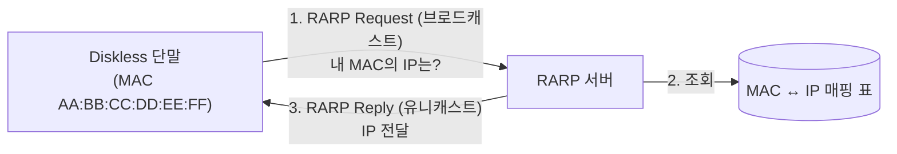

# RARP (Reverse Address Resolution Protocol)

---

## I. MAC으로 자기 IP를 묻는, RARP의 개요

### 가. 정의

- 디스크 없는(Diskless) 단말이 **자신의 MAC 주소를 근거로 RARP 서버에 자기 IP 주소를 요청**하는 역방향 주소 변환 [[프로토콜]] (RFC 903, 1984)

### 나. 특징

| 구분 | 내용 |
| --- | --- |
| 등장 배경 | 저장 장치가 없어 IP 설정을 보관할 수 없는 단말의 부팅 지원 |
| 동작 계층 | 이더넷 프레임(EtherType 0x8035)으로 직접 동작, IP 없이 통신 |
| 브로드캐스트 요청 | 서버 위치를 몰라 같은 LAN에 브로드캐스트 |
| 정적 매핑 | 서버가 MAC↔IP 표를 수동 관리 |
| 현재 위상 | BOOTP를 거쳐 [[DHCP]]로 대체, 사실상 사용 안 함 |

---

## II. 동작 구조 및 구성요소

### 가. 동작 절차

- 부팅 시 단말이 자신의 MAC을 담아 브로드캐스트하면, 서버가 매핑 표를 조회해 해당 IP를 응답

### 나. 구성요소 및 한계

| 구분 | 요소 | 설명 |
| --- | --- | --- |
| 식별 | MAC 주소 | NIC 고유 주소로 단말 식별 |
| 메시지 | Request · Reply | [[ARP]]와 같은 형식, Opcode 3(요청)·4(응답) |
| 서버 | RARP 서버 (rarpd) | MAC↔IP 정적 표 관리 |
| 한계 | 서브넷 제한 | L2 브로드캐스트라 [[라우터]]를 넘지 못해 서브넷마다 서버 필요 |
| | 정보 부족 | IP만 제공, 서브넷 마스크·[[게이트웨이]]·DNS·부트 파일 정보 없음 |
| | 수동 관리 | 단말 추가 때마다 표 수정 |

---

## III. 비교 및 동향

### 가. RARP vs BOOTP vs DHCP

| 비교 항목 | RARP | BOOTP | DHCP |
| --- | --- | --- | --- |
| 동작 | L2 이더넷 프레임 | UDP 67/68 | UDP 67/68 |
| 제공 정보 | IP 주소만 | IP, 게이트웨이, 부트 파일 | IP, 마스크, 게이트웨이, DNS 등 다양한 옵션 |
| 서브넷 간 | 불가 | Relay Agent로 가능 | Relay Agent로 가능 |
| 주소 관리 | 정적 | 정적 | 동적 임대·회수 |
| 현재 | 사용 안 함 | DHCP에 흡수 | 표준 |

### 나. 의의

- 네트워크 부팅·자동 주소 설정의 출발점으로, 개념은 BOOTP·DHCP와 PXE 부팅으로 계승
- IPv6에서는 SLAAC·DHCPv6가 같은 역할을 담당 ([[IPv6]])

---

### 🔗 연관 토픽

- **소속 도메인**: [[00_네트워크_MOC|🌐 네트워크]]
- **세부 분류**: `1. OSI 7계층 & 데이터링크 계층 (L1/L2)`
- **핵심 연관 토픽**:
  - [[ARP]]
  - [[DHCP|DHCP(Dynamic Host Configuration Protocol)]]
  - [[데이터 링크 계층|데이터 링크 계층 (Data Link Layer)]]
  - [[IPv4]]
  - [[네트워크 계층|네트워크 계층 (Network Layer)]]
