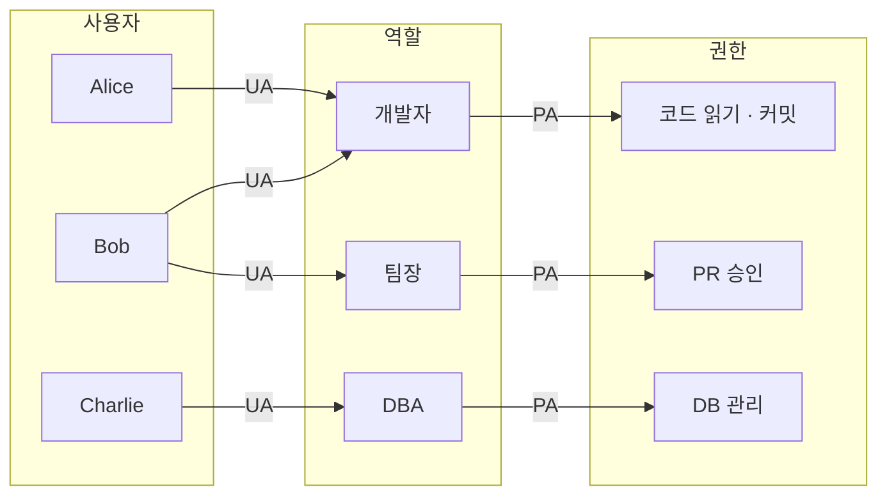

# RBAC (Role-Based Access Control)

---

## I. 사람이 아닌 역할에 권한을, RBAC의 개요

### 가. 정의

- 접근 권한을 개별 사용자가 아니라 **조직 내 역할(Role)에 부여하고, 사용자는 역할을 할당받아 권한을 얻는** 비임의적 접근통제 모델

### 나. 특징

| 구분 | 내용 |
| --- | --- |
| 관리 용이성 | 인사이동 시 역할만 바꾸면 권한이 일괄 변경 |
| 최소 권한 | 역할 수행에 필요한 권한만 부여 |
| 직무 분리 (SoD) | 상충 역할(요청자·승인자)을 한 사람에게 함께 부여하지 않음 |
| 절충형 | [[DAC]]의 취약성과 [[MAC]]의 경직성 사이에서 기업 환경에 적합 |

---

## II. 구조 및 구성요소

### 가. 사용자-역할-권한 매핑

- 사용자 할당(UA)과 권한 할당(PA)을 분리해, 사용자는 세션에서 필요한 역할을 활성화하여 권한 행사

### 나. 구성요소

| 구분 | 요소 | 설명 |
| --- | --- | --- |
| 기본 요소 | 사용자·역할·권한·세션 | 세션은 사용자가 일부 역할을 활성화한 상태 |
| Sandhu RBAC96 | RBAC0 | 기본 모델 (사용자·역할·권한·세션) |
| | RBAC1 | RBAC0 + 역할 계층 (상위 역할이 하위 권한 상속) |
| | RBAC2 | RBAC0 + 제약 조건 (SoD, 역할 수 제한) |
| | RBAC3 | RBAC1 + RBAC2 통합 |
| NIST 표준 (ANSI INCITS 359) | Core RBAC | 기본 구성요소 |
| | Hierarchical RBAC | 역할 계층 |
| | SSD (정적 직무 분리) | 상충 역할을 같은 사용자에게 할당 금지 |
| | DSD (동적 직무 분리) | 상충 역할을 한 세션에서 동시 활성화 금지 |

---

## III. 비교 및 동향

### 가. 접근통제 모델 비교

| 비교 항목 | DAC | MAC | RBAC | ABAC |
| --- | --- | --- | --- | --- |
| 기준 | 소유자·신분 | 보안 레이블 | 역할 | 주체·객체·환경 속성 |
| 권한 결정 | 소유자 | 시스템 정책 | 보안 관리자 | 정책 엔진 |
| 장점 | 유연, 구현 쉬움 | 강한 [[기밀성]] | 관리 용이, 인사이동 대응 | 상황 기반 세밀 제어 |
| 단점 | 트로이 목마에 취약 | 경직, 관리 부담 | 역할 폭증 | 정책 복잡, 평가 비용 |

### 나. 동향

- **역할 폭증 대응**: 조건별 역할이 늘어나는 문제를 ABAC·PBAC(정책 기반)와 결합해 해결 (예: AWS IAM 역할 + 조건 키)
- **쿠버네티스 RBAC**: Role·ClusterRole·RoleBinding으로 클러스터 자원 권한 관리
- **역할 마이닝·재인증**: 실제 사용 이력으로 역할을 정리하고 정기적으로 권한 재검토 ([[IAM]]·IGA)

---

### 🔗 연관 토픽

- **소속 도메인**: [[00_보안_MOC|🛡️ 보안]]
- **세부 분류**: `1. 정보보안 원칙 & 거버넌스 · 인증`
- **핵심 연관 토픽**:
  - [[접근 제어 접근 통제|접근 제어/접근 통제(Access Control)]]
  - [[DAC]]
  - [[MAC]]
  - [[IAM]]
  - [[서버 접근 통제]]
