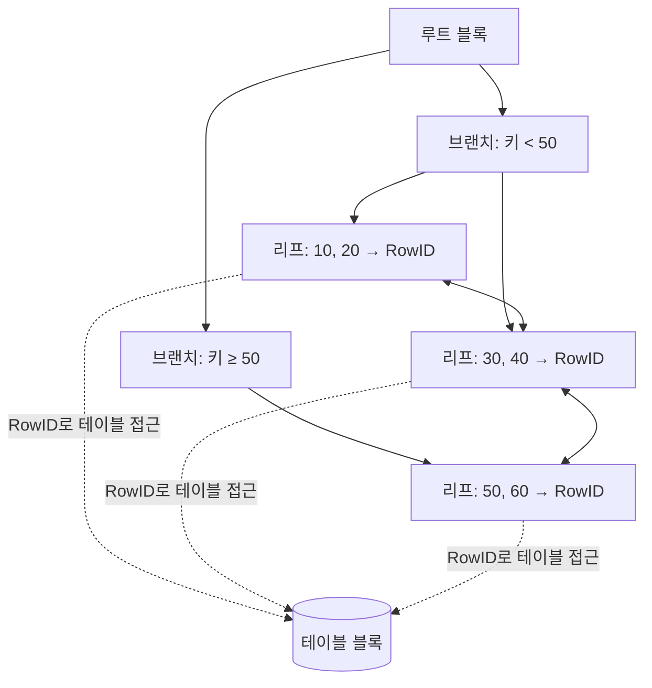

# RDBMS 인덱스 (Index)

---

## I. 검색 경로를 미리 만들어 두는 구조, 인덱스의 개요

### 가. 정의

- 테이블의 **하나 이상 컬럼 값을 정렬·해시 구조로 저장하고 행 위치(RowID)를 가리켜, 전체 스캔 없이 원하는 행을 빠르게 찾게 하는 별도 자료구조**

### 나. 특징

| 구분 | 내용 |
| --- | --- |
| 조회 성능 | Full Table Scan 대신 소수 블록만 읽어 I/O 감소 |
| 정렬 활용 | ORDER BY·MIN/MAX·범위 조건을 정렬 순서로 처리 |
| 쓰기 비용 | INSERT·UPDATE·DELETE 시 인덱스도 갱신 |
| 저장 공간 | 테이블과 별도의 공간 필요 |

---

## II. 구조 및 구성요소

### 가. B+Tree 인덱스 구조

- 루트에서 리프까지 높이가 같은 균형 트리이며, 리프가 서로 연결되어 범위 스캔이 빠름 ([[Balanced Tree B-Tree|B-Tree]])

### 나. 구성요소와 유형

| 구분 | 요소 | 설명 |
| --- | --- | --- |
| 구조 | B+Tree | 대부분 RDBMS의 기본, 일치·범위 검색 모두 효율적 |
| | Hash | 일치 검색 O(1), 범위·정렬 불가 |
| | Bitmap | 값 종류가 적은 컬럼, DW 다중 조건 결합 |
| 저장 방식 | 클러스터형 | 테이블 행이 인덱스 키 순서로 저장, 테이블당 1개 (InnoDB는 PK) |
| | 비클러스터형 | 키와 행 위치만 저장, 여러 개 가능 |
| 설계 | 결합 인덱스 | 선두 컬럼이 조건에 쓰여야 효율적, 등치 조건 컬럼을 앞에 배치 |
| | 커버링 인덱스 | 질의에 필요한 컬럼이 모두 인덱스에 있어 테이블 접근 생략 |
| | 함수 기반 인덱스 | UPPER(col) 등 식에 대한 인덱스 |
| 공간 관리 | Fill Factor·PCTFREE | 페이지에 여유 공간을 남겨 페이지 분할 감소 |

---

## III. 비교 및 동향

### 가. 클러스터형 vs 비클러스터형

| 비교 항목 | 클러스터형 | 비클러스터형 |
| --- | --- | --- |
| 데이터 정렬 | 행 자체가 키 순서로 저장 | 행 순서와 무관 |
| 개수 | 테이블당 1개 | 여러 개 |
| 범위 검색 | 인접 저장으로 매우 빠름 | 키마다 테이블 접근(랜덤 I/O) 발생 |
| 쓰기 | 키 변경 시 행 이동, 무작위 키는 페이지 분할 증가 | 인덱스만 갱신 |
| 적합 키 | 변경이 없고 증가하는 값 (일련번호) | 자주 쓰는 검색·조인 컬럼 |

### 나. 동향

- **불필요 인덱스 정리**: 사용 이력(pg_stat_user_indexes 등)을 보고 미사용 인덱스 제거
- **선택도 기반 설계**: 성별·Y/N처럼 값 종류가 적은 컬럼은 B+Tree 효과가 낮아 결합 인덱스 후순위 또는 Bitmap 검토
- **자동 인덱싱**: Oracle Auto Indexing, Azure SQL 자동 튜닝 등 워크로드 기반 인덱스 생성·삭제 ([[DB 성능 개선 방안]])

---

### 🔗 연관 토픽

- **소속 도메인**: [[00_데이터베이스_MOC|🗄️ 데이터베이스]]
- **세부 분류**: `2. 트랜잭션 & 동시성 제어 (Concurrency)`
- **핵심 연관 토픽**:
  - [[Balanced Tree B-Tree|Balanced Tree B-Tree (비트리)]]
  - [[인덱스 구조에 따른 분류]]
  - [[다차원 색인구조]]
  - [[DB 성능 개선 방안|DB 성능 개선 방안 (Tuning)]]
  - [[OPTIMIZER]]
