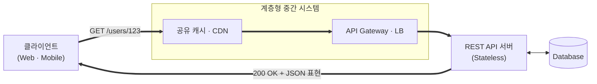

# REST 및 RESTful API 설계 6원칙

---

## I. 웹의 설계 원리를 API로, REST의 개요

### 가. 정의

- **REST(Representational State Transfer)**: 자원을 URI로 식별하고 **HTTP 메서드로 자원의 표현(Representation)을 주고받아 상태를 전달**하는 분산 하이퍼미디어 시스템 아키텍처 스타일 (Roy Fielding, 2000년 박사논문)
- **RESTful API**: REST 제약 조건을 따르도록 설계된 웹 API

### 나. 특징

| 구분 | 내용 |
| --- | --- |
| 등장 배경 | 웹의 확장성을 API에 적용, SOAP 등 무거운 방식 대비 단순한 연동 요구 |
| 구성 3요소 | 자원(URI), 행위(HTTP Method), 표현(JSON·XML 등) |
| 장점 | HTTP 인프라(캐시·프록시) 그대로 활용, 클라이언트-서버 독립 진화 |
| 한계 | 표준 규격이 아닌 스타일이라 설계 편차 큼, 복잡한 조회 시 여러 번 호출 |

---

## II. 구조 및 6원칙

### 가. 동작 구조

- 클라이언트는 URI로 식별한 자원에 HTTP 메서드로 요청하고, 서버는 상태를 보관하지 않은 채 자원의 표현을 응답하며, 중간 계층(캐시·게이트웨이)이 투명하게 개입

### 나. REST 6원칙 (Fielding 제약 조건)

| 구분 | 요소 | 설명 |
| --- | --- | --- |
| 1 | 클라이언트-서버 | UI(클라이언트)와 데이터·로직(서버)의 관심사 분리, 독립적 진화 |
| 2 | 무상태성 (Stateless) | 서버는 클라이언트 [[세션]] 상태를 저장하지 않고, 각 요청이 처리에 필요한 정보(토큰 등)를 모두 포함 → 수평 확장 용이 |
| 3 | 캐시 가능 (Cacheable) | 응답에 캐시 가능 여부 명시 (Cache-Control, ETag) |
| 4 | 균일한 인터페이스 | 자원 식별(URI), 표현을 통한 자원 조작, 자기 서술적 메시지, HATEOAS의 4개 하위 제약 |
| 5 | 계층형 시스템 | 클라이언트는 중간 계층(프록시·LB·[[방화벽]]) 존재를 알 필요 없음 |
| 6 | 주문형 코드 (선택) | 서버가 스크립트 등 실행 코드를 전달해 클라이언트 기능 확장, 유일한 선택 제약 |

- 일부 수험서는 균일한 인터페이스의 하위 요소(자기 서술성, HATEOAS)를 별도 원칙으로 세어 "Uniform Interface, Stateless, Cacheable, Self-descriptiveness, Client-Server, 계층형"을 6원칙으로 제시하기도 함

---

## III. 비교 및 동향

### 가. 리처드슨 성숙도 모델

| 비교 항목 | Level 0 | Level 1 | Level 2 | Level 3 |
| --- | --- | --- | --- | --- |
| 명칭 | The Swamp of POX | Resources | HTTP Verbs | Hypermedia Controls |
| 특징 | 단일 엔드포인트에 POST로 모든 호출 (SOAP, XML-RPC) | 자원별 URI 부여 | 메서드(GET·POST·PUT·DELETE)와 상태 코드 의미대로 사용 | 응답에 다음 동작 링크 포함 (HATEOAS) |
| REST 수준 | REST 아님 | 부분 | 실무 표준 | Fielding이 정의한 REST 충족 |

- 실무 API 대부분은 Level 2 수준이며, HATEOAS는 클라이언트 구현 복잡도 때문에 제한적으로 사용

### 나. 동향

- **용도별 병행**: 외부 공개 API는 REST, 화면별 복잡한 조회는 GraphQL, 내부 서비스 간 통신은 gRPC를 함께 사용 ([[Open API 및 API]])
- **명세 우선 설계**: OpenAPI Specification으로 계약을 먼저 정의하고 문서·SDK·Mock 자동 생성
- **AI 에이전트 호출**: 명확한 명세를 가진 REST API를 LLM이 도구로 호출하는 사례 증가

---

### 🔗 연관 토픽

- **소속 도메인**: [[00_디지털서비스_MOC|🚀 디지털서비스]]
- **세부 분류**: `4. 데이터 플랫폼 & 개방형 API 생태계`
- **핵심 연관 토픽**:
  - [[Open API 및 API|Open API API]]
  - [[API Gateway]]
  - [[세션]]
  - [[JSON]]
  - [[MSA (Micro Service Architecture)]]
