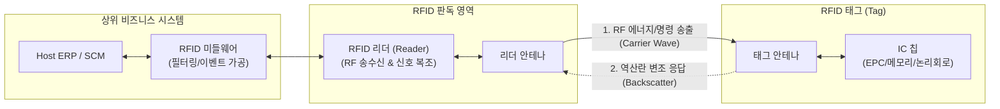

# RFID (Radio Frequency Identification)

---

## I. 비접촉식 사물 식별 및 추적의 핵심 기술, RFID의 개요

무선 주파수(Radio Frequency) 신호를 이용하여 비접촉 방식으로 사물에 부착된 태그(Tag)의 고유 식별 정보를 인식하고 데이터를 교환하는 근거리 무선 통신 기술이다.

| 구분 | 주요 내용 |
| --- | --- |
| **개념** | 전파를 송출하는 리더(Reader)와 고유 식별 정보(EPC)가 내장된 마이크로칩 및 안테나로 구성된 태그(Tag) 간의 무선 신호 결합 메커니즘 |
| **등장 배경** | 기존 바코드(Barcode)의 가시선(Line-of-Sight) 확보 제약, 1:1 순차 판독 및 오염 취약성 한계 극복, 공급망 전반의 실시간 가시성 확보 요구 |
| **핵심 특징** | 비가시선(Non-Line-of-Sight) 투과 판독, 다수 태그 동시 인식(Anti-Collision), 데이터 쓰기/수정 가능, 다양한 주파수 대역(LF/HF/UHF) 활용 |

---

## II. RFID의 아키텍처 및 핵심 구성요소

### 가. RFID 시스템 구성 및 신호 전달 아키텍처

리더기가 무선 주파수 에너지를 방출하면 태그 안테나가 이를 수신하여 IC 칩을 구동하고, 칩에 저장된 고유 데이터를 역산란(Backscatter Modulation) 방식으로 반사하여 리더기로 회신한다.

### 나. RFID 시스템의 핵심 기술 요소

| 분류 | 요소기술 (키워드) | 세부 설명 |
| --- | --- | --- |
| **태그** | RFID 태그 (Transponder) | 사물에 부착되는 고유 식별 매체로, 데이터를 연산·저장하는 **IC 칩**과 전파를 유도하는 **안테나**로 구성 |
| **판독 장비** | RFID 리더 (Interrogator) | 특정 주파수의 반송파를 발사하여 태그를 활성화하고, 태그로부터 반사된 신호를 복조하여 호스트로 전달 |
| **소프트웨어** | RFID 미들웨어 | 리더기에서 수집된 대량의 원시 데이터(Raw Data) 중 중복을 제거하고 비즈니스 유의미 이벤트로 정제 |
| **충돌 제어** | 충돌 방지 ([[알고리즘]]) | 리더 인식 범위 내 다수 태그의 동시 응답 간섭을 방지하는 프로토콜 (ALOHA, Tree Walking 기법 등) |
| **주파수 대역** | LF / HF 대역 | 125kHz(LF), 13.56MHz(HF) 대역으로 10cm 내외 인식. 수분·금속 간섭에 강해 교통카드, 출입 통제에 활용 |
| **주파수 대역** | UHF 대역 | 860~960MHz 대역으로 5~10m 이상 장거리 고속 다중 판독 지원. 물류 및 재고 관리(RAIN RFID)의 표준 대역 |
| **데이터 표준** | EPC (Electronic Product Code) | GS1 국제 표준 상품 식별 코드로, 전 세계 모든 개별 상품에 고유 번호를 부여하여 유통 이력 추적 |

---

## III. RFID 태그 유형 비교 및 최신 산업 동향

### 가. 전원 공급 방식에 따른 RFID 태그 유형 비교

| 비교 항목 | 수동형 (Passive) | 반수동형 (Semi-Passive / BAP) | 능동형 (Active) |
| --- | --- | --- | --- |
| **전원 소스** | **자체 배터리 없음** (리더 전파 에너지 구동) | 내장 배터리(칩 구동) + 리더 전파(무선 통신) | **내장 배터리** (연산 및 RF 신호 송출 전면 구동) |
| **인식 거리** | 짧음 (수 cm ~ 최대 10m 내외) | 중간 (10m ~ 30m 수준) | **매우 긺 (수십 m ~ 100m 이상)** |
| **단가 및 수명** | 매우 저렴 (종이 스티커형 대량 생산), 반영구적 | 중간 단가, 배터리 수명 종속 | 고가, 대형 규격, 정기적 배터리 교체 필요 |
| **주요 활용처** | 리테일 의류 재고, 도서관 장서, 유통 물류 라벨 | 환경 센서 결합 (온·습도 상태 모니터링) | 항만 [[컨테이너]] 추적, 대형 자산 실시간 위치 추적(RTLS) |

### 나. 최신 기술 동향 및 발전 방향

* **아이템 레벨 태깅(Item-Level Tagging) 대중화**: 태그 칩 생산 단가가 개당 수 센트 수준으로 하락함에 따라, 박스/파렛트 단위를 넘어 유통·패션 매장의 개별 상품 낱개 단위 부착이 확산되어 무인 매장 자동 결제(Self-Checkout)의 기반으로 정착됨.
* **스마트 센서 결합 및 콜드체인(Cold Chain) 관리**: 온도, 습도, 진동 센서를 통합한 센서 태그를 통해 의약품, 백신, 신선식품 물류 전 과정의 적정 보관 상태를 실시간 기록하고 품질 무결성을 검증함.
* **[[블록체인]] 연계 위변조 방지**: RFID 태그의 고유 식별값(EPC)과 물류 유통 이벤트를 분산 원장에 실시간 기록하여 명품, 주류, 의약품 등의 진품 인증 및 유통 이력 투명성을 보장함.

---

### 🔗 연관 토픽

- **소속 도메인**: [[00_네트워크_MOC|🌐 네트워크]]
- **세부 분류**: `4. 무선 및 차세대 이동통신 (5G/6G/Wi-Fi)`
- **핵심 연관 토픽**:
  - [[SCM (Supply Chain Management)|SCM]]
  - [[NFC]]
  - [[알고리즘]]
  - [[컨테이너|컨테이너 (Container)]]
  - [[블록체인]]
