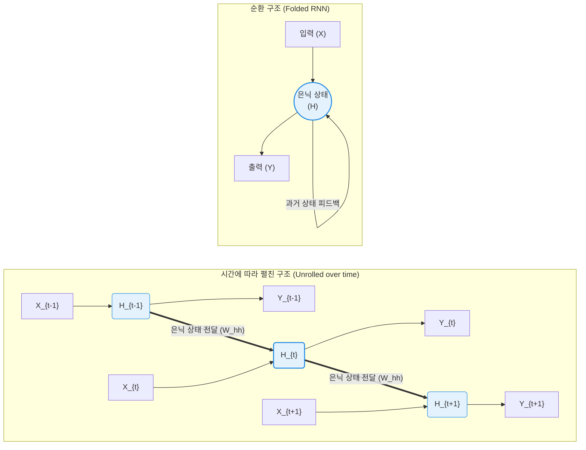

# RNN (Recurrent Neural Network, 순환 신경망)

---

## I. 순차 데이터 처리를 위한 딥러닝의 모태, RNN의 개요

### 가. RNN의 정의
- 시간의 흐름에 따른 순차 데이터(Sequential Data)의 패턴을 인식하기 위해, 내부 은닉층(Hidden Layer)의 출력이 다시 동일 은닉층의 입력으로 순환되는(Recurrent) 피드백 루프 구조를 가진 인공 신경망이다.

### 나. RNN의 등장 배경 및 주요 특징

| 구분 | 주요 내용 |
| --- | --- |
| 독립성 한계 극복 | 기존 순방향 신경망(FNN)의 입력 독립성 가정을 극복하여 시계열 데이터의 전후 문맥(Context) 모델링 |
| 가변 길이 처리 | 입력과 출력 시퀀스의 길이가 동적으로 변하는 자연어 번역, 텍스트 요약, 음성 인식에 유연하게 대응 |
| 가중치 공유 | 모든 타임스텝에서 동일한 가중치 행렬($W_{xh}, W_{hh}, W_{hy}$)을 재사용하여 학습 파라미터 수 최소화 |
| 장기 기억 취약 | 시퀀스가 길어질수록 시간 축 역전파(BPTT)에 따른 기울기 소실 및 장기 의존성(Long-term Dependency) 한계 |

---

## II. RNN의 아키텍처 및 핵심 구성요소

### 가. RNN의 순환 구조 및 시간 펼침(Unrolled) 개념도

* **순환(Feedback) 루프**: 은닉층의 노드는 현재 시점($t$)의 입력값($X_t$)과 이전 시점($t-1$)의 은닉 상태값($H_{t-1}$)을 함께 입력받아 현재의 은닉 상태($H_t$)를 갱신합니다.
* **시간 펼침(Unrolling)**: 위 다이어그램 우측처럼 RNN을 시간 축을 기준으로 펼쳐보면, 마치 정보가 왼쪽에서 오른쪽으로 흐르는 깊은(Deep) 신경망처럼 작동하는 것을 직관적으로 확인할 수 있습니다.

### 나. RNN의 핵심 알고리즘 및 구성 요소

| 분류 | 요소기술(키워드) | 세부 설명 |
| --- | --- | --- |
| **핵심 상태** | 은닉 상태 (Hidden State, $h_t$) | 과거 시점부터 현재 시점까지의 입력 데이터를 압축하여 기억하는 **메모리(Memory) 역할** 수행 |
| **학습 메커니즘** | 파라미터 공유 (Weight Sharing) | 모든 타임스텝($t$)에서 입력-은닉층($W_{xh}$), 은닉-은닉층($W_{hh}$), 은닉-출력층($W_{hy}$) 가중치를 동일하게 재사용하여 학습 효율성 증대 |
| **학습 [[알고리즘]]** | BPTT (Backpropagation Through Time) | 일반적인 오차역전파를 시간 축으로 확장한 개념으로, 출력층에서 발생한 오차를 시간의 역순(과거 타임스텝 방향)으로 거슬러 올라가며 가중치를 업데이트 |
| **활성화 함수** | $\tanh$ (하이퍼볼릭 탄젠트) | 은닉 상태 값이 반복적으로 곱해지며 발산하는 것을 막기 위해, 출력값을 -1과 1 사이로 정규화하는 비선형 활성화 함수를 주로 사용 |

---

## III. 순차 데이터 모델의 진화 비교 및 최신 동향

### 가. 순차 데이터 처리 모델의 세대별 진화 비교

| 발전 단계 | 모델명 | 주요 특징 및 한계점 |
| --- | --- | --- |
| 1세대 (도입) | Vanilla RNN | 최초의 순환 구조 도입, 시간 축 역전파(BPTT) 시 기울기 소실 및 장기 의존성 한계 |
| 2세대 (개선) | [[LSTM (Long Short-Term Memory)\|LSTM]] / GRU | 망각·입력·출력 게이트 및 셀 상태(Cell State) 추가로 기울기 소실 및 장기 기억 개선 |
| 3세대 (응용) | [[seq2seq\|Seq2Seq]] + Attention | 인코더-디코더 구조에 동적 어텐션 메커니즘을 결합하여 고정 길이 압축 병목 해소 |
| 4세대 (혁신) | Transformer | 순환 구조를 완전히 제거하고 셀프 어텐션(Self-Attention) 병렬 연산으로 LLM 기반 확립 |

### 나. RNN의 한계 극복 및 최신 동향
- **기울기 소실/폭발 방지**: BPTT 연산 시 연속 곱셈에 의한 기울기 소실·발산을 방지하기 위해 그레이디언트 클리핑(Gradient Clipping) 및 게이트 제어 기법 정형화
- **상태 공간 모델(SSM)로의 부활**: 트랜스포머의 $O(N^2)$ 계산 복잡도를 극복하기 위해 선형 시간 복잡도 $O(N)$로 긴 시퀀스를 처리하는 Mamba, S4 등 현대적 순환 모델 재부상
- **하이브리드 시퀀스 아키텍처**: 셀프 어텐션의 전역 문맥 이해와 순환 신경망/SSM의 빠른 추론·적은 메모리 장점을 결합한 하이브리드 아키텍처 연구 확산

---

### 🔗 연관 토픽

- **소속 도메인**: [[00_인공지능_MOC|🤖 인공지능]]
- **세부 분류**: `3. 딥러닝 핵심 아키텍처 & 신경망`
- **핵심 연관 토픽**:
  - [[seq2seq]]
  - [[초거대 언어 모델|초거대 언어 모델(Large Language Model)]]
  - [[LSTM (Long Short-Term Memory)]]
  - [[딥러닝]]
  - [[인공지능]]
