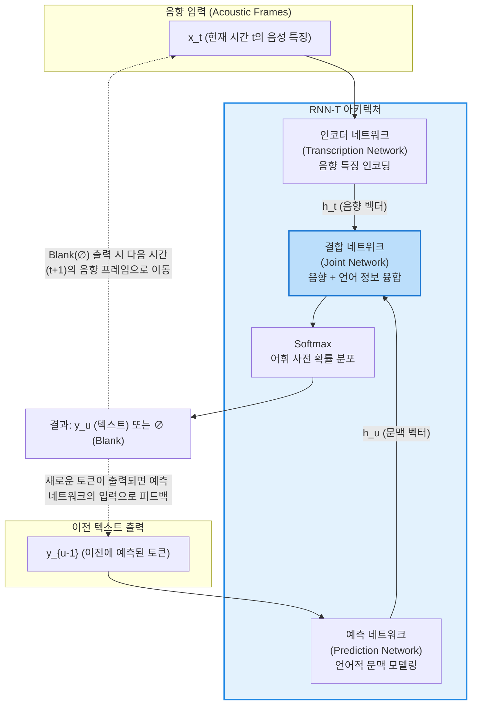

# RNN-T (Recurrent Neural Network Transducer)

---

## I. 실시간 엔드투엔드(End-to-End) 음성 인식의 핵심, RNN-T의 개요

### 가. RNN-T의 정의
- 입력 오디오 프레임과 출력 텍스트 토큰의 길이가 다를 때 명시적인 정렬(Alignment) 없이 두 시퀀스를 매핑하며, 입력 음성이 들어오는 즉시 실시간(Streaming)으로 텍스트를 디코딩하는 엔드투엔드([[End-to-End]]) 시퀀스 변환 신경망 모델이다.

### 나. RNN-T의 등장 배경 및 주요 특징

| 구분 | 주요 내용 |
| --- | --- |
| CTC 한계 극복 | 프레임 간 조건부 독립 가정으로 이전 출력 문맥을 반영하지 못하던 CTC의 언어적 한계 해소 |
| Seq2Seq 한계 극복 | 전체 발화 입력을 모두 수신한 뒤에야 디코딩을 시작하는 어텐션 기반 모델의 긴 지연 시간 극복 |
| 모델 통합 | 음향 모델(Acoustic Model)과 언어 모델(Language Model)을 단일 엔드투엔드 네트워크로 결합 |
| 공백 토큰(∅) | 공백(Blank) 토큰을 도입하여 오디오 프레임 시간 축과 텍스트 토큰 축 간의 동적 2D 정렬 지원 |

---

## II. RNN-T의 아키텍처 및 핵심 구성요소

### 가. RNN-T 아키텍처 및 데이터 흐름 개념도

* **동작 방식**: 현재 음성 프레임의 정보(인코더)와 지금까지 출력한 텍스트의 정보(예측 네트워크)를 융합(결합 네트워크)하여 다음 글자를 출력합니다. 만약 아직 발음이 끝나지 않아 출력할 글자가 없다면 공백($\emptyset$)을 출력하고 다음 음성 프레임으로 넘어가며 스트리밍을 유지합니다.

### 나. RNN-T의 3대 핵심 서브 네트워크

| 서브 네트워크 | 역할 및 기능 | 세부 설명 및 특징 |
| --- | --- | --- |
| **인코더 네트워크** (Encoder Net) | **음향 모델(AM) 역할** | 연속적인 오디오 프레임($x_t$)을 입력받아 고차원의 음향 특징 표현($h_t$)으로 변환. 과거에는 [[LSTM (Long Short-Term Memory)\|LSTM]]/[[RNN (Recurrent Neural Network)\|RNN]]을 썼으나, 현재는 Conformer/Transformer 등으로 대체되는 추세 |
| **예측 네트워크** (Prediction Net) | **언어 모델(LM) 역할** | 현재까지 예측된 Non-blank 레이블 시퀀스($y_{u-1}$)를 입력받아 다음 토큰에 대한 언어적 문맥 벡터($h_u$)를 생성. CTC의 조건부 독립성 한계를 해결하는 핵심 요소 |
| **결합 네트워크** (Joint Net) | **정보 융합 및 최종 분류** | 인코더의 음향 특징과 예측 네트워크의 문맥 특징을 Feed-Forward 네트워크로 결합(보통 더하기 연산)한 후, Softmax를 통해 실제 어휘 토큰이거나 Blank($\emptyset$)일 확률을 계산 |

---

## III. 유사 음성 인식 아키텍처 비교 및 최신 동향

### 가. E2E 음성 인식(ASR) 아키텍처 비교 (CTC vs Seq2Seq vs RNN-T)

| 비교 항목 | CTC (Connectionist Temporal Classification) | [[LAS]] (Listen, Attend and Spell / Seq2Seq) | RNN-T (RNN-Transducer) |
| --- | --- | --- | --- |
| **실시간(Streaming) 처리** | **가능** (프레임 단위 독립적 매핑) | 불가능 (전체 문장을 들어야 디코딩 가능) | **가능** (입력이 들어오는 대로 즉각 디코딩) |
| **출력 간 의존성 (문맥)** | 없음 (토큰 간 독립성 가정으로 오타 잦음) | **매우 강함** (어텐션 기반 강력한 언어 모델링) | **강함** (예측 네트워크를 통한 자체 문맥 반영) |
| **정렬(Alignment) 방식** | 단방향 프레임별 독립적 매핑 (Blank 사용) | Attention 메커니즘을 통한 소프트 정렬 | Joint Network를 통한 동적 2D 격자(Lattice) 탐색 |
| **주요 장점** | 연산이 빠르고 지연 시간이 극도로 짧음 | 정확도가 가장 높고 컨텍스트 이해도가 뛰어남 | **정확도와 실시간 처리(Low Latency)의 최적 균형** |

### 나. 한계 극복 및 최신 발전 동향
- **메모리 연산 비용 최적화**: 훈련 시 인코더 시간 축과 레이블 축의 모든 격자점($T \times U$) 연산으로 인한 메모리 병목을 해소하기 위해 Pruned RNN-T, Fast RNN-T 알고리즘 적용
- **온디바이스 ASR 표준화**: 네트워크 연결 없이 모바일 기기 내부에서 실시간 음성을 텍스트로 변환하는 온디바이스 음성 비서의 사실상 표준(De facto standard) 아키텍처로 안착
- **Conformer-Transducer 진화**: RNN 기반 인코더를 CNN의 국소 특징 추출과 트랜스포머의 전역 어텐션을 결합한 Conformer로 대체한 Conformer-T 구조가 음성 인식 최고 성능(SOTA) 달성

---

### 🔗 연관 토픽

- **소속 도메인**: [[00_인공지능_MOC|🤖 인공지능]]
- **세부 분류**: `3. 딥러닝 핵심 아키텍처 & 신경망`
- **핵심 연관 토픽**:
  - [[RNN (Recurrent Neural Network)]]
  - [[seq2seq]]
  - [[LSTM (Long Short-Term Memory)]]
  - [[LAS]]
  - [[딥러닝]]
