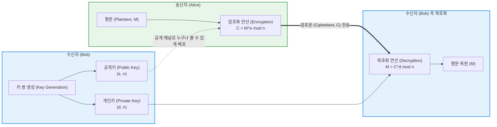

# RSA (Rivest Shamir Adleman)

---

## I. 현대 공개키 암호 인프라(PKI)의 근간, RSA의 개요

### 가. RSA의 정의
- 매우 큰 두 소수의 곱을 소인수분해하는 수학적 난해성에 기반하여, 공개키와 개인키 쌍을 통해 데이터 암호화 및 전자서명을 수행하는 비대칭키(Asymmetric Key) [[암호화]] [[알고리즘]].

### 나. RSA의 등장 배경 및 주요 특징
| 구분 | 내용 |
| --- | --- |
| 키 분배 문제 해결 | 대칭키 암호 체계([[DES]], AES 등)의 취약점인 비보안 채널에서의 비밀키 분배 한계 극복 |
| 소인수분해 난해성 | 큰 수의 소인수분해(Integer Factorization)에 소요되는 계산적 복잡도를 안전성의 근간으로 채택 |
| 하이브리드 활용 | 모듈러 멱승 연산으로 인한 연산 속도 저하를 극복하기 위해 대칭키 교환(Key Wrapping) 및 전자서명에 집중 활용 |
| 권장 키 길이 | 컴퓨팅 파워 향상 및 인수분해 알고리즘 발전에 대응하여 최소 2048-bit 이상(권장 3072/4096-bit) 운용 |

---

## II. RSA의 아키텍처 및 수학적 동작 원리

### 가. RSA 암호화 및 복호화 통신 메커니즘

* 송신자(Alice)는 수신자(Bob)가 미리 배포한 **공개키**를 사용하여 데이터를 암호화합니다.
* 생성된 암호문은 오직 Bob이 안전하게 보관하고 있는 **개인키**로만 복호화할 수 있으므로, 중간에 해커가 암호문과 공개키를 가로채더라도 데이터를 해독할 수 없습니다.

### 나. RSA의 핵심 기술 요소 및 수학적 구조

| 분류 | 요소기술(키워드) | 세부 설명 및 공식 |
| --- | --- | --- |
| **키 생성** | 소수 선택 및 오일러 함수 | 두 개의 매우 큰 소수 $p, q$를 선택하여 $n = p \times q$를 계산. 오일러 피 함수 $\phi(n) = (p-1)(q-1)$를 산출함. |
| **키 도출** | 공개키($e$)와 개인키($d$) | $\phi(n)$과 서로소인 정수 $e$(공개키)를 선택하고, $(e \times d) \pmod{\phi(n)} = 1$을 만족하는 $d$(개인키)를 역원으로 계산함. |
| **보안 모델 1** | [[기밀성]] (Confidentiality) | 수신자의 **공개키로 암호화**하여 전송. 오직 수신자의 **개인키로만 복호화** 가능 (데이터 유출 방지). |
| **보안 모델 2** | 전자서명 (부인방지/인증) | 송신자의 **개인키로 암호화(서명)**하여 전송. 누구나 송신자의 **공개키로 복호화(검증)**할 수 있으므로, 해당 데이터가 특정 송신자로부터 작성되었음을 확고히 증명함. |
| **취약성 요인** | 소인수분해 공격 | 공격자가 공개된 $n$을 소인수분해하여 $p$와 $q$를 알아내면 개인키 $d$를 계산할 수 있음. 이를 방지하기 위해 최소 2048-bit 이상의 키 길이를 권장함. |

---

## III. 현대 암호 체계 비교 및 차세대 발전 동향

### 가. 3대 핵심 암호화 알고리즘 비교 (AES vs RSA vs ECC)

| 비교 항목 | AES ([[AES\|Advanced Encryption Standard]]) | RSA (Rivest Shamir Adleman) | [[ECC]] (Elliptic Curve Cryptography) |
| --- | --- | --- | --- |
| **암호화 방식** | **대칭키** (비밀키 1개 공유) | **비대칭키** (공개키/개인키 쌍) | **비대칭키** (공개키/개인키 쌍) |
| **보안 기반 수학** | 혼돈(Confusion)과 확산(Diffusion) | **소인수분해의 난해성** | **타원곡선 이산대수 문제 (ECDLP)** |
| **연산 속도** | **매우 빠름** | 매우 느림 | 느림 (RSA보다는 훨씬 빠름) |
| **권장 키 길이** | 128 / 256 bit | **2048 / 4096 bit (키가 매우 큼)** | 256 bit (짧은 키로 동일 보안 수준 제공) |
| **현대 주요 용도** | 디스크, 파일, 페이로드 등 대용량 데이터 암호화 | 인증서(PKI), 전자서명, **대칭키(AES) 교환용 래핑** | 모바일 환경, 스마트카드, **[[블록체인]](비트코인 등)** |

### 나. 한계 극복 및 최신 암호학 발전 동향
- **TLS/SSL 하이브리드 암호 체계 정착**: RSA의 연산 부하를 해소하기 위해 초기 세션 핸드셰이크 단계에서만 대칭키([[AES]]) 교환 용도로 사용하고 실제 데이터 전송은 대칭키로 수행하는 구조 표준화.
- **쇼어 알고리즘(Shor's Algorithm) 위협**: 양자 컴퓨터의 쇼어 알고리즘 구동 시 다항 시간 내 소인수분해가 가능해져 기존 2048/4096-bit RSA 체계의 기밀성 완전 무력화 위험 직면.
- **양자내성암호(PQC) 마이그레이션**: 격자 기반(ML-KEM 등) 차세대 양자 내성 공개키 표준(NIST FIPS 203) 확정에 따라 기존 RSA 기반 PKI 인프라의 단계적 교체 및 하이브리드 PQC 전환 추진.

---

### 🔗 연관 토픽

- **소속 도메인**: [[00_보안_MOC|🛡️ 보안]]
- **세부 분류**: `2. 현대 암호학 & 키 관리 · 전자서명`
- **핵심 연관 토픽**:
  - [[ECC|ECC(Elliptic Curve Cryptography)]]
  - [[암호화|암호화 (Encryption)]]
  - [[기밀성]]
  - [[AES]]
  - [[FIPS (Federal Information Processing Standards)]]
