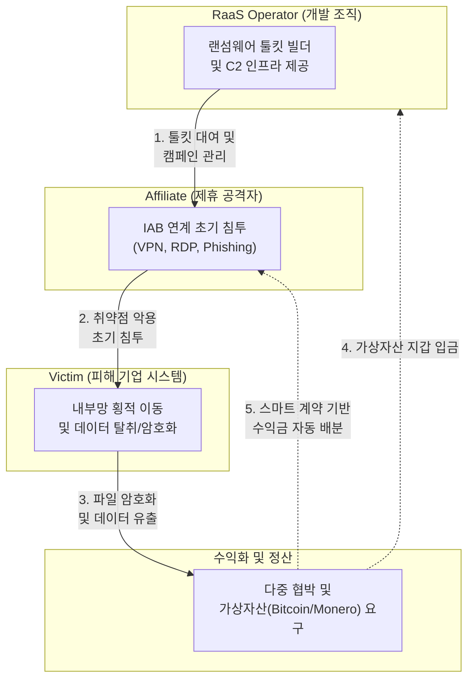

# RaaS (Ransomware as a Service)

---

## I. 서비스형 범죄 비즈니스 모델, RaaS의 개요

### 가. RaaS의 정의
- 랜섬웨어 개발 전문 조직(Operator)이 악성코드와 C2 인프라를 구독 또는 수익 배분 형태로 제공하고 제휴 공격자(Affiliate)가 이를 임대하여 기업을 침해하는 서비스형 사이버범죄(CaaS) 모델.

### 나. RaaS의 등장배경 및 주요 특징
| 구분 | 내용 |
| --- | --- |
| 범죄 분업화·조직화 | 악성코드 개발자와 실제 침투 실행자 간 역할 분담을 통해 해킹 기술 장벽 대폭 완화 |
| 수익 배분 모델 | 피해 기업으로부터 갈취한 가상자산 몸값을 오퍼레이터와 제휴자가 일정 비율(예: 2:8)로 분배 |
| 다중 협박(Multi-Extortion) | 단순 데이터 암호화를 넘어 유출 데이터 공개, [[DDOS|DDoS]], 고객사 직접 협박을 병행 |
| 다크웹 인프라 패키징 | Tor 기반 C2 서버, 협상 포털, 가상자산 믹싱 등 범죄 실행 전 과정을 턴키 솔루션으로 제공 |

---

## II. RaaS의 개념도 및 핵심 기술 요소

### 가. RaaS의 공격 생태계 및 동작 원리

* RaaS 오퍼레이터가 개발한 툴킷을 제휴자가 IAB(초기 침투 브로커) 등을 통해 기업에 주입하고, [[암호화]] 및 유출된 데이터를 기반으로 얻은 몸값을 자동 정산하는 구조임.

### 나. RaaS의 핵심 기술 요소 및 구성

| 분류 | 요소기술(키워드) | 세부 설명 |
| --- | --- | --- |
| **운영 모델** | **Affiliate Program** | 개발자(Operator)와 실행자(Affiliate)가 역할을 분담하고 서비스형 소프트웨어(SaaS) 형태로 범죄 수행 |
| **초기 침투** | **IAB 연계 (Initial Access)** | 취약점 계정, RDP 무차별 대입, 악성 스피어 피싱 등을 통해 기업 내부망에 최초로 교두보를 확보 |
| **우회 기술** | **Evasion Payload** | [[EDR(Endpoint Detection and Response)\|EDR]] 및 백신 탐지를 회피하기 위해 안티 디버깅, 코드 [[난독화]], 드라이버 블랭킹(BYOVD) 적용 |
| **확산 기술** | **Lateral Movement** | 내부망 진입 후 권한 상승(Privilege Escalation) 및 액티브 디렉토리(AD) 장악을 통한 전사 확산 |
| **협박 전략** | **Triple / Quad Extortion** | 암호화 + 데이터 유출 + 고객/파트너 협박 + DDoS 공격을 병행하여 지불 압박 극대화 |
| **인프라** | **Tor & Crypto Mixing** | 추적을 차단하기 위해 Tor 네트워크 기반의 C2 서버 운영 및 가상자산 믹서(Mixer) 활용 |
| **관리 도구** | **RaaS Control Panel** | 가입자 관리, 감염 통계, 피해자별 몸값 협상(Chat Portal)을 제공하는 웹 기반 대시보드 |
| **방어 체계** | **[[XDR]] & [[SOAR (Security Orchestration, Automation and Response)\|SOAR]] 연동** | 단말 이상 징후를 실시간 탐지하고, 격리(Isolation) 및 자동화된 플레이북으로 피해 확산 차단 |

---

## III. 전통적 랜섬웨어와 RaaS 비교 및 향후 대응 동향

### 가. 전통적 랜섬웨어와 RaaS 비교

| 비교 항목 | 전통적 랜섬웨어 (Traditional) | RaaS (Ransomware-as-a-Service) |
| --- | --- | --- |
| **공격 주체** | 독립된 해커 또는 소규모 해킹 그룹 | 조직화된 **오퍼레이터 + 다수의 제휴자(Affiliate)** 체계 |
| **개발 방식** | 자체 악성코드 개발 및 직접 유포 | 검증된 구독형 툴킷(Malware Kit) 임대 활용 |
| **공격 대상** | 주로 개인 사용자 및 무차별 불특정 다수 | 보안이 취약한 **대기업, 공공기관, 의료 시설 (표적형)** |
| **피해 규모** | 파일 암호화 및 단말 복구 비용 중심 | **기업 기밀 유출, 비즈니스 중단, 법적 리스크 등 파괴적** |

### 나. 최신 위협 동향 및 대응 방안
- **생성형 AI 결합 스피어 피싱 및 공격 자동화**: 대규모 언어 모델을 활용해 정교한 악성 메일과 취약점 정찰 도구를 제작하여 비전문 범죄자의 초기 침투(Initial Access) 성공률 급증.
- **불변 백업(Immutable Backup) 및 재해복구 체계**: 파일 암호화 및 볼륨 섀도 복사본 삭제 공격에 대비해 WORM(Write Once, Read Many) 스토리지 기반 에어갭(Air-gap) 백업 및 신속 복원 훈련 정례화.
- **제로트러스트 및 EDR/XDR 능동 격리**: [[제로 트러스트 보안모델|제로 트러스트]] 원칙에 기반한 계정 권한 최소화(PoLP), 마이크로세그멘테이션, 그리고 [[EDR(Endpoint Detection and Response)|EDR]]/[[XDR]] 솔루션의 비정상 프로세스 즉각 차단 체계 필수 구축.

---

### 🔗 연관 토픽

- **소속 도메인**: [[00_보안_MOC|🛡️ 보안]]
- **세부 분류**: `2. 현대 암호학 & 키 관리 · 전자서명`
- **핵심 연관 토픽**:
  - [[랜섬웨어]]
  - [[XDR|XDR(eXtended Detection Response)]]
  - [[제로 트러스트 보안모델|제로 트러스트 (Zero Trust) 보안모델]]
  - [[EDR(Endpoint Detection and Response)]]
  - [[APT(Advanced Persistent Threat) 공격]]
