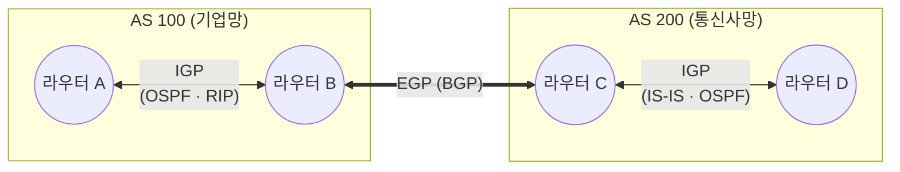

# 라우팅 프로토콜 (Routing Protocol)

---

## I. 라우터끼리 길 정보를 나누는, 라우팅 프로토콜의 개요

### 가. 정의

- [[라우터]]들이 **경로 정보를 교환해 목적지별 최적 경로를 계산하고 라우팅 테이블을 자동으로 유지**하는 [[프로토콜]] (동적 라우팅)

### 나. 필요성 및 특징

| 구분 | 내용 |
| --- | --- |
| 정적 라우팅 한계 | 망이 커지면 수동 설정·변경 관리가 불가능 |
| 장애 대응 | 링크·장비 장애 시 우회 경로 자동 계산 |
| 메트릭 | 홉 수, 대역폭, 지연, 정책 속성 등으로 경로 비교 |
| 수렴 (Convergence) | 변화 후 모든 라우터가 일관된 경로를 갖기까지의 과정, 짧을수록 좋음 |
| 관리 거리 (AD) | 여러 프로토콜이 같은 목적지를 알려줄 때 신뢰도 우선순위 |

---

## II. 구조 및 분류

### 가. AS 기반 계층 구조

- 하나의 관리 주체가 운영하는 자율 시스템(AS) 내부는 IGP, AS 사이는 EGP로 경로를 교환

### 나. 분류 및 구성요소

| 구분 | 요소 | 설명 |
| --- | --- | --- |
| 운영 범위 | IGP | AS 내부 (RIP, OSPF, IS-IS, EIGRP) |
| | EGP | AS 간, 현재 [[BGP]]가 사실상 유일 |
| 알고리즘 | [[거리 벡터 알고리즘\|거리 벡터]] | 이웃에게 받은 거리·방향으로 결정, Bellman-Ford (RIP) |
| | [[링크 상태 알고리즘\|링크 상태]] | 전체 토폴로지로 [[다익스트라 알고리즘\|Dijkstra]] SPF 계산 (OSPF, IS-IS) |
| | 경로 벡터 | 경로의 AS 목록과 정책으로 결정 (BGP) |
| | 고급 거리 벡터 | DUAL 알고리즘, 빠른 수렴 (EIGRP) |
| 지표 | 메트릭 | RIP 홉 수, OSPF Cost, EIGRP 대역폭·지연 |
| | 수렴 시간 | 토폴로지 변화 후 안정 상태까지 시간 |

---

## III. 비교 및 동향

### 가. RIP vs OSPF vs BGP

| 비교 항목 | RIP | OSPF | BGP |
| --- | --- | --- | --- |
| 범위 | IGP (소규모) | IGP (중대형) | EGP (인터넷) |
| [[라우팅 알고리즘]] | 거리 벡터 | 링크 상태 | 경로 벡터 |
| 메트릭 | 홉 수 (최대 15, 16은 도달 불가) | Cost (기본 참조 대역폭 / 링크 대역폭) | 경로 속성·정책 |
| 갱신 | 30초 주기 전체 테이블 (v1 브로드캐스트, v2 멀티캐스트 224.0.0.9) | 변경 시 LSA 멀티캐스트 (224.0.0.5/6) | [[TCP]] 179 세션, 변경분만 |
| 수렴 | 느림 | 빠름 | 느림 |
| 장단점 | 단순 / 대규모 불가 | 확장성·계층 구조 / CPU·메모리 부담 | 정책 제어 / 설정 복잡 |

### 나. 동향

- **SDN 연계**: 컨트롤러·PCE가 전체 망 정보를 모아 경로를 계산하고 장비에 내려 트래픽 엔지니어링 ([[SDN(Software Defined Network)|SDN]], [[OpenFlow]])
- **Segment Routing**: OSPF·IS-IS 확장으로 SID를 배포하고 출발지가 경로를 지정해 LDP·RSVP-TE 제거 (SR-MPLS, SRv6)
- **데이터센터 BGP**: Spine-Leaf 언더레이 IGP 대신 eBGP 사용 (RFC 7938)

---

### 🔗 연관 토픽

- **소속 도메인**: [[00_네트워크_MOC|🌐 네트워크]]
- **세부 분류**: `1. OSI 7계층 & 데이터링크 계층 (L1/L2)`
- **핵심 연관 토픽**:
  - [[라우팅 알고리즘|라우팅 알고리즘(Routing Protocol, 거리벡터, 링크상태)]]
  - [[거리 벡터 알고리즘]]
  - [[링크 상태 알고리즘]]
  - [[BGP|BGP(Border Gateway Protocol)]]
  - [[라우터]]
