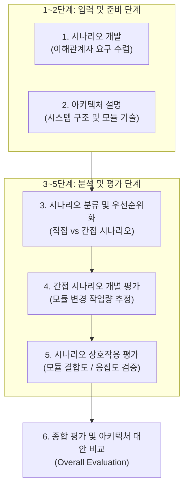

# SAAM (Software Architecture Analysis Method)

---

## I. 시나리오 기반 소프트웨어 아키텍처 평가의 시초, SAAM의 개요

소프트웨어 아키텍처가 시스템이 요구하는 비기능적 품질 속성, 특히 변경 용이성(Modifiability)과 기능성을 얼마나 잘 지원하는지 시나리오(Scenario)를 기반으로 분석하고 평가하는 1세대 아키텍처 평가 방법론이다.

| 구분 | 주요 내용 |
| --- | --- |
| **개념** | 카네기멜론 대학교 SEI(1994년)에서 개발한 최초의 시나리오 기반 아키텍처 분석 기법으로, 직접/간접 시나리오를 통해 아키텍처 대안 간의 변경 작업량을 비교 평가 |
| **등장 배경** | 아키텍처 설계 단계의 결함이 개발 후반부나 운영 단계에서 막대한 재작업 비용을 초래하므로, 구현 전 설계 타당성을 조기에 검증할 체계적 도구 필요 |
| **핵심 특징** | 변경 용이성에 집중, 시나리오 상호작용(Scenario Interaction)을 통한 높은 결합도 및 낮은 응집도 모듈 식별, [[ATAM]]의 모태 |

---

## II. SAAM의 아키텍처 평가 프로세스 및 핵심 기술 요소

### 가. SAAM의 6단계 평가 프로세스 흐름도

이해관계자들이 제시한 시나리오를 바탕으로 아키텍처 변경 없이 수용 가능한 직접 시나리오와 아키텍처 수정이 필요한 간접 시나리오를 구분하여 평가하고, 동일 모듈에 복수의 변경이 겹치는 상호작용을 검출한다.

### 나. SAAM의 핵심 기술 및 구성 요소

| 분류 | 요소기술 (키워드) | 세부 설명 |
| --- | --- | --- |
| **평가 척도** | 시나리오 (Scenario) | 사용자와 시스템의 상호작용 상황 및 시스템이 보여주어야 할 구체적인 반응을 명세한 문서 |
| **시나리오 분류** | 직접 시나리오 (Direct) | 시스템 구조나 모듈의 변경 없이 **현재 아키텍처가 기본적으로 즉시 수용**할 수 있는 시나리오 |
| **시나리오 분류** | 간접 시나리오 (Indirect) | 새로운 요구사항을 수용하기 위해 **소프트웨어 모듈의 코드 수정 및 재설계가 수반**되는 시나리오 |
| **품질 결함 식별** | 시나리오 상호작용 (Interaction) | 둘 이상의 상이한 간접 시나리오가 **동일한 단일 모듈의 수정을 요구**하는 현상 (높은 결합도 및 낮은 응집도 방증) |
| **정량 지표** | 변경 작업량 (Cost of Change) | 간접 시나리오를 만족하기 위해 수정되어야 하는 컴포넌트의 수와 난이도를 정량 추정하여 대안 비교 |
| **이해관계자** | 전원 참여 평가 | 개발자, 아키텍트뿐만 아니라 기획자, 고객, 운영자가 함께 시나리오 도출 및 우선순위 결정에 참여 |

---

## III. SEI 3대 아키텍처 평가 방법론 비교 및 최신 동향

### 가. SEI 아키텍처 평가 방법론 진화 비교 (SAAM vs ATAM vs CBAM)

| 비교 항목 | SAAM (1세대) | [[ATAM]] (2세대) | [[CBAM]] (3세대) |
| --- | --- | --- | --- |
| **평가 중심** | **변경 용이성** (단일 품질 속성) | **다양한 품질 속성** (성능, 보안, 가용성 등) | **경제성 및 투자 대비 효과** (ROI) |
| **핵심 기법** | 직접/간접 시나리오, 상호작용 분석 | **유틸리티 트리**, 민감점, 상충점(Trade-off) | 효용 곡선, 비용-편익(Cost-Benefit) 분석 |
| **주요 장점** | 프로세스가 단순하여 초기 도입 용이 | 복합 품질 간의 상충관계를 명확히 규명 | 비즈니스 가치 기반 아키텍처 의사결정 지원 |
| **주요 한계** | 품질 속성 간의 충돌 분석 불가 | 재무적 비용 타당성 제시 한계 | 정량적 효용과 비용의 정확한 추정 곤란 |

### 나. 최신 기술 동향 및 발전 방향

* **진화적 아키텍처(Evolutionary Architecture)로의 패러다임 전환**: 초기 단계의 일회성 수동 아키텍처 평가를 넘어, 비즈니스 변화에 맞춰 지속적으로 시스템을 진화시키는 아키텍처 기법이 정착됨.
* **적합도 함수(Fitness Function)를 통한 지속적 검증**: SAAM의 정적 시나리오 평가를 CI/CD 파이프라인의 테스트 코드로 구현하여, 모듈 간 결합도(ArchUnit 등)와 순환 참조를 빌드 시점마다 자동 검증하는 아키텍처 감시 체계로 발전함.

---

### 🔗 연관 토픽

- **소속 도메인**: [[00_소프트웨어공학_MOC|🏗️ 소프트웨어공학]]
- **세부 분류**: `3. 요구사항 공학 & UML 객체지향 분석/설계`
- **핵심 연관 토픽**:
  - [[ATAM]]
  - [[CBAM]]
  - [[ARID]]
  - [[SW Architecture 평가]]
  - [[Agile]]
