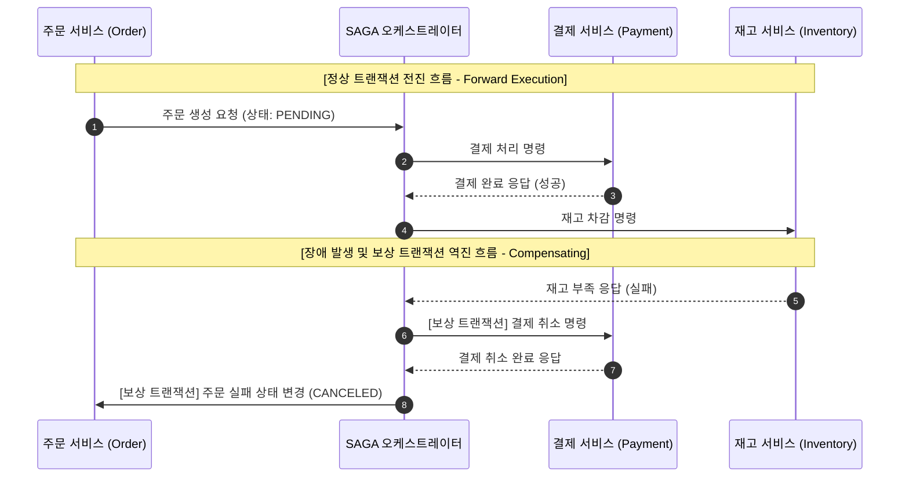

# SAGA 패턴 (SAGA Pattern)

---

## I. MSA 환경의 분산 트랜잭션 관리 표준, SAGA 패턴의 개요

마이크로서비스 아키텍처(MSA)처럼 데이터베이스가 물리적으로 분리된 환경에서, 여러 서비스에 걸친 비즈니스 트랜잭션을 일련의 독립적인 로컬 트랜잭션(Local Transaction) 시퀀스로 분할 실행하고, 장애 시 보상 트랜잭션을 통해 데이터 일관성을 유지하는 분산 트랜잭션 패턴이다.

| 구분 | 주요 내용 |
| --- | --- |
| **개념** | 전통적 2PC의 락(Lock) 기반 동기 제어 대신, 각 서비스가 자체 DB에 커밋하고 실패 시 보상 트랜잭션(Compensating Transaction)을 역순으로 실행하는 비동기 트랜잭션 모델 |
| **등장 배경** | Database-per-Service 구조에서 2PC 사용 시 발생하는 성능 저하, 서비스 간 강결합 및 단일 장애점(SPOF) 한계 극복 |
| **핵심 특징** | 결과적 일관성(Eventual Consistency) 수용, 락-프리(Lock-Free) 고성능 처리, 오케스트레이션 및 코레오그래피 2대 구현 방식 지원 |

---

## II. SAGA 패턴의 아키텍처 및 핵심 구성요소

### 가. 중앙 제어(Orchestration) 방식 기반 SAGA 트랜잭션 흐름

각 서비스는 자신의 로컬 DB에 데이터를 즉시 커밋하며, 중간 단계에서 실패가 발생하면 데이터베이스 레벨의 물리적 롤백이 아닌 이전 성공 작업들을 비즈니스적으로 상쇄하는 보상 트랜잭션을 역순 실행하여 논리적 원상복구를 수행한다.

### 나. SAGA 패턴의 2대 구현 모델 및 핵심 기술 요소

| 분류 | 요소기술 (키워드) | 세부 설명 |
| --- | --- | --- |
| **구현 모델** | 코레오그래피 (Choreography) | 중앙 오케스트레이터 없이 각 서비스가 로컬 트랜잭션 완료 후 이벤트를 발행(Pub)하고 타 서비스가 구독(Sub)하는 이벤트 기반 분산 방식 |
| **구현 모델** | 오케스트레이션 (Orchestration) | 중앙의 SAGA 오케스트레이터가 상태 머신(State Machine)을 기반으로 각 서비스에 실행 및 보상 커맨드를 순차 발행·지휘하는 방식 |
| **트랜잭션** | 로컬 트랜잭션 (Local Tx) | 개별 마이크로서비스가 자신의 전용 데이터베이스 내에서 완결하는 독립적인 단위 트랜잭션 |
| **복구 메커니즘** | 보상 트랜잭션 (Compensating Tx) | 비즈니스 프로세스 실패 시, 이미 커밋된 이전 단계의 작업 결과를 상쇄(Undo)하기 위해 실행되는 역방향 트랜잭션 |
| **실행 보증** | 멱등성 (Idempotency) | 네트워크 재전송이나 타임아웃으로 인해 동일한 보상 트랜잭션이 중복 호출되어도 결과 상태가 동일하게 유지되는 특성 |
| **격리성 보완** | 시맨틱 락 (Semantic Lock) | 트랜잭션 진행 중 중간 상태 데이터의 무단 갱신을 방지하기 위해 레코드 상태를 `PENDING` 등으로 플래깅하는 기법 |

---

## III. 분산 트랜잭션 모델 비교 및 최신 동향

### 가. 2PC (Two-Phase Commit) vs SAGA 패턴 비교

| 비교 항목 | 2단계 커밋 (2PC) | SAGA 패턴 (SAGA) |
| --- | --- | --- |
| **일관성 보장** | **강한 일관성 (Strong / ACID)** | **결과적 일관성 (Eventual / BASE)** |
| **처리 메커니즘** | 동기식 블로킹 (전체 노드 락 점유) | **비동기식 논블로킹 (메시지 큐 기반)** |
| **격리성 (Isolation)** | 완벽 보장 (트랜잭션 중 타 트랜잭션 대기) | **격리성 미보장** (중간 데이터 노출, 시맨틱 락 통제 필요) |
| **장애 복구** | 분산 트랜잭션 매니저의 물리적 DB 롤백 | **애플리케이션 계층의 비즈니스 보상 트랜잭션** |
| **적합한 환경** | 단일 데이터베이스 샤딩, 폐쇄형 레거시 금융망 | **대규모 마이크로서비스(MSA), [[클라우드 네이티브]] 분산 환경** |

### 나. 최신 기술 동향 및 발전 방향

* **트랜잭셔널 아웃박스(Transactional Outbox) 패턴 연계**: 로컬 DB 커밋과 이벤트 메시지 발행(Kafka)의 원자성을 보장하기 위해, DB 내부 Outbox 테이블과 CDC(Change Data Capture, Debezium)를 연계한 SAGA 아키텍처가 표준화됨.
* **분산 워크플로우 오케스트레이션 엔진 도입**: 복잡한 상태 머신과 보상 로직을 직접 코딩하는 대신, Temporal, Camunda, AWS Step Functions 등 전문 워크플로우 엔진을 채택하여 SAGA 프로세스를 선언적으로 관리함.

---

### 🔗 연관 토픽

- **소속 도메인**: [[00_소프트웨어공학_MOC|🏗️ 소프트웨어공학]]
- **세부 분류**: `4. 아키텍처 스타일 & 객체지향 설계 원리`
- **핵심 연관 토픽**:
  - [[MSA (Micro Service Architecture)]]
  - [[EDA]]
  - [[데이터베이스]]
  - [[트랜잭션]]
  - [[클라우드 네이티브]]
