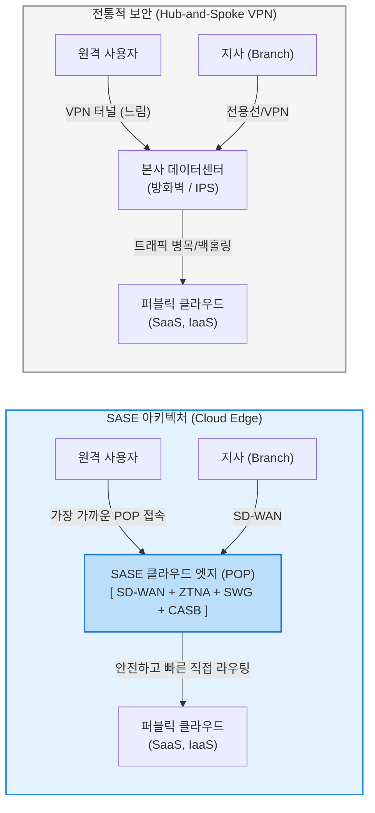

# SASE (Secure Access Service Edge)

---

## I. 클라우드 시대의 네트워크와 보안의 융합 패러다임, SASE의 개요

### 가. SASE의 정의
- 클라우드 네이티브 환경에서 엔터프라이즈 광대역 네트워크([[SD-WAN (Software-Defined Wide Area Network)\|SD-WAN]]) 역량과 포괄적 보안 서비스(SSE)를 단일 클라우드 플랫폼으로 통합 제공하는 차세대 보안 아키텍처.

### 나. SASE의 등장 배경 및 주요 특징
| 구분 | 내용 |
| --- | --- |
| 경계 보안 붕괴 극복 | 재택·원격 근무 확산 및 멀티 클라우드·SaaS 도입으로 온프레미스 경계(Perimeter) 중심 통제 한계 |
| 헤어피닝(Hairpinning) 해소 | 외부 사용자가 사내망([[VPN]])을 거쳐 인터넷으로 나가는 트래픽 백홀링 병목 및 지연 원천 제거 |
| 신원(Identity) 기반 정책 | 물리적 IP/위치가 아닌 사용자 신원, 기기 보안 상태, 위치 등 종합 컨텍스트 기반 동적 인가 |
| 엣지(Edge) 분산 검사 | 전 세계 분산된 클라우드 PoP(Point of Presence) 엣지에서 네트워크 최적화 및 보안 검사 동시 수행 |

---

## II. SASE의 아키텍처 및 핵심 기술 구성 요소

### 가. 전통적 보안망과 SASE 아키텍처의 트래픽 흐름 비교

### 나. SASE를 구성하는 5대 핵심 기술 요소

SASE는 크게 네트워크 역량([[SD-WAN (Software-Defined Wide Area Network)|SD-WAN]])과 클라우드 보안 역량(SSE: Security Service Edge)으로 결합됩니다.

| 기술 분류 | 요소기술(약어) | 세부 설명 및 역할 |
| --- | --- | --- |
| **Network** | **SD-WAN** (Software-Defined WAN) | 트래픽 패턴을 분석하여 전용선, 브로드밴드, 5G 등 다양한 회선 중 최적의 경로를 소프트웨어 기반으로 동적 라우팅하는 지능형 네트워크 기술 |
| **Security** | **ZTNA** ([[제로 트러스트 보안모델\|Zero Trust]] Network Access) | 전통적인 VPN을 대체하며, '신뢰하지 않고 항상 검증한다'는 제로 트러스트 원칙에 따라 사용자 신원 및 디바이스 상태 기반으로 최소 권한 접근만 허용 |
| **Security** | **SWG** (Secure Web Gateway) | 사용자가 인터넷 웹 사이트에 접속할 때 URL 필터링, 악성코드 차단, 트래픽 복호화 및 검사를 수행하여 웹 기반 위협으로부터 보호 |
| **Security** | **CASB** (Cloud Access Security Broker) | 기업이 사용하는 여러 클라우드(SaaS/IaaS) 애플리케이션의 가시성을 확보하고, 비인가 앱 사용(Shadow IT) 통제 및 데이터 유출 방지([[DLP]]) 수행 |
| **Security** | **FWaaS** (Firewall as a Service) | 물리적 [[방화벽]] 장비 없이, 클라우드 상에서 차세대 방화벽(NGFW) 기능을 서비스 형태로 제공하여 모든 엣지 지점의 트래픽을 검사 및 통제 |

---

## III. 전통적 네트워크 보안 모델과의 비교 및 최신 동향

### 가. 전통적 보안 네트워크 모델 vs SASE 모델 비교

| 비교 항목 | 전통적 모델 (Hub-and-Spoke / VPN) | SASE (Secure Access Service Edge) |
| --- | --- | --- |
| **아키텍처 구조** | 데이터센터 중심 (Data Center-centric) | **클라우드 엣지 중심 (Identity/Cloud-centric)** |
| **보안 검사 위치** | 중앙 허브(본사)로 모든 트래픽 집중 후 검사 | 사용자와 가장 가까운 클라우드 PoP(Point of Presence) |
| **접근 통제 방식** | IP 및 네트워크 세그먼트 기반 (내부망 접속 시 전체 신뢰) | **신원 및 컨텍스트 기반의 제로 트러스트 (ZTNA)** |
| **성능 및 지연시간** | 클라우드 접속 시 헤어피닝으로 인한 심각한 병목 발생 | 클라우드 서비스로 직접(Direct) 통신하여 지연 최소화 |
| **장비 및 관리 비용** | 지사마다 물리적 보안 장비(Appliance) 구매 및 설치 | 클라우드 구독 모델(OpEx)로 전환, 단일 콘솔 통합 관리 |

### 나. 현대 보안 아키텍처의 발전 동향
- **단계적 SSE(Security Service Edge) 선도입**: 기존 네트워크 라우터 인프라를 전면 교체하기 어려운 환경에서 클라우드 보안 계층(ZTNA, SWG, CASB)인 SSE를 선제 구축한 후 점진적으로 SD-WAN을 결합하는 마이그레이션 확산.
- **단일 벤더(Single-Vendor) 통합 가속화**: 이종 솔루션 혼용(Best-of-Breed)에 따른 설정 오류와 가시성 파편화를 방지하기 위해 네트워크와 보안 스택을 단일 에이전트 및 통합 관리 콘솔로 제공하는 단일 벤더 SASE 플랫폼 선호.
- **AIOps 기반 자율 최적화 및 능동 위협 차단**: 인공지능 기반 AIOps를 연계하여 지사회선 트래픽 경로를 실시간 자동 최적화하고 사용자 단말의 이상 행위 탐지 시 세션을 실시간 격리하는 지능형 운영 체계 구현.

---

### 🔗 연관 토픽

- **소속 도메인**: [[00_보안_MOC|🛡️ 보안]]
- **세부 분류**: `2. 현대 암호학 & 키 관리 · 전자서명`
- **핵심 연관 토픽**:
  - [[제로 트러스트 보안모델|제로 트러스트 (Zero Trust) 보안모델]]
  - [[방화벽]]
  - [[SD-WAN (Software-Defined Wide Area Network)]]
  - [[VPN|VPN(Virtual Private Network)]]
  - [[SDP(Software Defined Perimeter)]]
