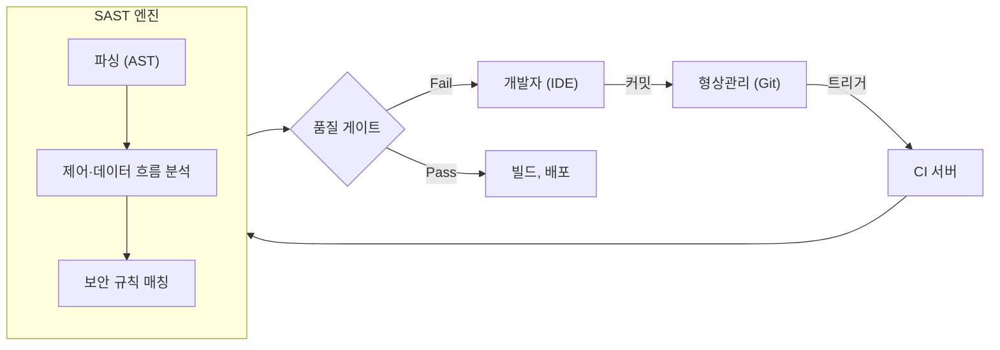

# SAST (Static Application Security Testing)

---

## I. 실행 없이 코드를 분석하는, SAST의 개요

### 가. 정의

- 애플리케이션을 **실행하지 않고** 소스 코드·바이트 코드·바이너리를 분석해 보안 약점([[SQL Injection]], [[XSS]] 등)과 코딩 규칙 위반을 찾는 **화이트박스 보안 테스트**

### 나. 필요성 및 특징

| 구분 | 내용 |
| --- | --- |
| Shift-Left | 개발 단계에서 취약점을 찾아 후반 수정 비용 감소 |
| 자동화 | CI/CD 파이프라인·IDE에 통합해 커밋마다 검사 |
| 전수 분석 | 실행되지 않는 경로까지 코드 전체 분석, 취약 코드 위치(라인) 제시 |
| 한계 | 언어 종속, 런타임 맥락 부재로 오탐(False Positive) 비율 높음, 설정·인증 흐름 결함 탐지 한계 |
| 공공 적용 | 행정안전부 SW 개발보안 진단에서 보안약점 점검 도구로 활용 ([[시큐어코딩]]) |

---

## II. 동작 구조와 분석 기법

### 가. 개념도

- 코드를 구문 트리로 변환해 흐름을 추적하고 보안 규칙과 비교한 뒤, 품질 게이트에서 배포 여부 결정

### 나. 분석 기법

| 구분 | 요소 | 설명 |
| --- | --- | --- |
| 분석 기법 | 어휘 분석 | 토큰 단위 패턴 매칭, 하드코딩된 비밀번호·위험 함수(strcpy 등) 탐지 |
| | 구문 분석 | 추상 구문 트리(AST)로 취약한 코드 구조 식별 |
| | 제어 흐름 분석 | 실행 경로 그래프로 도달 불가 코드, 예외 처리 누락 탐지 |
| | 데이터 흐름 분석 | 오염 분석(Taint): 외부 입력(Source)이 검증 없이 위험 함수(Sink)에 도달하는지 추적 |
| 운영 | 규칙 세트 | CWE·OWASP·행안부 보안약점 기준 매핑 ([[CWE]]) |
| | 품질 게이트 | 심각도 기준 미충족 시 빌드 차단 |
| 도구 | 상용·오픈소스 | SonarQube, Checkmarx, Fortify, Semgrep, CodeQL 등 ([[정적 분석 도구]]) |

---

## III. 비교 및 동향

### 가. SAST vs DAST vs IAST

| 비교 항목 | SAST | [[DAST]] | IAST |
| --- | --- | --- | --- |
| 방식 | 화이트박스, 코드 분석 | 블랙박스, 외부에서 공격 시뮬레이션 | 그레이박스, 런타임 에이전트 계측 |
| 실행 여부 | 실행 안 함 | 실행 필요 | 실행 필요 |
| 적용 시점 | 코딩·빌드 | 테스트·스테이징·운영 | 테스트 (자동화 테스트와 병행) |
| 오탐 | 높음 | 낮음 | 낮음 |
| 언어 종속 | 강함 | 없음 | 있음 (에이전트 지원 언어) |
| 위치 정보 | 코드 라인 제시 | URL·요청 단위 | 코드 라인 + 요청 |

### 나. 동향

- **LLM 보조**: 탐지 결과의 오탐 분류, 수정 코드 제안으로 개발자 부담 감소
- **ASPM 통합**: SAST·DAST·SCA 결과를 통합 관리해 우선순위화 ([[SBOM]], [[DevSecOps]])
- **AI 생성 코드 검증**: 코딩 어시스턴트가 만든 코드의 보안 약점 점검 수요 증가

---

### 🔗 연관 토픽

- **소속 도메인**: [[00_프로젝트관리_MOC|📋 프로젝트관리]]
- **세부 분류**: `5. 애자일 프로젝트 관리 & 개발 운영 (Agile PM)`
- **핵심 연관 토픽**:
  - [[DAST]]
  - [[DevSecOps]]
  - [[시큐어코딩]]
  - [[정적 분석 도구]]
  - [[CWE]]
