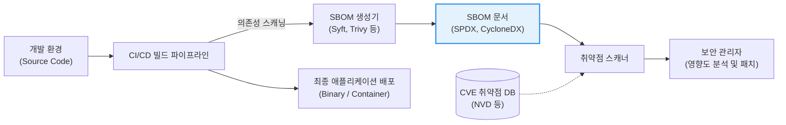

# SBOM (Software Bill of Materials)

---

## I. 소프트웨어 공급망 보안의 핵심 인프라, SBOM의 개요

### 가. 정의

- 소프트웨어 애플리케이션을 구성하는 모든 오픈소스, 서드파티 컴포넌트, 라이브러리 및 이들 간의 의존성(Dependency) 관계를 기계 판독 가능한(Machine-readable) 형태로 명세한 **소프트웨어 자재 명세서**

### 나. 등장 배경 및 필요성

| 구분 | 내용 |
| --- | --- |
| 공급망 보안 위협 | 오픈소스 비중(80~90%) 급증 및 Log4j, SolarWinds 등 공급망 침투 공격 빈발 |
| 컴플라이언스 의무화 | 미국 행정명령(EO 14028) 등 연방정부 및 글로벌 규제 기관의 SBOM 제출 의무화 |
| 가시성·투명성 확보 | 취약점 발생 시 영향받는 컴포넌트를 즉각 식별하고 라이선스(GPL 등) 위반 리스크 통제 |
| 자동화 파이프라인 연계 | CI/CD 단계에서 취약점 분석 도구와 연계하여 배포 전 선제적 조치 지원 |

---

## II. SBOM의 아키텍처 및 핵심 구성요소

### 가. CI/CD 파이프라인 내 SBOM 생성 및 활용 개념도

### 나. SBOM이 포함해야 할 필수 메타데이터 (NTIA 권고안 기준)

| 분류 | 메타데이터 항목 | 세부 설명 |
| --- | --- | --- |
| **식별 정보** | 컴포넌트 이름 및 버전 | 포함된 라이브러리/모듈의 정확한 명칭과 릴리스 버전 (예: `log4j-core`, `2.14.1`) |
| **식별 정보** | 고유 식별자 | 컴포넌트를 유일하게 식별할 수 있는 값 (CPE, PURL, SWID 등) |
| **출처 정보** | 작성자(Author) 및 공급자 | 해당 오픈소스나 컴포넌트를 개발하고 배포한 주체 |
| **관계 정보** | 의존성 트리 (Dependency) | 컴포넌트 간의 포함 관계(A가 B를 포함하고, B가 C를 포함하는 구조) 명시 |
| **추적 정보** | 타임스탬프 (Timestamp) | SBOM이 언제, 어떤 도구에 의해 생성되었는지에 대한 기록 |

---

## III. SBOM 표준 포맷 비교 및 최신 동향

### 가. 3대 글로벌 SBOM 표준 포맷 비교

| 비교 항목 | SPDX (Software Package Data Exchange) | CycloneDX | SWID (Software Identification) |
| --- | --- | --- | --- |
| **주관 기관** | 리눅스 재단 (Linux Foundation) | OWASP (개방형 웹 어플리케이션 보안 프로젝트) | ISO/IEC (국제표준화기구) |
| **설계 목적** | **오픈소스 라이선스 컴플라이언스 준수**에 특화되어 출발 | **보안 취약점 분석 및 공급망 보안**에 최적화 | 설치된 **상용 소프트웨어 자산 관리** 및 라이선스 추적 |
| **포맷 지원** | Tag:Value, RDF, [[JSON]], [[XML]], YAML | XML, JSON | XML |
| **현재 위상** | ISO 표준(ISO/IEC 5962)으로 등록된 가장 포괄적인 포맷 | 보안 커뮤니티와 [[DevSecOps]] 툴체인에서 가장 빠르고 널리 채택됨 | 엔터프라이즈 자산 관리 솔루션(ITAM)에서 주로 활용 |

### 나. 최신 공급망 보안 동향 및 한계 극복

- **VEX (Vulnerability Exploitability eXchange) 연동**: 실제 런타임 환경에서 취약점([[CVE]])의 악용 가능 여부를 선언한 VEX를 결합해 불필요한 경보 피로도(Alert Fatigue)를 줄이고 패치 우선순위 최적화
- **[[컨테이너]]·[[클라우드 네이티브]] 확장**: 단순 소스 코드를 넘어 [[도커|Docker]] 이미지 레이어, OS 패키지, 런타임 환경 전체를 스캐닝(Trivy, Syft)하여 [[DevSecOps]] 파이프라인 전반에 통합
- **국내외 제도화 및 표준 준수 가속**: 미국 행정명령 및 국내 'SW 공급망 보안 가이드라인' 수립에 맞춰 공공·금융 조달 사업에서 SBOM 제출 및 검증 자동화 체계 확대

---

### 🔗 연관 토픽

- **소속 도메인**: [[00_소프트웨어공학_MOC|🏗️ 소프트웨어공학]]
- **세부 분류**: `6. 소프트웨어 테스팅 & 품질 보증 (QA/QC)`
- **핵심 연관 토픽**:
  - [[DevSecOps]]
  - [[오픈소스 SW 보안위협]]
  - [[XML]]
  - [[오픈소스 거버넌스]]
  - [[컨테이너|컨테이너 (Container)]]
