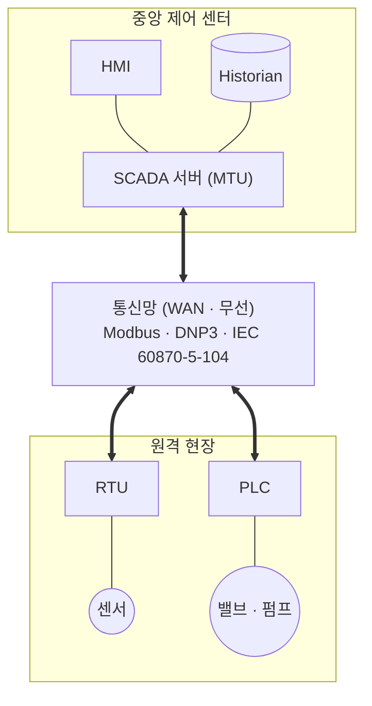

# SCADA (Supervisory Control and Data Acquisition)

---

## I. 광역 분산 설비의 원격 감시·제어, SCADA의 개요

### 가. 정의

- 전력망·가스관·상하수도·철도처럼 **넓은 지역에 분산된 설비의 데이터를 원격 수집하고 중앙에서 감시·제어**하는 산업제어시스템(ICS)

### 나. 특징

| 구분 | 내용 |
| --- | --- |
| 등장 배경 | 수십~수백 km 떨어진 설비를 현장 인력 없이 감시·제어할 필요 |
| 감시 중심 | 중앙은 상위 감시·명령, 실시간 제어 루프는 현장 RTU·PLC가 수행 |
| 실시간 경보 | 압력 초과 등 이상 시 즉시 알람·대응 |
| 이력 관리 | Historian에 시계열 데이터 장기 저장·분석 |
| 보안 취약성 | 가용성 우선 설계, 인증·암호화 없는 레거시 프로토콜 다수 |

---

## II. 구조 및 구성요소

### 가. 구조

- 중앙 서버(MTU)가 현장 RTU·PLC를 폴링해 데이터를 모으고, 운영자는 HMI로 상태를 보고 제어 명령 하달

### 나. 구성요소

| 구분 | 요소 | 설명 |
| --- | --- | --- |
| 중앙 | MTU (SCADA 서버) | 현장 장치 폴링, 데이터 수집·명령 하달 |
| | HMI | 설비 상태 그래픽 표시, 경보·조작 화면 |
| | Historian | 시계열 데이터 장기 저장·트렌드 분석용 [[데이터베이스]] |
| 현장 | RTU (Remote Terminal Unit) | 원격지 센서 신호 수집·변환, 열악한 환경용 독립 단말 |
| | PLC | 기계·라인의 순차·논리 제어 |
| 통신 | 산업용 [[프로토콜]] | Modbus, DNP3(전력·수도), IEC 60870-5-104, OPC UA |
| 보안 | 산업제어 보안 | 망분리, 단방향 게이트웨이, IEC 62443 기반 구역(Zone)·통로(Conduit) 설계 |

---

## III. 비교 및 동향

### 가. SCADA vs DCS vs PLC

| 비교 항목 | SCADA | DCS | PLC |
| --- | --- | --- | --- |
| 목적 | 광역 데이터 수집·감시 | 연속 공정 제어 | 개별 기계 논리 제어 |
| 범위 | 광역 (수십~수백 km) | 단일 플랜트 | 장비·라인 단위 |
| 산업 | 전력망, 송유관, 상하수도, 철도 | 정유, 화학, 발전 플랜트 | 자동차 조립, 반도체 장비 |
| 통신 의존 | 통신 단절 시에도 현장 장치가 자체 제어 유지 | 플랜트 내부 고신뢰 네트워크 | 로컬 I/O 중심 |
| 이중화 | 서버·통신 이중화 | 제어기·네트워크 이중화 기본 | 필요 시 이중화 |

### 나. 동향

- **OT 보안 강화**: Stuxnet(2010)·우크라이나 전력망 공격(2015) 이후 폐쇄망 가정이 깨져 망 분할·접근통제·[[제로 트러스트 보안모델|제로 트러스트]] 적용 확대, 국가기반시설 보안 규제 강화
- **IIoT · 클라우드 SCADA**: 현장 데이터를 [[MQTT (Message Queuing Telemetry Transport)|MQTT]] 등으로 클라우드에 전송하고 웹·모바일로 감시
- **[[디지털 트윈]] 연계**: SCADA 실시간 데이터를 가상 모델과 동기화해 고장 예측·운영 최적화

---

### 🔗 연관 토픽

- **소속 도메인**: [[00_디지털서비스_MOC|🚀 디지털서비스]]
- **세부 분류**: `3. 사물인터넷 (IoT) & 스마트 플랫폼 · 메타버스`
- **핵심 연관 토픽**:
  - [[CPS]]
  - [[Smart Factory|Smart Factory/스마트 팩토리(공장)]]
  - [[MQTT (Message Queuing Telemetry Transport)]]
  - [[디지털 트윈|디지털 트윈 (Digital Twin)]]
  - [[제로 트러스트 보안모델|제로 트러스트]]
