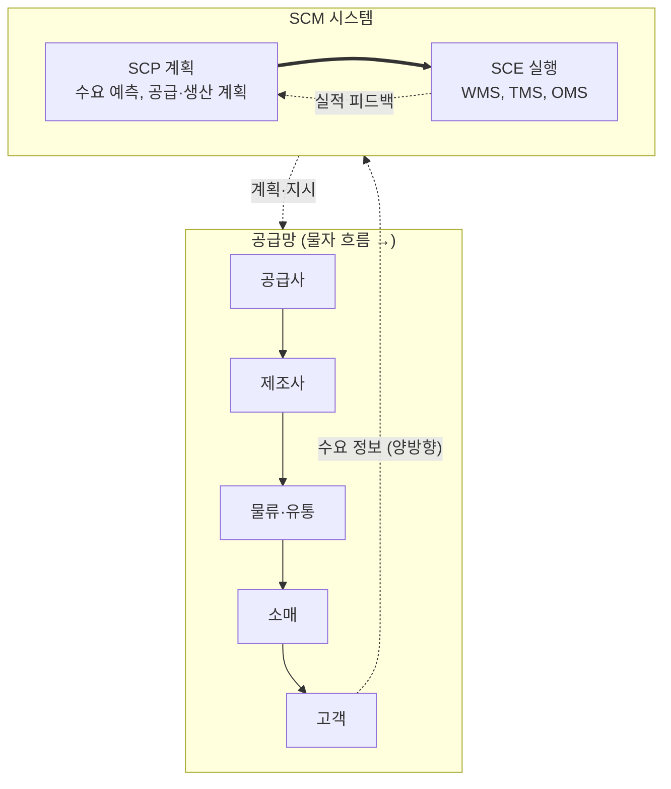

# SCM (Supply Chain Management, 공급망 관리)

---

## I. 공급망 전체를 하나로 동기화하는, SCM의 개요

### 가. 정의

- 원자재 조달 → 생산 → 유통 → 고객 전달에 이르는 공급망을 하나의 흐름으로 보고 **물자·정보·자금 흐름을 통합 계획·실행·통제**하는 경영 기법

### 나. 필요성 및 특징

| 구분 | 내용 |
| --- | --- |
| 경쟁 단위 변화 | 기업 간 경쟁에서 공급망 간 경쟁으로 |
| 채찍 효과 해소 | 정보 왜곡으로 상류로 갈수록 주문 변동이 커지는 현상 완화 |
| 목표 | 적시·적소·적량 공급으로 재고·리드타임 축소, 고객 서비스 향상 |
| 협업 | 공급자·제조사·유통사 간 수요·재고 정보 공유 |

---

## II. SCM의 구조 및 구성요소

### 가. 공급망 흐름과 시스템 구조

- 물자는 공급사 → 고객으로, 자금은 반대로, 정보는 양방향으로 흐르며, SCP가 계획하고 SCE가 실행·피드백

### 나. 구성요소

| 구분 | 요소 | 설명 |
| --- | --- | --- |
| 계획 (SCP) | 수요 계획 (Demand Planning) | 판매 이력·계절성·시장 동향으로 수요 예측 |
| | 공급·생산 계획 (APS) | 설비·자재 제약을 반영한 생산 일정·발주 계획 |
| 실행 (SCE) | WMS | 창고 입고·적치·피킹·출고 관리 |
| | TMS | 배차, 운송 경로 최적화, 화물 추적 |
| | OMS | 주문 접수·할당·배송·반품 관리 |
| 협업 | VMI (Vendor Managed Inventory) | 공급자가 고객 재고를 보고 직접 보충 |
| | CPFR | 제조사·유통사가 판매 예측과 보충 계획을 공동 수립 |
| 가시성 | SCEM | 공급망 이벤트·예외 실시간 감시 |

---

## III. 채찍 효과 및 동향

### 가. 채찍 효과 (Bullwhip Effect) 원인과 대책 (Lee, Padmanabhan, Whang 1997)

| 원인 | 내용 | 대책 |
| --- | --- | --- |
| 수요 예측 갱신 | 단계마다 따로 예측하고 안전재고 추가 | POS 데이터 공유, CPFR |
| 일괄 주문 (Order Batching) | 운송비 절감을 위한 주기적 대량 주문 | 소량 다빈도 주문, 혼載 운송 |
| 가격 변동 | 할인 시 선구매(Forward Buying) | 상시 저가 정책(EDLP) |
| 배급 게임 (Shortage Gaming) | 품귀 예상 시 과다 주문 | 과거 판매 실적 기반 할당 |

### 나. 동향

- **공급망 컨트롤 타워**: 지정학 위기·물류 차질에 대비해 공급망 전 구간 가시성과 대체 경로 시뮬레이션 제공
- **AI 수요 예측·자동 발주**: 외부 데이터(날씨, 경기 지표)까지 반영한 예측과 재발주 자동화
- **추적성 강화**: [[RFID]]·IoT 센서와 [[블록체인]]으로 콜드체인·의약품 이력 관리, 탄소 배출(Scope 3) 추적과 공급망 실사 규제 대응

---

### 🔗 연관 토픽

- **소속 도메인**: [[00_경영전략_MOC|📈 경영전략]]
- **세부 분류**: `1. 경영 환경 분석 & 전략 수립 프레임워크`
- **핵심 연관 토픽**:
  - [[가치사슬|가치사슬(Value Chain)]]
  - [[CRM]]
  - [[EDI]]
  - [[RFID]]
  - [[ESG 경영]]
