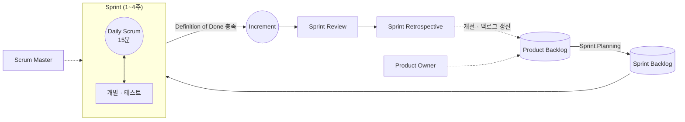

# 스크럼 (Scrum)

---

## I. 경험주의 기반 애자일 프레임워크, 스크럼의 개요

### 가. 정의

- 복잡하고 불확실한 환경에서 **짧은 타임박스(스프린트) 단위의 반복적·점진적 개발**로 고객 가치를 지속적으로 인도하는 경량 [[Agile]] [[프레임워크]]

### 나. 등장 배경 및 특징

| 구분 | 내용 |
| --- | --- |
| 등장 배경 | 요구가 고정된다고 가정하는 [[워터폴\|폭포수]] 모델의 변화 대응 한계와 후반부 통합 리스크 |
| 경험주의 3대 기둥 | 투명성(Transparency), 검사(Inspection), 적응(Adaptation) |
| 구조 | 3가지 책임(역할), 3가지 산출물, 5가지 이벤트 (3-3-5) |
| 팀 | 교차 기능·자기 관리(Self-Managing) 팀 |

---

## II. 스크럼 프로세스 및 구성요소

### 가. 스프린트 흐름

### 나. 3-3-5 구성요소

| 분류 | 요소 | 설명 |
| --- | --- | --- |
| 책임 (3) | Product Owner | 제품 가치 극대화, 제품 백로그 관리·우선순위 결정 |
| | Scrum Master | 스크럼 정착을 돕는 서번트 리더, 장애물 제거 |
| | Developers | 매 스프린트 증분을 만드는 교차 기능·자기 관리 팀 |
| 산출물 (3) | Product Backlog | 제품에 필요한 항목의 우선순위 목록, 약속: **제품 목표** |
| | Sprint Backlog | 스프린트에서 할 항목과 계획, 약속: **스프린트 목표** |
| | Increment | 사용 가능한 완성 결과물, 약속: **완료의 정의(DoD)** |
| 이벤트 (5) | Sprint | 1개월 이하의 고정 타임박스, 다른 이벤트를 포함 |
| | Sprint Planning | 스프린트 목표와 백로그 선정 |
| | Daily Scrum | 매일 15분, 진척 점검과 당일 계획 조정 |
| | Sprint Review | 증분 시연, 이해관계자 피드백 |
| | Sprint Retrospective | 프로세스·협업 방식 개선 |

---

## III. 방법론 비교 및 동향

### 가. 폭포수 vs 스크럼 vs 칸반

| 비교 항목 | 폭포수 | 스크럼 | [[Kanban (development) 프로세스\|칸반]] |
| --- | --- | --- | --- |
| 작업 흐름 | 순차적 단계 | 고정 길이 스프린트 반복 | 연속 흐름 |
| 변경 수용 | 낮음 (변경 통제) | 높음 (다음 스프린트에 반영) | 매우 높음 |
| 핵심 통제 | 간트 차트, [[WBS]] | 타임박스, 속도(Velocity), [[번다운차트]] | WIP 제한, 리드·사이클 타임 |
| 역할 | PM 중심 | PO, SM, Developers | 기존 역할 유지 |
| 적합 환경 | 요구가 명확한 SI | 변화가 큰 신규 제품 개발 | 운영·[[유지보수]], 티켓 처리 |

### 나. 동향

- **대규모 확장**: 여러 팀을 동기화하는 SAFe, LeSS, Scrum@Scale, Scrum of Scrums
- **스크럼반 (Scrumban)**: 스크럼의 역할·회고에 칸반의 WIP 제한을 결합한 하이브리드
- **제품 중심 조직**: 프로젝트보다 프로덕트 단위로 조직이 재편되며 PO의 역할 강화
- **AI 도구**: 백로그 정제, 스토리 포인트 예측, 스프린트 위험 조기 탐지 자동화

---

### 🔗 연관 토픽

- **소속 도메인**: [[00_프로젝트관리_MOC|📋 프로젝트관리]]
- **세부 분류**: `5. 애자일 프로젝트 관리 & 개발 운영 (Agile PM)`
- **핵심 연관 토픽**:
  - [[Agile]]
  - [[애자일 선언문]]
  - [[Kanban (development) 프로세스]]
  - [[번다운차트|번다운차트 (Burn Down Chart)]]
  - [[XP]]
