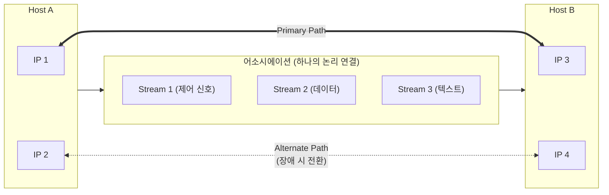

# SCTP (Stream Control Transmission Protocol)

---

## I. 여러 경로, 여러 스트림의 신뢰 전송, SCTP의 개요

### 가. 정의

- [[TCP]]의 신뢰성과 UDP의 메시지 경계 보존을 결합하고 **멀티호밍과 멀티스트리밍을 지원하는 연결형 [[전송 계층]] [[프로토콜]]** (RFC 9260, 기존 RFC 4960 대체)

### 나. 등장 배경 및 특징

| 구분 | 내용 |
| --- | --- |
| 등장 배경 | 전화망 신호(SS7)를 IP망으로 전달(SIGTRAN)하기 위해 IETF가 설계 |
| TCP의 한계 | 바이트 스트림이라 메시지 경계 없음, 하나의 손실이 전체 지연(HOL), 단일 주소 종속 |
| 어소시에이션 | 연결 개념으로, 양 끝이 여러 IP 주소를 가질 수 있음 |
| 메시지 지향 | 응용 메시지 경계 보존, 순서 없는 전달(Unordered)도 선택 가능 |
| 연결 보호 | 4-Way Handshake와 쿠키로 SYN Flooding류 공격 완화 |

---

## II. 구조 및 구성요소

### 가. 멀티호밍·멀티스트리밍 구조

- 하나의 어소시에이션 안에 독립 스트림을 두어 한 스트림의 손실이 다른 스트림을 막지 않고, Heartbeat로 경로 상태를 확인해 주 경로 장애 시 대체 경로로 전환

### 나. 구성요소

| 구분 | 요소 | 설명 |
| --- | --- | --- |
| 연결 | 어소시에이션 | 양 끝 주소 목록과 포트로 정의되는 논리 연결 |
| 경로 | 멀티호밍 | 여러 IP 경로 중 Primary 사용, Heartbeat로 감시 후 Failover ([[HA(High Availability)\|고가용성]]) |
| 흐름 | 멀티스트리밍 | 스트림별 순서 보장, 스트림 간 HOL Blocking 없음 |
| 패킷 | 청크 (Chunk) | 제어 청크(INIT, SACK 등)와 DATA 청크를 한 패킷에 묶음(Bundling) |
| 연결 설정 | INIT → INIT-ACK(State Cookie) → COOKIE-ECHO → COOKIE-ACK | 서버는 쿠키 확인 전까지 자원 미할당 ([[DoS (Denial of Service)\|DoS]] 완화) |
| 신뢰성 | SACK · 혼잡 제어 | 선택 확인응답, TCP와 유사한 혼잡 제어 |
| 종료 | 3-Way Shutdown | SHUTDOWN → SHUTDOWN-ACK → SHUTDOWN-COMPLETE, Half-Close 없음 |

---

## III. 비교 및 동향

### 가. TCP vs UDP vs SCTP

| 비교 항목 | TCP | UDP | SCTP |
| --- | --- | --- | --- |
| 신뢰성 | 보장 | 없음 | 보장 |
| 전송 단위 | 바이트 스트림 | 데이터그램 | 메시지 (경계 보존) |
| 다중 경로 | 단일 | 단일 | 멀티호밍 |
| HOL Blocking | 발생 | 없음 | 스트림 간 없음 |
| 연결 설정 | 3-Way | 없음 | 4-Way (쿠키) |
| 순서 | 항상 순서 보장 | 없음 | 순서·비순서 선택 |

### 나. 동향

- **이동통신 신호망**: LTE S1AP·X2AP, 5G NGAP·XnAP, Diameter(일부) 등 기지국·코어 제어 신호의 전송 계층
- **WebRTC 데이터 채널**: 브라우저 간 데이터 전송에 SCTP over DTLS over UDP 사용
- **보급 한계**: 인터넷의 NAT·방화벽 통과가 어려워 일반 응용에서는 UDP 캡슐화나 QUIC가 대안

---

### 🔗 연관 토픽

- **소속 도메인**: [[00_네트워크_MOC|🌐 네트워크]]
- **세부 분류**: `1. OSI 7계층 & 데이터링크 계층 (L1/L2)`
- **핵심 연관 토픽**:
  - [[TCP 와 UDP 비교]]
  - [[전송 계층|전송 계층 (Transport Layer)]]
  - [[TCP]]
  - [[HTTP 3|HTTP/3]]
  - [[5G|5G 주요 기술]]
