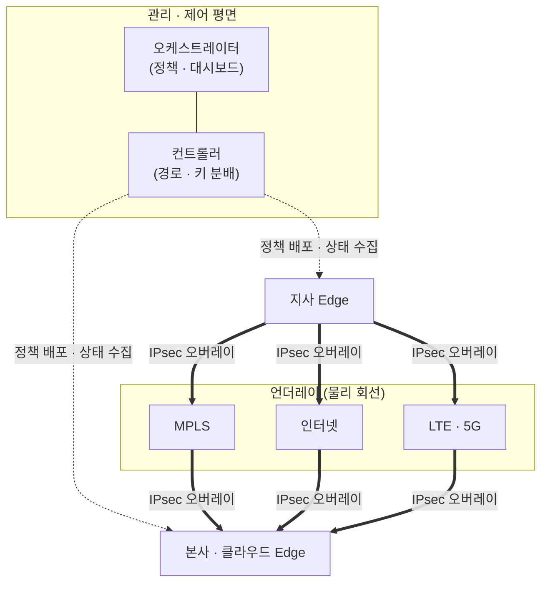

# SD-WAN (Software-Defined Wide Area Network)

---

## I. 회선은 섞고 제어는 중앙에서, SD-WAN의 개요

### 가. 정의

- [[SDN(Software Defined Network)|SDN]] 개념을 광역망에 적용해 **MPLS·인터넷·LTE/5G 등 여러 회선 위에 암호화 오버레이를 구성하고, 중앙 정책으로 애플리케이션별 경로를 동적으로 선택**하는 WAN 구조

### 나. 등장 배경 및 특징

| 구분 | 내용 |
| --- | --- |
| 회선 비용 | 고가 MPLS 의존에서 저가 인터넷 회선 혼용으로 비용 절감 |
| 클라우드 접속 | 지사 트래픽이 본사를 거쳐 나가는 백홀(Hairpinning)로 SaaS 지연 발생 |
| 운영 부담 | 장비별 CLI 설정을 중앙 정책·자동 배포로 대체 |
| 전송망 독립 | 물리 회선 종류와 무관한 오버레이 구성 (Transport Agnostic) |
| 애플리케이션 인식 | 회선 품질과 애플리케이션 요구에 따라 경로 선택 |

---

## II. 구조 및 구성요소

### 가. 오버레이·언더레이 구조

- Edge 장비가 여러 회선 위에 IPsec 터널을 만들고, 컨트롤러 정책에 따라 회선별 지연·손실을 측정해 애플리케이션마다 최적 경로로 보냄

### 나. 구성요소

| 구분 | 요소 | 설명 |
| --- | --- | --- |
| 구조 | Edge 장비 (CPE) | 지사·본사·클라우드에 두는 물리·가상 장비 |
| | 오케스트레이터 · 컨트롤러 | 정책 수립·배포, 경로·암호 키 관리 |
| 오버레이 | [[IP Sec\|IPsec]] [[VPN]] 터널 | 언더레이 위 암호화 가상망 |
| 동적 제어 | 애플리케이션 인식 라우팅 | DPI로 애플리케이션 식별, 지연·지터·손실 기준 경로 선택 |
| 품질 보정 | FEC · 패킷 복제 | 손실이 큰 회선에서 음성·영상 품질 보완 |
| 배포 | ZTP | 장비 설치 후 전원 연결만으로 정책 자동 수신 |
| 클라우드 | 로컬 브레이크아웃 | SaaS 트래픽을 지사 인터넷으로 직접 내보냄 |
| 보안 | 내장 NGFW · SASE 연동 | 지사별 [[방화벽]] 기능 또는 클라우드 보안 서비스 연결 |

---

## III. 비교 및 동향

### 가. 전통 WAN vs SD-WAN

| 비교 항목 | 전통 WAN | SD-WAN |
| --- | --- | --- |
| 제어 | 라우터별 분산 설정 | 중앙 정책 기반 |
| 회선 | MPLS 중심 | MPLS·인터넷·LTE/5G 혼용, Active-Active |
| 경로 선택 | 목적지 기반 | 애플리케이션·회선 품질 기반 |
| 클라우드 접속 | 본사 백홀 | 로컬 브레이크아웃 |
| 배포 | 현장 방문 CLI 설정 | ZTP, GUI 통합 관리 |
| 보안 | 본사 중앙 방화벽 | 지사 NGFW 또는 [[SASE(Secure Access Service Edge)\|SASE]] |

### 나. 동향

- **SASE 융합**: 로컬 브레이크아웃으로 분산된 보안 통제를 ZTNA·SWG·CASB 클라우드 보안과 결합
- **AIOps**: 텔레메트리 분석으로 회선 품질 저하를 예측해 미리 경로 전환
- **관리형 서비스**: 통신사·MSP가 SD-WAN과 보안을 구독형(NaaS)으로 제공

---

### 🔗 연관 토픽

- **소속 도메인**: [[00_네트워크_MOC|🌐 네트워크]]
- **세부 분류**: `2. 네트워크 계층 & 라우팅 프로토콜 (L3)`
- **핵심 연관 토픽**:
  - [[SDN(Software Defined Network)]]
  - [[SASE(Secure Access Service Edge)]]
  - [[IP Sec]]
  - [[VAN]]
  - [[QoS|QoS (Quality of Service)]]
