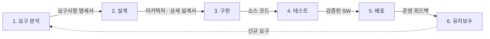

# SDLC (Software Development Life Cycle, 소프트웨어 개발 생명주기)

---

## I. 요구에서 폐기까지의 공정 틀, SDLC의 개요

### 가. 정의

- 요구사항 분석부터 설계·구현·테스트·배포·유지보수·폐기까지 **소프트웨어 생애 전 과정을 단계와 산출물로 정의한 개발 [[프로세스]] 모델**

### 나. 필요성

| 구분 | 내용 |
| --- | --- |
| 등장 배경 | 1968년 NATO 회의에서 제기된 소프트웨어 위기, Build & Fix 방식의 일정·예산·품질 문제 |
| 가시성 · 통제 | 단계별 산출물로 진척과 품질을 관리 |
| 의사소통 | 이해관계자 간 공통 작업 기준 제공 |
| 모델 다양성 | [[워터폴\|폭포수]], [[프로토타이핑 모델\|프로토타이핑]], [[Spiral 모델\|나선형]], [[Agile\|애자일]] 등 사업 특성에 맞춰 선택 |

---

## II. 공통 단계 및 산출물

### 가. SDLC 공통 단계

- 각 단계의 산출물이 다음 단계의 입력이 되며, 운영 중 발생한 요구는 다음 주기의 분석으로 환류

### 나. 단계별 활동 및 산출물

| 구분 | 요소 | 설명 |
| --- | --- | --- |
| 요구 분석 | 활동 | 타당성 검토, 기능·비기능 요구 수집·명세 ([[요구 공학]]) |
| | 산출물 | [[요구사항 명세서]](SRS), 타당성 보고서 |
| 설계 | 활동 | 아키텍처 설계(HLD)와 모듈·DB·UI 상세 설계(LLD) |
| | 산출물 | 아키텍처 정의서, ERD, 화면 설계서 |
| 구현 | 활동 | 코딩, 버전 관리, 코드 리뷰 |
| | 산출물 | 소스 코드, 빌드 결과물 |
| 테스트 | 활동 | [[단위 테스트\|단위]]→[[통합 테스트\|통합]]→[[시스템 테스트\|시스템]]→[[인수 테스트\|인수]] 테스트 |
| | 산출물 | 테스트 케이스, 결함 보고서 |
| 배포 | 활동 | 운영 환경 릴리스, 사용자 교육 |
| | 산출물 | 릴리스 노트, 사용자 매뉴얼 |
| [[유지보수]] | 활동 | 수정·적응·완전·예방 유지보수 |
| | 산출물 | 변경 요청서, 패치 이력 |

---

## III. 비교 및 동향

### 가. 폭포수 vs 애자일 vs DevOps

| 비교 항목 | [[워터폴\|폭포수]] | 애자일 ([[SCRUM\|Scrum]]) | [[DevOps]] |
| --- | --- | --- | --- |
| 진행 방식 | 단계별 순차 진행 | 짧은 스프린트 반복 | 개발·운영 통합 연속 루프 |
| 변경 수용 | 낮음 (후반 변경 비용 큼) | 높음 (주기마다 반영) | 높음 (상시 반영) |
| 핵심 가치 | 사전 계획, 문서화 | 동작하는 SW, 고객 협력 | 협업 문화, 자동화, 측정 |
| 배포 주기 | 수개월~수년 | 수 주 | 수시 (하루 다회 가능) |

### 나. 동향

- 보안 활동을 초기 단계로 당기는 Secure SDLC·[[DevSecOps]] ([[SAST]], [[DAST]], SCA 자동화)
- 요구 명세·코드·테스트 생성 전반에 생성형 AI를 활용하는 AI 보조 SDLC
- [[MSA (Micro Service Architecture)|MSA]]·[[컨테이너]] 환경에서 서비스마다 독립된 짧은 생명주기 운영

---

### 🔗 연관 토픽

- **소속 도메인**: [[00_소프트웨어공학_MOC|🏗️ 소프트웨어공학]]
- **세부 분류**: `1. 소프트웨어 개발 생명주기(SDLC) & 방법론`
- **핵심 연관 토픽**:
  - [[소프트웨어 개발 방법론]]
  - [[워터폴|폭포수 모델]]
  - [[Spiral 모델]]
  - [[Agile]]
  - [[DevOps|데브옵스 (DevOps)]]
