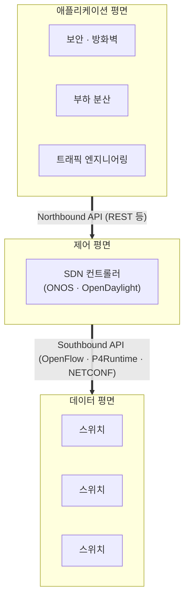

# SDN (Software Defined Network)

---

## I. 망의 두뇌를 소프트웨어로, SDN의 개요

### 가. 정의

- 네트워크 장비의 **제어 평면을 데이터 평면에서 분리해 중앙 컨트롤러로 모으고, 개방형 API로 네트워크 동작을 프로그래밍**하는 구조

### 나. 등장 배경 및 특징

| 구분 | 내용 |
| --- | --- |
| 벤더 종속 | 폐쇄형 장비·OS로 신기능 도입과 자동화가 어려움 |
| 클라우드 수요 | VM·컨테이너 증가로 망 구성 변경이 잦아 API 기반 자동화 필요 |
| 평면 분리 | 컨트롤러가 경로 계산, 장비는 규칙에 따라 전달 |
| 전역 뷰 | 전체 토폴로지를 보고 트래픽 엔지니어링 |
| 개방성 | 표준 인터페이스([[OpenFlow]] 등)와 범용 하드웨어(White-box) 활용 |

---

## II. 구조 및 구성요소

### 가. 3계층 구조

- 애플리케이션은 Northbound API로 의도를 전달하고, 컨트롤러는 이를 Southbound 인터페이스로 장비 규칙(플로우 테이블)으로 변환해 설치

### 나. 구성요소

| 구분 | 요소 | 설명 |
| --- | --- | --- |
| 제어 평면 | SDN 컨트롤러 | 토폴로지·상태 수집, 경로 계산, 규칙 배포 (ONOS, OpenDaylight) |
| 데이터 평면 | SDN 스위치 | 컨트롤러가 내려준 플로우 규칙에 따라 매칭·전달 |
| 인터페이스 | Southbound | [[OpenFlow]], P4Runtime, NETCONF/YANG, gNMI |
| | Northbound | REST API 등 애플리케이션용 인터페이스 |
| | East-West | 컨트롤러 클러스터 간 상태 동기화 (가용성 확보) |
| 규칙 | 플로우 테이블 | 매치 필드 + 액션 + 카운터 |
| 프로그래밍 | P4 | 데이터 평면 파싱·처리 로직 자체를 정의 |

---

## III. 비교 및 동향

### 가. 전통 네트워크 vs SDN

| 비교 항목 | 전통 네트워크 | SDN |
| --- | --- | --- |
| 제어 | 장비별 분산 제어 ([[라우팅 알고리즘]] OSPF·[[BGP]]) | 중앙 컨트롤러 |
| 구조 | 제어·데이터 평면 일체 | 제어·데이터 평면 분리 |
| 장비 | 벤더 전용 하드웨어·OS | 개방형 인터페이스, White-box 가능 |
| 운영 | CLI 수동 설정 | API 기반 자동화 |
| 한계 | 변경 대응 느림 | 컨트롤러 장애·확장성 → 클러스터링으로 보완 |

### 나. 동향

- **NFV 결합**: SDN은 연결을, [[NFV]]는 망 기능을 소프트웨어화해 5G 코어·[[네트워크 슬라이싱]]의 기반
- **의도 기반 운영**: 관리자의 의도(What)를 정책으로 변환하고 지속 검증하는 [[IBN(Intent-Based Networking)|IBN]]으로 발전
- **광역망 확장**: [[SD-WAN (Software-Defined Wide Area Network)|SD-WAN]], 보안과 결합한 [[SASE(Secure Access Service Edge)|SASE]]로 확산
- **하이브리드 SDN**: 완전 중앙화 대신 분산 라우팅(BGP·IGP) 위에 컨트롤러가 정책·TE만 담당하는 방식이 주류

---

### 🔗 연관 토픽

- **소속 도메인**: [[00_네트워크_MOC|🌐 네트워크]]
- **세부 분류**: `2. 네트워크 계층 & 라우팅 프로토콜 (L3)`
- **핵심 연관 토픽**:
  - [[OpenFlow]]
  - [[NFV]]
  - [[SD-WAN (Software-Defined Wide Area Network)]]
  - [[IBN(Intent-Based Networking)]]
  - [[네트워크 슬라이싱]]
