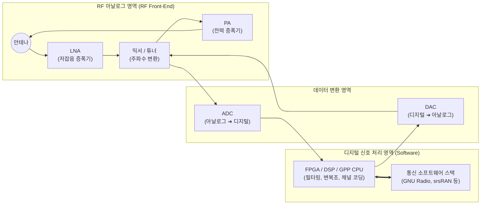

# SDR (Software Defined Radio)

---

## I. 통신 인프라의 소프트웨어화, SDR의 개요

기존 무선 통신 기기에서 하드웨어 회로로 구현되던 주파수 변조, 복조, 필터링, 신호 처리 등의 기능을 DSP, FPGA 또는 범용 프로세서(GPP) 기반 소프트웨어로 대체하여 구현한 무선 통신 기술이다.

| 구분 | 주요 내용 |
| --- | --- |
| **개념** | 안테나와 RF 변환단을 제외한 대부분의 기저대역(Baseband) 통신 신호 처리를 소프트웨어 프로그래밍 방식으로 유연하게 제어하는 기술 |
| **등장 배경** | 특정 주파수·규격에 고정된 전용 칩셋(ASIC)의 하드웨어 교체 비용 부담 극복, 다중 통신 표준(Multi-Standard) 통합 수용 및 신속한 업그레이드 요구 |
| **핵심 특징** | 소프트웨어 업데이트만으로 새로운 통신 프로토콜 지원, RF 구간 최소화, 광대역 주파수 수용성 및 인프라 가상화(vRAN/O-RAN)의 근간 제공 |

---

## II. SDR의 아키텍처 및 핵심 구성요소

### 가. SDR 트랜시버(송수신기) 기본 아키텍처

수신 시 안테나를 통해 유입된 RF 신호는 LNA와 믹서를 거쳐 즉시 ADC로 변환되며, 기저대역의 모든 신호 처리와 변복조는 디지털 하드웨어 및 소프트웨어 스택에서 수행된다.

### 나. SDR의 4대 핵심 구성 요소

| 분류 | 요소기술 (키워드) | 세부 설명 |
| --- | --- | --- |
| **RF 아날로그** | RF Front-End (RFFE) | 안테나를 통해 수신된 미세 RF 신호를 저잡음 증폭(LNA)하고, 주파수를 기저대역으로 변환(Mixer) |
| **변환 인터페이스** | ADC / [[DAC]] | 아날로그 신호를 고속 디지털 샘플로 변환하거나 역변환하며, SDR 시스템의 대역폭과 신호 해상도를 결정 |
| **연산 하드웨어** | FPGA / DSP / GPP | 고속 푸리에 변환(FFT), 디지털 필터링, 채널 코딩 등 대량의 연산을 실시간 병렬 처리하는 반도체 플랫폼 |
| **소프트웨어** | 신호 처리 [[프레임워크]] | I/Q 샘플 데이터를 블록 단위로 처리하고 프로토콜 스택을 구현하는 개발 소프트웨어 (GNU Radio 등) |

---

## III. 전통적 무선 시스템과의 비교 및 최신 동향

### 가. 전통적 라디오(ASIC) vs SDR 비교

| 비교 항목 | 전통적 하드웨어 라디오 (Legacy) | SDR (Software Defined Radio) |
| --- | --- | --- |
| **기능 구현** | 전용 칩셋(ASIC) 기반 하드웨어 배선 고정 | **소프트웨어 프로그래밍 및 알고리즘 기반** |
| **표준 변경** | 불가능 (신규 표준 지원 시 장비 전면 교체) | **원격 소프트웨어/펌웨어 업데이트로 즉각 변경** |
| **호환성** | 단일 대역, 특정 단일 [[프로토콜]] 전용 | **광대역 주파수 수용 및 다중 표준 동시 지원** |
| **개발 비용** | 초기 칩셋 설계 비용(NRE) 과다, 재활용 어려움 | COTS 하드웨어 활용으로 개발 주기 단축 및 비용 절감 |
| **전력 소모** | 전용 회로로 최적화되어 소비 전력 낮음 | 범용 연산 소자 사용으로 상대적 전력 소모 높음 |

### 나. 최신 기술 동향 및 발전 방향

* **인지 무선(Cognitive Radio)과의 결합**: SDR 기반 하드웨어에 AI 모델을 접목하여 주변 전파 환경을 실시간 감지하고, 비어있는 유휴 주파수 대역(White Space)을 동적으로 점유하여 통신하는 지능형 무선 통신으로 진화함.
* **가상화 기지국(vRAN) 및 [[O-RAN]]의 근간**: 기지국 신호 처리 장비(DU)를 전용 ASIC에서 x86 COTS 서버 상의 소프트웨어 컨테이너로 구현하는 vRAN과 개방형 프론트홀 O-RAN 기술의 핵심 기반으로 안착됨.
* **위성 및 군 전술 통신망 적용**: 물리적 수리가 불가능한 인공위성 통신 탑재체와 연합 작전 시 이종 군용 무전기 간 상호 운용성을 확보하기 위한 표준 무선 플랫폼으로 채택됨.

---

### 🔗 연관 토픽

- **소속 도메인**: [[00_네트워크_MOC|🌐 네트워크]]
- **세부 분류**: `4. 무선 및 차세대 이동통신 (5G/6G/Wi-Fi)`
- **핵심 연관 토픽**:
  - [[O-RAN]]
  - [[프로토콜]]
  - [[가상화]]
  - [[DAC]]
