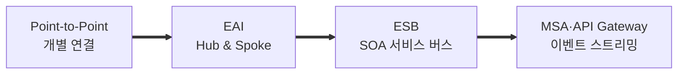

# SI (System Integration, 시스템 통합)

---

## I. 정보시스템 구축을 일괄 수행하는, SI의 개요

### 가. 정의

- 고객의 업무 요구에 맞춰 **HW·SW·네트워크·솔루션을 선정·설계·개발·통합해 정보시스템을 구축**하고 안정화까지 책임지는 IT 서비스 사업

### 나. 필요성 및 특징

| 구분 | 내용 |
| --- | --- |
| 필요성 | 이기종 시스템(ERP, [[CRM]], [[SCM (Supply Chain Management)\|SCM]] 등) 증가로 통합·연계 역량 필요 |
| 맞춤 구축 | 패키지(COTS)만으로 수용하기 어려운 고유 업무를 개발·커스터마이징 |
| 전 주기 수행 | 분석 → 설계 → 개발 → 시험 → 이행(데이터 전환) → 안정화 ([[SDLC]]) |
| 프로젝트 기반 | 계약된 범위·일정·비용 내 일괄 수행, 품질·감리 대상 |

---

## II. 통합 아키텍처 및 통합 계층

### 가. 통합 방식의 발전

- 연결 수가 늘어나는 문제를 중앙 허브(EAI) → 표준 서비스 버스(ESB) → API·이벤트 기반 분산 통합으로 해결해 온 흐름

### 나. 통합 계층

| 구분 | 요소 | 설명 |
| --- | --- | --- |
| 데이터 통합 | ETL, MDM | 이기종 DB 데이터 추출·변환·적재, 기준 정보 일원화 |
| 애플리케이션 통합 | [[EAI]], ESB, API | 메시지·서비스 호출로 시스템 간 기능 연계 |
| 프로세스 통합 | BPM, 워크플로 | 여러 시스템에 걸친 업무 흐름 자동화 |
| 인프라 통합 | 서버·스토리지·네트워크·클라우드 | 하드웨어·플랫폼 구성과 이중화 |

---

## III. IT 서비스 유형 비교 및 동향

### 가. ISP vs SI vs SM

| 구분 | [[ISP (Information Strategy Plan)\|ISP]]·[[ISMP]] | SI | SM (System Management) |
| --- | --- | --- | --- |
| 단계 | 기획 | 구축 | 운영·유지보수 |
| 산출물 | 전략, 요구사항, RFP | 구축된 시스템 | 안정 운영, 개선 |
| 계약 형태 | 컨설팅 | 일괄 도급 (프로젝트) | 연간 운영 계약, SLA |
| 핵심 지표 | 계획 품질 | 범위·일정·품질 준수 | 가용성, [[SLA]] 달성률 |

### 나. 동향

- **클라우드 SI**: 온프레미스 장비 납품 중심에서 클라우드 인프라 설계, [[컨테이너]]·[[MSA (Micro Service Architecture)|MSA]] 기반 개발로 전환
- **SaaS 연계·로우코드**: 패키지·SaaS 도입 후 API로 레거시와 연계, 로우코드 플랫폼으로 개발 기간 단축
- **공공 SW 시장 제도**: 대기업 참여 제한, 과업 변경 시 대가 반영, 원격지 개발 허용 등 [[SW사업 대가산정 가이드]]·SW진흥법 기반 발주 제도 개선

---

### 🔗 연관 토픽

- **소속 도메인**: [[00_경영전략_MOC|📈 경영전략]]
- **세부 분류**: `2. IT 거버넌스 & 엔터프라이즈 아키텍처 (EA/ISP)`
- **핵심 연관 토픽**:
  - [[EAI]]
  - [[ISMP]]
  - [[SDLC]]
  - [[SW사업 대가산정 가이드]]
  - [[MSA (Micro Service Architecture)]]
