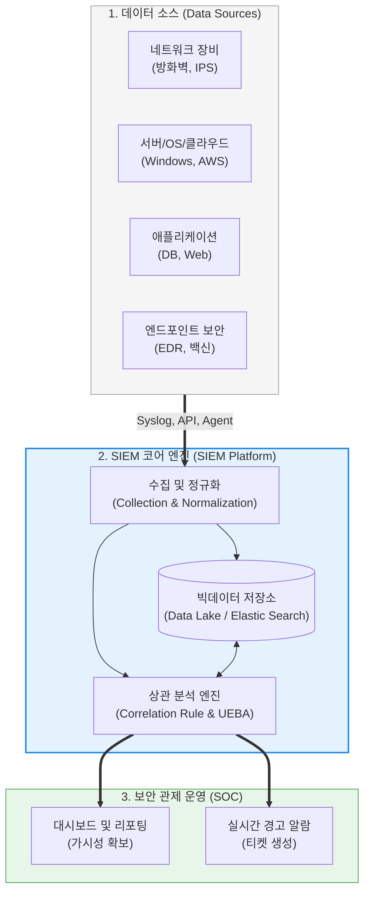

# SIEM (Security Information and Event Management)

---

## I. 이기종 보안 데이터의 중앙 집중식 통합 관제 플랫폼, SIEM의 개요

### 가. SIEM의 정의
- 시스템, 네트워크, 애플리케이션 등 인프라 전반에서 발생하는 대규모 이종 로그를 중앙 수집·정규화하여 실시간 상관분석을 통해 보안 위협을 탐지·대응하는 통합 보안 관제(SOC) 플랫폼.

### 나. SIEM의 등장 배경 및 주요 특징
| 구분 | 내용 |
| --- | --- |
| 경보 피로(Alert Fatigue) | 단위 보안 장비(방화벽, IPS 등)의 파편화된 대량 알람으로 인한 관제 인력의 피로도 극복 |
| 다차원 상관분석 | 개별 이벤트로는 탐지 불가능한 APT 우회 침투 패턴을 시간적·논리적 상관 규칙으로 식별 |
| SIM과 SEM의 결합 | 규제 준수(Compliance) 및 포렌식을 위한 장기 보관(SIM)과 실시간 이벤트 모니터링(SEM) 융합 |
| Next-Gen SIEM 발전 | 머신러닝 기반 UEBA(사용자/엔티티 행위 분석) 및 클라우드 네이티브 빅데이터 레이크 결합 |

---

## II. SIEM의 아키텍처 및 핵심 구성요소

### 가. SIEM 기반 통합 보안 관제 데이터 파이프라인

### 나. SIEM의 4대 핵심 기술 요소

| 분류 | 요소기술 (키워드) | 세부 설명 및 역할 |
| --- | --- | --- |
| **데이터 수집** | 파싱 및 정규화 (Normalization) | 서로 다른 벤더(Cisco, PaloAlto, MS 등)가 생성한 제각각의 로그 포맷을 통일된 표준 [[스키마]](예: Source IP, Dest Port, Timestamp)로 변환하여 분석이 가능하게 함 |
| **위협 탐지** | **상관 분석 (Correlation)** | 독립적으로 보면 정상적인 이벤트들을 시간적, 논리적 규칙으로 엮어 공격 패턴을 식별함. (예: "방화벽 접속 5회 실패(A)" 후 "성공(B)", 그리고 "대용량 DB 다운로드(C)"가 5분 내 발생 시 알람) |
| **장기 보관** | 컴플라이언스 및 포렌식 | 침해 사고 발생 시 역추적(Forensic)을 위한 장기 로그 저장 기능을 제공하며, [[ISMS-P]], GDPR, PCI-DSS 등 법적 규제 준수를 위한 자동화 리포트를 생성함 |
| **차세대 탐지** | **UEBA** (사용자 및 [[엔티티]] 행동 분석) | 정적 룰(Rule) 기반 탐지의 한계를 넘어, 머신러닝(ML)을 이용해 평소 사용자의 행동 패턴(Baseline)을 학습한 후 이를 벗어나는 이상 행위([[Anomaly(이상현상)\|Anomaly]])를 탐지함 |

---

## III. 현대 보안 관제 아키텍처 비교 및 최신 동향

### 가. 3대 핵심 보안 관제 솔루션 (SIEM vs SOAR vs EDR) 비교

| 비교 항목 | SIEM (Security Info & Event Mgmt) | [[SOAR (Security Orchestration, Automation and Response)\|SOAR (Security Orchestration, Automation & Response)]] | [[EDR(Endpoint Detection and Response)\|EDR]] (Endpoint Detection & Response) |
| --- | --- | --- | --- |
| **핵심 목적** | 이기종 로그의 **중앙 수집 및 상관 분석을 통한 '탐지(Detection)'** | 탐지된 위협에 대한 **자동화된 '대응(Response)' 및 오케스트레이션** | PC, 서버 등 **'엔드포인트(단말)' 수준의 상세 행위 가시성 확보 및 격리** |
| **주요 역할** | 전체 인프라의 가시성 확보, 경고 발생 | 보안 분석가의 수동 반복 작업(단순 티켓 처리, 차단 등) 자동화 | 단말 내 악성 [[프로세스]] 실행, 레지스트리 변경 등 정밀 분석 |
| **핵심 기술** | 정규화, 상관 분석 엔진, 빅데이터 검색 | **플레이북 (Playbook)**, 서드파티 API 연동 (오케스트레이션) | [[커널]] 레벨 모니터링, 단말 네트워크 차단(격리) |
| **상호 관계** | 경고(Alert)를 생성하여 SOAR로 전달 | SIEM의 알람을 받아 EDR/방화벽에 차단 명령을 내림 | SIEM에 상세 로그를 제공하고, SOAR의 명령에 따라 단말을 제어함 |

### 나. 클라우드 네이티브와 차세대 관제(Next-Gen SOC) 동향
- **클라우드 네이티브 SIEM(Cloud SIEM) 확산**: 온프레미스 스토리지 및 인덱싱 성능 한계를 극복하기 위해 서버리스 빅데이터 레이크 기반의 Microsoft Sentinel, Google SecOps 등 클라우드 네이티브 SIEM으로 전면 전환.
- **CTI 실시간 상관분석 결합**: 글로벌 침해지표(IoC: IP, 도메인, 파일 해시) 피드를 제공하는 [[CTI]]와 연계하여 내부 인프라 로그와 실시간 대조함으로써 잠재적 공격을 조기 식별.
- **XDR 및 생성형 AI SOC 보조원(Co-pilot) 도입**: 파편화된 원시 로그 분석의 비효율을 줄이기 위해 사전 정규화된 [[XDR]] 파이프라인 및 LLM 기반 침해사고 요약·쿼리 생성 자동화 도구 적극 채택.

---

### 🔗 연관 토픽

- **소속 도메인**: [[00_보안_MOC|🛡️ 보안]]
- **세부 분류**: `3. 네트워크 & 엔드포인트 · 인프라 보안`
- **핵심 연관 토픽**:
  - [[SOAR (Security Orchestration, Automation and Response)]]
  - [[CTI]]
  - [[XDR|XDR(eXtended Detection Response)]]
  - [[EDR(Endpoint Detection and Response)]]
  - [[위협 헌팅|위협 헌팅(Threat Hunting)]]
