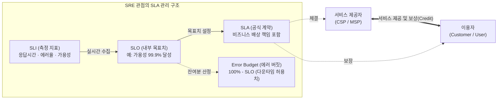

# SLA (Service Level Agreement)

---

## I. IT 서비스 품질의 정량적 기준, SLA의 개요

### 가. 정의

- IT 서비스 제공자와 이용자 간에 **제공할 서비스의 품질 수준(가용성, 성능 등)을 정량적 지표로 정의하고, 미달 시 보상 기준을 명시한 공식 협약**

### 나. 특징 및 필요성

| 구분 | 내용 |
| --- | --- |
| 책임 소재 명확화 | 클라우드(XaaS) 및 아웃소싱 환경에서 서비스 제공자와 이용자 간 품질 분쟁 예방 |
| 정량적 지표 기반 | 모호한 품질 기준을 배제하고 SLI, SLO 기반의 측정 가능한 수치로 객관적 평가 수행 |
| 재무적 보상 연계 | 서비스 수준 미달 시 요금 감면(Service Credit) 등 실질적 구제 수단 제공 |
| SRE 운영 제어 | 허용 가능한 서비스 장애 예산(Error Budget) 산정 및 기능 배포 속도 제어 기준으로 활용 |

---

## II. 개념도 및 핵심 구성요소

### 가. 개념도

- 실시간 측정값(SLI)을 통해 내부 관리 목표(SLO)를 모니터링하고, 계약 기준(SLA) 위반 시 사전에 조치하여 페널티 발생 방지

### 나. 핵심 구성요소

| 구분 | 요소 | 설명 |
| --- | --- | --- |
| 지표 체계 | SLI | 서비스 품질을 측정하는 정량적 지표 (응답 지연, 처리량, 에러율 등) |
| | SLO | 내부 운영진이 설정한 SLI 기반의 품질 목표치 (예: 99.9% 이상 정상 응답) |
| 계약 체계 | SLA | 고객과 체결하는 공식 계약서 (SLO 미달 시 페널티 및 법적 조건 명시) |
| | Service Credit | SLA 미달 시 차월 이용료 할인 등으로 제공하는 계약상 보상액 |
| 운영 체계 | Error Budget | 100% - SLO로 정의되는 허용 다운타임 한도 (신규 기능 배포 속도 제어 기준) |
| 신뢰성 지표 | MTBF | Mean Time Between Failures, 고장과 고장 사이의 평균 정상 가동 시간 |
| | MTTR | Mean Time To Recovery, 장애 발생 후 정상 복구까지 걸리는 평균 시간 |
| 모니터링 | Observability | APM, 분산 트레이싱, 메트릭 대시보드를 통한 종단간 SLI 실시간 추적 |

---

## III. 관리 지표 비교 및 동향

### 가. SLI vs SLO vs SLA

| 비교 항목 | SLI | SLO | SLA |
| --- | --- | --- | --- |
| 정의 | 서비스 상태의 **실제 측정값** | 내부 달성을 위한 **목표치** | 고객과의 법적·비즈니스 **공식 계약** |
| 성격 | 기술적·정량적 지표 | 운영적·관리적 목표 | 재무적·법률적 합의 |
| 주체 | 모니터링 시스템, 엔지니어 | 개발팀, SRE 운영팀, PO | 비즈니스 담당자, 고객, 법무팀 |
| 미달 시 영향 | 이상 감지 알람(Alert) 발생 | 배포 중단 및 신뢰성 개선 작업 집중 | 위약금 부과 및 Service Credit 지급 |
| 예시 | 지난 30일간 HTTP 200 비율 99.95% | 월간 99.9% 가용성 유지 목표 | 99.9% 미달 시 이용료 10% 감면 |

### 나. 동향

- **경험 중심 XLA(eXperience Level Agreement)로 확장**: 단순 인프라 Uptime 중심에서 사용자가 실제 체감하는 서비스 만족도, 페이지 로딩 시간, 트랜잭션 완결성을 평가하는 XLA 도입 확산
- **AIOps 기반 예방형 관리**: 장애 발생 후 사후 정산하는 수동적 방식에서 벗어나, 머신러닝으로 SLI 저하 징후를 예측하고 자원을 자동 스케일링하는 예방 체계 구축
- **멀티 클라우드 종단간(End-to-End) 가시성 확보**: 다수의 클라우드(CSP)와 온프레미스가 결합된 하이브리드 환경에서 복합 트랜잭션의 SLA를 통합 모니터링하는 플랫폼 적용

---

### 🔗 연관 토픽

- **소속 도메인**: [[00_경영전략_MOC|📈 경영전략]]
- **세부 분류**: `5. IT 투자 성과 평가 & 비즈니스 연속성 계획 (BCP)`
- **핵심 연관 토픽**:
  - [[SRE (Site Reliability Engineering)]]
  - [[PDCA(Plan-Do-Check-Act, Deming Cycle)]]
  - [[서비스 수준 관리|서비스 수준 관리 (SLM Service Level Management)]]
  - [[ITSM(Information Technology Service Management)]]
  - [[DevOps|데브옵스 (DevOps)]]
