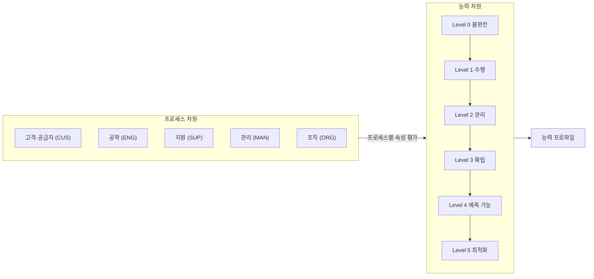

# SPICE (Software Process Improvement and Capability Determination)

---

## I. 프로세스별 능력 수준 평가, SPICE의 개요

### 가. 정의

- 소프트웨어 **프로세스를 프로세스 차원과 능력 차원의 2차원으로 평가해 프로세스별 능력 수준(0~5)을 판정하고 개선을 유도**하는 국제 표준 (ISO/IEC 15504 → ISO/IEC 330xx 시리즈로 대체)

### 나. 특징

| 구분 | 내용 |
| --- | --- |
| 2차원 평가 | 무엇을 하는가(프로세스)와 얼마나 잘하는가(능력)를 분리 평가 |
| 능력 프로파일 | 조직 전체 단일 등급이 아닌 프로세스별 능력 수준 제시 |
| 이중 목적 | 자체 프로세스 개선(SPI)과 공급자 능력 판정(CD)에 모두 활용 |
| 도메인 확장 | 자동차 분야 Automotive SPICE 등 산업별 모델로 파생 |

---

## II. 평가 모델 및 구성요소

### 가. 2차원 평가 모델

- 각 프로세스에 대해 능력 수준별 프로세스 속성(PA) 달성도를 N·P·L·F 4단계로 판정해 프로세스별 능력 수준 도출 (15504-5에서는 기본·지원·조직 3개 그룹으로 재편)

### 나. 구성요소

| 구분 | 요소 | 설명 |
| --- | --- | --- |
| 프로세스 차원 | 프로세스 범주 | 고객-공급자, 공학, 지원, 관리, 조직 5개 범주 |
| 능력 차원 | Level 0 불완전 | 프로세스 목적 미달성 |
| | Level 1 수행 | 프로세스 목적 달성 (PA 1.1 프로세스 수행) |
| | Level 2 관리 | 수행 관리·작업 산출물 관리 (PA 2.1, 2.2) |
| | Level 3 확립 | 표준 프로세스 정의·전개 (PA 3.1, 3.2) |
| | Level 4 예측 가능 | 정량적 측정·통제 (PA 4.1, 4.2) |
| | Level 5 최적화 | 지속적 혁신·최적화 (PA 5.1, 5.2) |
| 평가 | 속성 판정 | N(미달성)·P(부분)·L(대부분)·F(완전) |
| 표준 체계 | ISO/IEC 330xx | 33001 개념, 33020 측정 프레임워크 등으로 15504 대체 |

---

## III. 비교 및 동향

### 가. CMMI vs SPICE

| 비교 항목 | [[CMMI]] | SPICE |
| --- | --- | --- |
| 성격 | CMMI Institute(현 ISACA) 모델 | ISO/IEC 국제 표준 |
| 평가 구조 | 단계적 표현(성숙도)·연속적 표현(능력) | 프로세스×능력 2차원 |
| 결과 | 조직 성숙도 등급 1~5 | 프로세스별 능력 프로파일 0~5 |
| 주요 활용 | 국방·SI 등 대규모 개발 조직 | 자동차(Automotive SPICE)·임베디드 공급망 평가 |

### 나. 동향

- 15504가 폐지되고 ISO/IEC 330xx 시리즈로 전환되어 SW 외 프로세스 평가까지 범용화
- 완성차 업체가 협력사에 Automotive SPICE 수준(Level 2~3)을 요구하며, 사이버보안·기능안전 프로세스와 연계 확대

---

### 🔗 연관 토픽

- **소속 도메인**: [[00_소프트웨어공학_MOC|🏗️ 소프트웨어공학]]
- **세부 분류**: `1. 소프트웨어 개발 생명주기(SDLC) & 방법론`
- **핵심 연관 토픽**:
  - [[CMMI]]
  - [[CMMI 3.0]]
  - [[SP 인증]]
  - [[ISO 26262]]
  - [[SDLC]]
