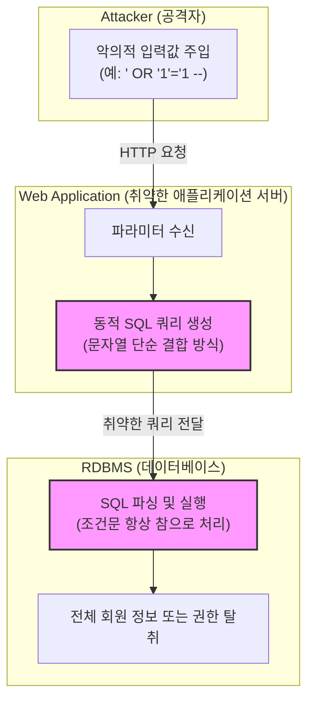

# SQL Injection (에스큐엘 인젝션)

---

## I. 웹 애플리케이션 취약점 악용을 통한 데이터베이스 무단 탈취 공격, SQL Injection의 개요

### 가. SQL Injection의 정의
- 웹 애플리케이션이 사용자 입력값을 검증 없이 동적 SQL 구문에 직접 결합할 때, 공격자가 악의적인 SQL 문장을 주입(Inject)하여 백엔드 데이터베이스를 비정상적으로 조작·탈취하는 웹 취약점 공격.

### 나. SQL Injection의 공격 영향 및 주요 특징
| 구분 | 내용 |
| --- | --- |
| 낮은 진입 장벽 | 로그인 입력 폼이나 URL 쿼리 파라미터 조작만으로 원격에서 데이터베이스 제어권 획득 가능 |
| 데이터 침해 치명성 | 인증 우회, 개인정보 대량 유출, 데이터 변조 및 테이블 삭제, 나아가 OS Command 실행까지 확장 |
| 지속적 고위험 위협 | OWASP Top 10의 인젝션(Injection) 영역에 지속 등재되는 가장 대표적인 웹 애플리케이션 취약점 |
| 근본적 방어 원칙 | 사용자 입력값을 쿼리 코드가 아닌 순수 데이터(Data)로 처리하는 Prepared Statement 적용 필수 |

---

## II. SQL Injection의 아키텍처 및 핵심 기술 요소

### 가. SQL Injection의 취약점 발생 메커니즘 및 동작 흐름

* 공격자가 인증 폼이나 URL 파라미터에 SQL 구문을 주입하면, 웹 서버가 문자열을 그대로 결합하여 SQL을 생성하고, DB가 이를 실행하면서 무단 데이터 조회가 발생함

### 나. SQL Injection의 취약점 유형 및 핵심 대응 기법

| 분류 (Category) | 요소기술 (키워드) | 세부 설명 |
| --- | --- | --- |
| **공격 유형** | In-band SQLi (Error/UNION) | 악성 쿼리의 결과나 에러 메시지가 화면에 직접 노출되어 데이터를 탈취하는 방식 |
| **공격 유형** | Inferential SQLi (Blind) | 참/거짓 응답이나 응답 지연(Time-based)을 통해 데이터를 점진적으로 유추하는 방식 |
| **공격 유형** | Out-of-band SQLi | DB 서버의 외부 네트워크 요청([[DNS(Domain Name System)\|DNS]], HTTP)을 유도하여 데이터를 빼내는 방식 |
| **방어 기법** | Prepared Statement | 사용자 입력값을 데이터(Data) 영역으로만 취급하고 코드와 분리하여 인젝션 원천 차단 |
| **방어 기법** | ORM (Hibernate / JPA) | 객체-관계 매핑 프레임워크를 활용하여 동적 SQL 문자열 결합 방지 및 파라미터 자동 바인딩 |
| **검증 기법** | Input Validation & Escaping | 허용된 입력값만 허용(Whitelist)하고, 특수문자 및 따옴표를 이스케이프(Escape) 처리 |
| **인프라 보안** | WAF (Web Application Firewall) | 웹 방화벽의 시그니처 및 패턴 매칭을 통해 악성 SQL 구문이 포함된 트래픽 사전 차단 |
| **진단 도구** | [[SAST]] / [[DAST]] | 소스코드 정적 분석(SAST) 및 동적 취약점 스캐너(DAST)를 통한 사전 진단 및 제거 |

---

## III. SQL Injection 공격 유형 비교 및 최신 보안 동향

### 가. SQL Injection 공격 유형 비교 (In-band vs Blind vs Out-of-band)

| 비교 항목 | In-band SQLi (인밴드) | Inferential / Blind SQLi (블라인드) | Out-of-band SQLi (아웃오브밴드) |
| --- | --- | --- | --- |
| **데이터 탈취 채널** | 공격에 사용한 동일한 HTTP 통신 채널 | 응답 차이(참/거짓) 또는 시간 지연(Time) | DNS 조회, HTTP 요청 등 별도의 외부 네트워크 채널 |
| **동작 메커니즘** | 에러 메시지(Error-based)나 `UNION` 구문을 통해 결과 직접 확인 | Boolean 질의 결과(Status/Content)나 `SLEEP()` 지연 기반 1비트씩 추론 | DB 엔진의 확장 프로시저를 악용해 외부 공격자 서버로 데이터 전송 유도 |
| **공격 난이도** | 낮음 (즉각적인 화면 출력 확인) | 중간~높음 (수많은 요청과 자동화 스크립트 필요) | 높음 (DB 서버의 외부 아웃바운드 통신 허용 필요) |
| **핵심 탐지 포인트** | WAF 에러 패턴 및 비정상 UNION 쿼리 탐지 | 비정상적인 대량 반복 요청 및 응답 지연 모니터링 | DB 서버로부터의 비인가 아웃바운드 DNS/HTTP 트래픽 차단 |

### 나. 최신 보안 동향 및 대응 전망
- **NoSQL 및 ORM 우회 인젝션 다변화**: MongoDB 등 비관계형 DB를 노린 NoSQL 인젝션 및 ORM 라이브러리의 원시 쿼리(Native Query) 취약점을 우회하는 공격 패턴 증가로 입력값 검증 계층 다각화.
- **DevSecOps 파이프라인 자동화**: 소프트웨어 개발 수명주기 단계에서 [[SAST]] 및 [[DAST]] 도구를 CI/CD 파이프라인에 통합하여 배포 전 SQL Injection 결함을 조기 식별 및 차단(Shift-Left).
- **WAAP 및 런타임 자율 보호(RASP) 결합**: 단순 시그니처 기반 웹 방화벽(WAF)을 넘어 웹 애플리케이션 및 API 보호([[WAAP]])와 애플리케이션 런타임 자체 보호(RASP)를 결합하여 제로데이 인젝션 실시간 차단.

---

### 🔗 연관 토픽

- **소속 도메인**: [[00_보안_MOC|🛡️ 보안]]
- **세부 분류**: `3. 네트워크 & 엔드포인트 · 인프라 보안`
- **핵심 연관 토픽**:
  - [[DAST]]
  - [[Dynamic SQL (동적 SQL)]]
  - [[SOAR (Security Orchestration, Automation and Response)]]
  - [[NoSQL (CAP 이론 BASE 속성)]]
  - [[CWE]]
