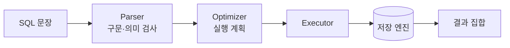

# 표준 SQL (Standard SQL) 문법

---

## I. 선언형 표준 질의 언어, SQL 문법의 개요

### 가. 정의

- 관계형 데이터베이스에서 **데이터를 정의·조작·제어하기 위한 ISO/IEC 9075 표준 선언형 언어**로, 무엇을 얻을지만 기술하고 처리 방법은 [[OPTIMIZER|옵티마이저]]가 결정

### 나. 특징

| 구분 | 내용 |
| --- | --- |
| 선언형 | How가 아닌 What 기술 |
| 집합 처리 | 행 단위가 아닌 집합(릴레이션) 단위 연산 |
| 표준 진화 | SQL-92 → SQL:1999(재귀·트리거) → SQL:2003(윈도 함수) → SQL:2016(JSON) → SQL:2023(SQL/PGQ) |
| 방언 | 벤더별 확장 문법 존재 (PL/SQL, T-SQL) |

---

## II. 처리 구조 및 문법 구성

### 가. SQL 처리 흐름

- SELECT의 논리적 처리 순서: FROM → WHERE → GROUP BY → HAVING → SELECT → ORDER BY

### 나. 문법 분류

| 구분 | 요소 | 설명 |
| --- | --- | --- |
| [[DDL]] | CREATE, ALTER, DROP, TRUNCATE | 객체 구조 정의 |
| [[DML]] | SELECT, INSERT, UPDATE, DELETE, MERGE | 데이터 조회·조작 |
| [[DCL]] | GRANT, REVOKE | 권한 부여·회수 |
| TCL | COMMIT, ROLLBACK, SAVEPOINT | 트랜잭션 제어 |
| 질의 구성 | [[조인\|JOIN]], GROUP BY, HAVING, 서브쿼리 | 결합·집계·중첩 질의 |
| 집합 연산 | UNION, INTERSECT, EXCEPT | 결과 집합 간 연산 |
| 분석 | 윈도 함수 (ROW_NUMBER, RANK, OVER) | 행을 묶지 않고 순위·누적 계산 ([[SQL 함수]]) |
| 확장 | WITH RECURSIVE, JSON_TABLE, GRAPH_TABLE·MATCH | 재귀, JSON, 속성 그래프 질의 (SQL:2023) |

---

## III. 비교 및 동향

### 가. 전통 SQL vs SQL:2023

| 비교 항목 | SQL-92 중심 | SQL:2023 |
| --- | --- | --- |
| 데이터 범위 | 정형 데이터 | 정형 + JSON + 속성 그래프 |
| 계층·그래프 | 벤더 문법(CONNECT BY), Self-Join | WITH RECURSIVE, SQL/PGQ 패턴 매칭 |
| 분석 | GROUP BY 중심 | 윈도 함수, 행 패턴 매칭 |
| JSON | 미지원 | JSON 타입·함수 표준화 |

### 나. 동향

- **벡터 검색 확장**: pgvector, Oracle 23ai 등이 벡터 타입·거리 함수를 SQL 확장으로 제공 (아직 표준 아님)
- **GQL 표준**: 그래프 전용 질의 언어 ISO/IEC 39075 GQL(2024) 제정, SQL/PGQ와 패턴 문법 공유
- **자연어 → SQL**: LLM 기반 Text-to-SQL 도구 확산

---

### 🔗 연관 토픽

- **소속 도메인**: [[00_데이터베이스_MOC|🗄️ 데이터베이스]]
- **세부 분류**: `1. 데이터 모델링 & 관계형 DB 설계`
- **핵심 연관 토픽**:
  - [[SQL(Structured Query Language)]]
  - [[DDL]]
  - [[DML]]
  - [[SQL 함수]]
  - [[OPTIMIZER|옵티마이저 (Optimizer)]]
