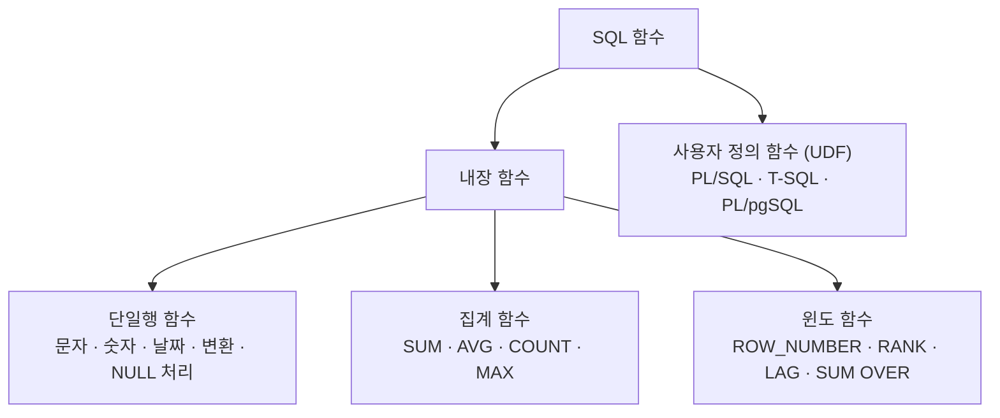

# SQL 함수 (SQL Functions)

---

## I. SQL 안에서 값을 가공하는 루틴, SQL 함수의 개요

### 가. 정의

- SQL 문 안에서 호출해 **문자·숫자·날짜 변환, 집계, 분석 연산을 수행하고 값을 반환하는 루틴** (내장 함수, 사용자 정의 함수)

### 나. 특징

| 구분 | 내용 |
| --- | --- |
| 서버 측 연산 | DB 안에서 가공해 전송량 감소 |
| 행 기준 분류 | 단일행(1:1), 다중행·집계(N:1), 윈도(N:N) |
| 재사용 | 공통 계산 규칙을 함수로 정의 |
| 주의점 | WHERE 절에서 인덱스 컬럼을 함수로 가공하면 인덱스 사용 불가 |

---

## II. 처리 구조 및 분류

### 가. 함수 분류

- 단일행 함수는 행마다, 집계 함수는 그룹마다, 윈도 함수는 행을 유지한 채 파티션 단위로 계산

### 나. 주요 함수

| 구분 | 요소 | 설명 |
| --- | --- | --- |
| 단일행 | 문자 함수 | SUBSTR, CONCAT, REPLACE, TRIM, UPPER |
| | 숫자 함수 | ROUND, TRUNC, MOD, ABS |
| | 날짜 함수 | SYSDATE·CURRENT_TIMESTAMP, ADD_MONTHS, EXTRACT |
| | 변환 함수 | CAST, TO_CHAR, TO_DATE |
| | NULL 처리 | COALESCE, NULLIF, NVL |
| 다중행 | 집계 함수 | SUM, AVG, COUNT, MIN, MAX (GROUP BY와 사용, NULL 제외) |
| | 그룹 확장 | ROLLUP, CUBE, GROUPING SETS |
| | 윈도 함수 | 순위(RANK, DENSE_RANK), 누적·이동 집계, LAG·LEAD |
| 확장 | UDF | 업무 규칙을 [[절차형 SQL]]로 구현한 함수 |
| | JSON·벡터 함수 | JSON_VALUE, JSON_TABLE, 벡터 거리 함수 (DBMS별) |

---

## III. 비교 및 동향

### 가. 내장 함수 vs 사용자 정의 함수

| 비교 항목 | 내장 함수 | 사용자 정의 함수 |
| --- | --- | --- |
| 제공 | DBMS 기본 제공 | 개발자 작성 |
| 성능 | 엔진 최적화로 빠름 | 호출마다 문맥 전환, 대량 행에서 느릴 수 있음 |
| 인덱스 | 컬럼 가공 시 일반 인덱스 무력화 → 함수 기반 인덱스로 보완 | DETERMINISTIC 선언 시 함수 기반 인덱스·캐시 가능 |
| 유연성 | 정해진 기능 | 복잡한 업무 로직 구현 |

### 나. 동향

- **인-DB AI 함수**: BigQuery ML, Snowflake Cortex처럼 SQL 함수 호출로 ML·LLM 추론 수행
- **벡터 함수 확산**: pgvector 거리 연산자, Oracle VECTOR_DISTANCE 등 유사도 계산을 SQL에서 직접 수행
- **UDF 인라인화**: SQL Server 2019 Scalar UDF Inlining 등 UDF를 질의에 펼쳐 성능 개선

---

### 🔗 연관 토픽

- **소속 도메인**: [[00_데이터베이스_MOC|🗄️ 데이터베이스]]
- **세부 분류**: `3. 장애 회복 기법 & 데이터 무결성`
- **핵심 연관 토픽**:
  - [[SQL 문법]]
  - [[절차형 SQL]]
  - [[SQL(Structured Query Language)]]
  - [[RDBMS 인덱스(index)]]
  - [[DML]]
