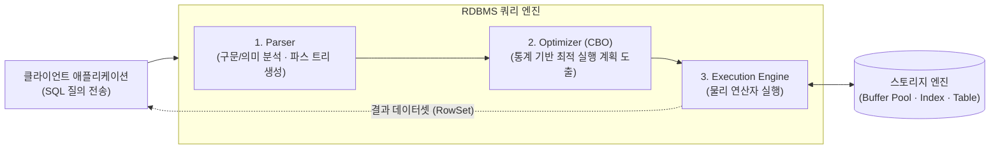

# SQL (Structured Query Language)

---

## I. 관계형 데이터베이스의 표준 질의 언어, SQL의 개요

### 가. 정의

- 관계형 데이터베이스 관리 시스템(RDBMS)에서 **데이터의 구조 정의(DDL), 조작(DML), 제어(DCL) 및 분석을 비절차적으로 기술하는 ISO/IEC 국제 표준(최신 SQL:2023) 선언형 질의 언어**

### 나. 특징 및 필요성

| 구분 | 내용 |
| --- | --- |
| 선언적 언어 | 데이터 처리 절차(How)가 아닌 추출할 결과(What)만 기술하여 직관적 개발 가능 |
| 벤더 독립성 | ANSI/ISO 표준 문법을 기반으로 오라클, MySQL, PostgreSQL 등 다양한 RDBMS 간 호환성 확보 |
| 풍부한 연산 체계 | 단순 CRUD를 넘어 조인(JOIN), 서브쿼리, 윈도우 함수, 계층형 쿼리 등 고난도 연산 제공 |
| 멀티모달 확장 | 최신 SQL:2023 표준을 통해 정형 데이터 외에 비정형 JSON 및 속성 그래프(SQL/PGQ) 네이티브 지원 |

---

## II. 개념도 및 핵심 구성요소

### 가. 개념도 (질의 처리 흐름)

- 파서가 SQL 문법을 검증하고 파스 트리를 생성하면, 비용 기반 옵티마이저(CBO)가 최소 비용의 실행 계획을 수립하고 실행 엔진이 스토리지 엔진에 접근하여 결과 추출

### 나. 핵심 기술 요소 및 하위 언어 분류

| 구분 | 요소 | 설명 |
| --- | --- | --- |
| DDL (데이터 정의) | `CREATE`, `ALTER`, `DROP` | 테이블, 뷰, 인덱스, 제약조건 등 스키마 객체 구조를 생성·수정·삭제 |
| | `TRUNCATE` | 테이블 내 모든 행을 빠르게 비우고 저장 공간을 반환 (Rollback 불가) |
| DML (데이터 조작) | `SELECT`, `INSERT`, `UPDATE`, `DELETE` | 테이블 내 데이터를 조회하고 행(Row) 단위로 추가·갱신·삭제 |
| | `MERGE` (Upsert) | 조건에 따라 데이터가 존재하면 UPDATE, 없으면 INSERT를 원자적으로 수행 |
| DCL / TCL | `GRANT`, `REVOKE` | 사용자 및 역할에 데이터 접근 권한을 부여하거나 회수 (DCL) |
| | `COMMIT`, `ROLLBACK` | 트랜잭션의 작업 변경 사항을 영구 반영하거나 취소 (TCL) |
| 분석 함수 | Window Function (`OVER`) | 행의 집약(Collapse) 없이 파티션별 순위(`ROW_NUMBER`), 누적 합, 이동 평균 산출 |
| 고급 확장 | 재귀 CTE (`WITH RECURSIVE`) | 조직도, 부품 계층(BOM) 등 트리 구조 데이터를 표준 문법으로 순환 탐색 |
| | JSON 연산 (`JSON_TABLE`) | 관계형 컬럼 내부의 비정형 JSON 문서를 정규 테이블 형태로 변환 및 질의 |
| | SQL/PGQ (속성 그래프) | SQL:2023에 표준화된 문법으로 테이블 간의 관계를 그래프 패턴(`MATCH`)으로 질의 |

---

## III. 표준 진화 비교 및 동향

### 가. 전통적 SQL vs 최신 SQL:2023

| 비교 항목 | 전통적 SQL (SQL-92 / SQL:1999) | 최신 표준 SQL:2023 |
| --- | --- | --- |
| 주 처리 데이터 | 정형 릴레이션 데이터 중심 | 정형 릴레이션 + JSON 비정형 + 속성 그래프(Graph) |
| 그래프 탐색 | 다중 Self-Join 또는 비표준 구문(Connect By) 의존 | `SQL/PGQ` 도입으로 복합 경로 패턴 매칭 직접 표현 |
| 비정형 데이터 처리 | 텍스트 컬럼에 문자열로 보관 및 외부 파싱 | JSON 데이터 타입 및 생성·조회 함수 네이티브 지원 |
| 분석 및 집계 | 단순 GROUP BY 및 기본 통계 함수 | 다양한 Window 함수 및 다차원 집계(CUBE, ROLLUP) |
| 벡터 연산 대응 | 미지원 | 고차원 임베딩 벡터 간 유사도 거리 연산 함수 확장 표준화 진행 |

### 나. 동향

- **인공지능 기반 자율 옵티마이저(Learned Optimizer)**: 전통적 CBO 통계 정보의 한계를 극복하기 위해 딥러닝/강화학습을 결합하여 복잡 조인 순서를 최적화하는 엔진 탑재
- **벡터 데이터베이스(Vector DB) 네이티브 통합**: LLM 및 RAG 응용 확산에 따라 pgvector 등 RDBMS 확장을 통해 SQL 내에서 코사인 유사도·L2 거리 검색을 기본 쿼리로 지원
- **HTAP(Hybrid Transaction/Analytical Processing)**: 동일 RDBMS 인프라 내에서 OLTP 트랜잭션과 OLAP 대용량 분석 쿼리를 실시간으로 동시 처리하는 분산 SQL 엔진 확산

---

### 🔗 연관 토픽

- **소속 도메인**: [[00_데이터베이스_MOC|🗄️ 데이터베이스]]
- **세부 분류**: `6. SQL 표준 문법 & 쿼리 성능 튜닝`
- **핵심 연관 토픽**:
  - [[OPTIMIZER|옵티마이저 (Optimizer)]]
  - [[DML]]
  - [[DDL]]
  - [[DCL]]
  - [[RDBMS 인덱스(index)|인덱스]]
