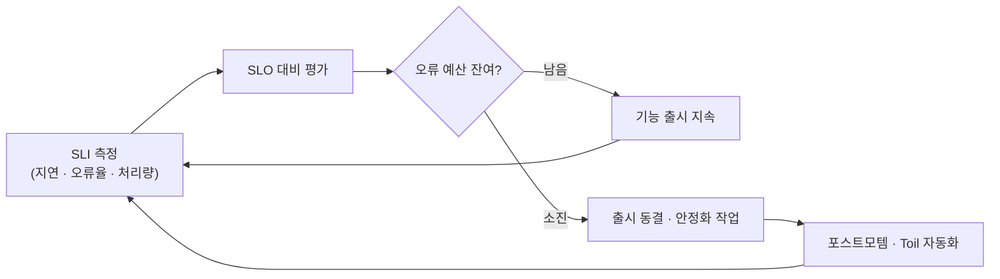

# SRE (Site Reliability Engineering)

---

## I. 운영을 소프트웨어 문제로 다루기, SRE의 개요

### 가. 정의

- **소프트웨어 엔지니어링 방법으로 운영 문제를 해결**하여, SLO와 오류 예산으로 배포 속도와 [[신뢰성]]의 균형을 관리하는 운영 방식 (Google, 2003)

### 나. 특징

| 구분 | 내용 |
| --- | --- |
| 등장 배경 | 대규모 분산 시스템·[[MSA (Micro Service Architecture)\|MSA]]에서 수작업 운영의 한계 |
| 속도와 안정 균형 | 오류 예산을 기준으로 출시 속도 조절 |
| 자동화 | 반복 수작업(Toil)을 업무 시간 50% 이하로 제한, 자동화로 대체 |
| 학습 문화 | 비난 없는 포스트모템으로 구조적 원인 개선 |

---

## II. 운영 루프 및 구성요소

### 가. SLO 기반 운영 루프

- SLI로 측정한 서비스 수준을 SLO와 비교해 오류 예산이 남으면 출시를 계속하고, 소진되면 안정화에 집중

### 나. 구성요소

| 구분 | 요소 | 설명 |
| --- | --- | --- |
| 지표 | SLI | 서비스 수준을 나타내는 측정 지표 (가용률, 지연, 오류율) |
| | SLO | SLI의 내부 목표치 (예: 월 가용률 99.9%) |
| | [[SLA\|SLA]] | 고객과의 계약, 미달 시 보상 (보통 SLO보다 느슨) |
| 위험 관리 | 오류 예산 | 1 − SLO 만큼 허용되는 불안정 (99.9%면 월 약 43분) |
| 모니터링 | 4대 황금 신호 | 지연(Latency)·트래픽·오류·포화도(Saturation) |
| | 관측성 | 로그·메트릭·트레이스 통합 분석 |
| 운영 효율 | Toil 제거 | 수동·반복·자동화 가능·가치 없는 작업 축소 |
| 장애 대응 | 인시던트 관리 · 포스트모템 | 역할 기반 대응, 비난 없는 사후 분석과 재발 방지 |

---

## III. 비교 및 동향

### 가. SLI vs SLO vs SLA

| 비교 항목 | SLI | SLO | SLA |
| --- | --- | --- | --- |
| 성격 | 측정값 | 내부 목표 | 외부 계약 |
| 예 | 성공 요청 비율 | 99.9% / 30일 | 99.5% 미달 시 요금 감면 |
| 주체 | SRE·개발팀 | SRE·제품팀 합의 | 사업·법무 |
| 위반 시 | - | 오류 예산 소진, 출시 동결 | 금전적 보상 |

### 나. 동향

- 생성형 AI로 인시던트 요약·원인 분석·런북 실행을 보조하는 AIOps
- SRE 역량을 내부 개발자 플랫폼(IDP)으로 제공하는 플랫폼 엔지니어링과 결합
- 신뢰성 목표와 클라우드 비용을 함께 최적화하는 FinOps 연계

---

### 🔗 연관 토픽

- **소속 도메인**: [[00_소프트웨어공학_MOC|🏗️ 소프트웨어공학]]
- **세부 분류**: `2. 애자일(Agile) & 지속적 통합/배포(CI/CD)`
- **핵심 연관 토픽**:
  - [[DevOps|데브옵스 (DevOps)]]
  - [[SLA|SLA (Service Level Agreement)]]
  - [[서비스 수준 관리|서비스 수준 관리 (SLM Service Level Management)]]
  - [[카오스 엔지니어링]]
  - [[신뢰성]]
