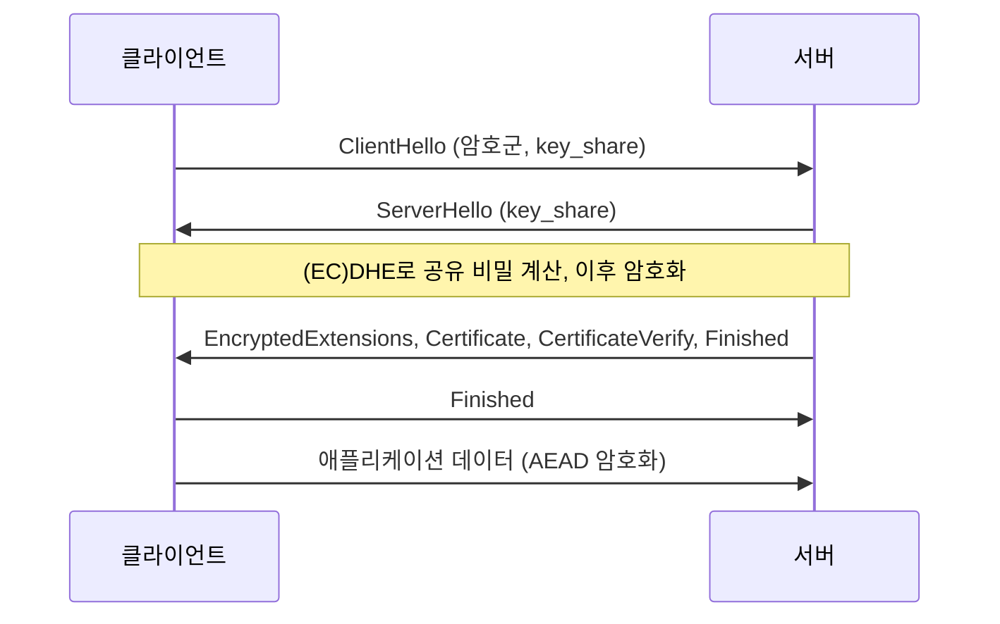

# SSL/TLS (Secure Sockets Layer / Transport Layer Security)

---

## I. 인터넷 통신의 기본 보호막, SSL/TLS의 개요

### 가. 정의

- TCP 위에서 **서버(선택적으로 클라이언트) 인증, 키 합의, 데이터 암호화·무결성**을 제공하는 전송 계층 보안 [[프로토콜]] (SSL은 폐기, 현재 TLS 1.2·1.3 사용)

### 나. 특징

| 구분 | 내용 |
| --- | --- |
| 보안 서비스 | [[기밀성]], [[무결성]], 서버 인증(mTLS 시 상호 인증) |
| 애플리케이션 독립 | HTTPS, SMTPS, IMAPS 등 다양한 프로토콜에 적용 |
| 버전 정리 | SSL 2.0·3.0, TLS 1.0·1.1 폐기 (RFC 8996) |
| TLS 1.3 | 1-RTT 핸드셰이크, AEAD·전방 비밀성 필수 (RFC 8446) |

---

## II. 구조 및 구성요소

### 가. TLS 1.3 핸드셰이크

- ClientHello에 키 공유 값을 미리 보내 1-RTT에 키 합의를 마치고, 서버 인증서부터 암호화된 상태로 전송

### 나. 구성요소

| 구분 | 요소 | 설명 |
| --- | --- | --- |
| 하위 프로토콜 | Handshake | 협상, 키 합의, 인증 |
| | Record | 메시지 분할·AEAD 암호화 (1.3에서 압축 제거) |
| | Alert | 오류·종료 통보 |
| 키 합의 | [[ECDHE]] | 세션마다 임시 키로 전방 비밀성(PFS) 보장 |
| 데이터 암호 | AES-GCM, ChaCha20-Poly1305 | 1.3은 AEAD만 허용 |
| 인증 | X.509 인증서·PKI | CA 서명으로 서버 공개키 보증 (RSA·ECDSA·EdDSA) |
| 키 유도 | HKDF | HMAC 기반 키 스케줄 |
| 연결 재개 | PSK·0-RTT | 재접속 시 지연 감소, 0-RTT 데이터는 재전송 공격 위험 |
| 프라이버시 | ECH | ClientHello의 SNI 등을 암호화 (IETF 확장) |

---

## III. 비교 및 동향

### 가. TLS 1.2 vs TLS 1.3

| 비교 항목 | TLS 1.2 | TLS 1.3 |
| --- | --- | --- |
| 핸드셰이크 | 2-RTT | 1-RTT (재개 시 0-RTT) |
| 키 교환 | RSA 키 전송 또는 (EC)DHE | (EC)DHE·PSK만 (RSA 키 전송 제거) |
| 암호군 | CBC·RC4 등 레거시 포함 가능 | AEAD 5종만 |
| 전방 비밀성 | 선택 | 기본 |
| 인증서 노출 | 평문 전송 | 암호화 전송 |

### 나. 동향

- **PQC 하이브리드 키 교환**: X25519MLKEM768이 주요 브라우저·CDN에 기본 적용
- **인증서 수명 단축**: CA/B 포럼 결정으로 공개 TLS 인증서 최대 유효기간을 단계적으로 47일까지 단축, ACME 자동 갱신 필수화
- **내부 구간 mTLS**: 서비스 메시로 마이크로서비스 간 상호 인증·암호화 ([[제로 트러스트 보안모델|제로 트러스트]])

---

### 🔗 연관 토픽

- **소속 도메인**: [[00_보안_MOC|🛡️ 보안]]
- **세부 분류**: `1. 정보보안 원칙 & 거버넌스 · 인증`
- **핵심 연관 토픽**:
  - [[ECDHE]]
  - [[전송 계층]]
  - [[IP Sec]]
  - [[RSA (Rivest Shamir Adleman)]]
  - [[VPN|VPN(Virtual Private Network)]]
