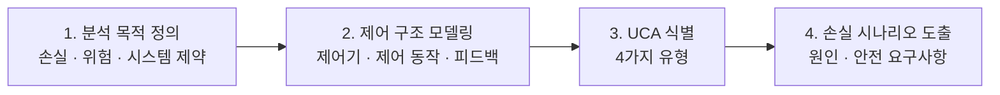

# STPA (System-Theoretic Process Analysis)

---

## I. 고장이 아닌 제어의 실패를 보는 안전 분석, STPA의 개요

### 가. 정의

- 사고를 부품 고장이 아니라 **안전 제약을 강제하지 못한 제어의 실패로 보고, 제어 구조에서 부적절한 제어 동작(UCA)과 그 원인 시나리오를 찾는** 시스템 이론 기반 위험 분석 기법 (N. Leveson, MIT, STAMP 모델 기반)

### 나. 특징

| 구분 | 내용 |
| --- | --- |
| 등장 배경 | SW·인간·복잡한 상호작용으로 인한 사고는 고장 없이도 발생 |
| 시스템 관점 | 계층적 제어 구조와 피드백 루프를 분석 대상으로 함 |
| 적용 시점 | 상세 설계 전 개념 단계부터 적용 가능 |
| 적용 분야 | 자율주행([[Smart Car(자율주행)\|자율주행]], SOTIF), 항공우주, 의료, AI 시스템 |

---

## II. 분석 절차 및 구성요소

### 가. 4단계 분석 절차 (STPA Handbook, 2018)

- 손실과 위험을 정의하고 제어 구조를 그린 뒤, 각 제어 동작의 부적절한 형태(UCA)와 그것이 발생하는 시나리오를 찾아 안전 요구사항으로 전환

### 나. 구성요소

| 구분 | 요소 | 설명 |
| --- | --- | --- |
| 기반 모델 | STAMP | 사고를 제약 위반과 제어 실패로 설명하는 사고 모델 |
| 정의 | 손실 · 위험 · 제약 | 막아야 할 손실, 손실로 이어지는 시스템 상태, 이를 막는 제약 |
| 모델링 | 계층적 제어 구조 | 제어기·제어 동작·피드백·피제어 프로세스 관계 |
| | 프로세스 모델 | 제어기가 가진 피제어 대상의 상태 인식 (어긋나면 UCA 유발) |
| UCA 유형 | 미제공 | 필요한 제어 동작을 하지 않아 위험 |
| | 제공 | 제어 동작을 해서 위험 |
| | 시점 · 순서 오류 | 너무 이르거나 늦거나 순서가 잘못됨 |
| | 지속 시간 오류 | 너무 일찍 멈추거나 너무 오래 적용 |
| 결과 | 손실 시나리오 | 잘못된 피드백, 프로세스 모델 결함 등 UCA 발생 원인 |

---

## III. 비교 및 동향

### 가. 전통적 기법 vs STPA

| 비교 항목 | [[FTA (Fault Tree Analysis)\|FTA]] · [[FMEA (Failure Mode and Effects Analysis)\|FMEA]] | STPA |
| --- | --- | --- |
| 사고 관점 | 부품 고장의 연쇄 | 제어 실패·안전 제약 위반 |
| SW · 인간 | 고장률 정의가 어려워 반영 한계 | 제어기로 모델링해 포함 |
| 분석 단위 | 부품·고장 모드 | 제어 루프·상호작용 |
| 정량화 | 고장 확률 산출 가능 | 정성 분석 중심 |

### 나. 동향

- ISO 21448(SOTIF) 등에서 기능 부족·오사용 위험 분석 기법으로 활용
- 보안까지 다루는 STPA-Sec, AI·자율 시스템 안전 분석으로 확장
- STPA 결과를 모델 기반 테스트 케이스와 런타임 감시 규칙으로 연계

---

### 🔗 연관 토픽

- **소속 도메인**: [[00_소프트웨어공학_MOC|🏗️ 소프트웨어공학]]
- **세부 분류**: `2. 애자일(Agile) & 지속적 통합/배포(CI/CD)`
- **핵심 연관 토픽**:
  - [[FMEA (Failure Mode and Effects Analysis)]]
  - [[FTA (Fault Tree Analysis)]]
  - [[HAZOP (Hazard and Operability Study)]]
  - [[기능안전 표준|기능안전 표준 (Functional Safety Standards)]]
  - [[SW 안전성(SW Safety) 및 분석 개념]]
