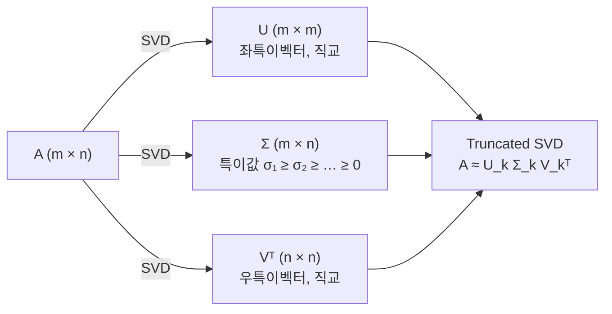

# SVD (Singular Value Decomposition, 특이값 분해)

---

## I. 모든 행렬을 세 행렬로 나누는, SVD의 개요

### 가. 정의

- 임의의 $m \times n$ 실수 행렬을 **$A = U\Sigma V^T$(직교 행렬 × 특이값 대각 행렬 × 직교 행렬)로 분해**하는 선형대수 기법

### 나. 특징

| 구분 | 내용 |
| --- | --- |
| 범용성 | 고유값 분해와 달리 정사각이 아닌 행렬에도 항상 존재 |
| 저랭크 근사 | 상위 $k$개 특이값만 남긴 $A_k$가 프로베니우스 노름 기준 최적 근사 (Eckart-Young 정리) |
| 기하학적 의미 | 회전($V^T$) → 축별 늘림($\Sigma$) → 회전($U$) |
| 수치 안정성 | 특이·비정사각 행렬에서도 안정적, 의사역행렬 계산에 사용 |
| 활용 | [[PCA(Principal Component Analysis)\|PCA]], 추천 시스템, LSA, 이미지 압축, 모델 압축 |

---

## II. 분해 구조 및 구성요소

### 가. 분해 구조

- 특이값이 큰 순서로 상위 $k$개 성분만 남기면 정보 손실을 최소화한 저랭크 근사

### 나. 구성요소

| 구분 | 요소 | 설명 |
| --- | --- | --- |
| 분해 | $U$ (좌특이벡터) | $AA^T$의 고유벡터, 열 공간의 정규직교 기저 |
| | $\Sigma$ (특이값) | $A^TA$ 고유값의 제곱근, 음이 아닌 값을 내림차순 배치 |
| | $V$ (우특이벡터) | $A^TA$의 고유벡터, 행 공간의 정규직교 기저 |
| 근사 | Truncated SVD | 상위 $k$개 성분으로 압축, 노이즈 제거 |
| 연계 | PCA | 중심화한 데이터 행렬의 SVD에서 $V$가 주성분, $\sigma_i^2/(n-1)$이 분산 |
| 응용 | 잠재 의미 분석 (LSA) | 단어-문서 행렬을 분해해 잠재 주제 공간 구성 ([[TF-IDF (Term Frequency - Inverse Document Frequency)\|TF-IDF]]) |
| | 추천 시스템 | 사용자-아이템 행렬의 잠재 요인 분해 (Netflix Prize의 행렬 분해 계열) |
| | 모델 압축 | 신경망 가중치 행렬을 저랭크 분해해 파라미터 절감 |

---

## III. 비교 및 동향

### 가. 고유값 분해 vs SVD

| 비교 항목 | 고유값 분해 | SVD |
| --- | --- | --- |
| 적용 대상 | 대각화 가능한 정사각 행렬 | 모든 $m \times n$ 행렬 |
| 형태 | $A = Q\Lambda Q^{-1}$ | $A = U\Sigma V^T$ |
| 벡터 직교성 | 대칭 행렬일 때만 직교 보장 | 좌·우특이벡터 항상 직교 |
| 값 | 고유값 (음수·복소수 가능) | 특이값 (항상 0 이상 실수) |
| 관계 | 대칭 양반정치 행렬에서는 두 분해가 일치 | |

### 나. 동향

- **대규모 근사**: Randomized SVD, 증분 SVD로 대용량·스트리밍 행렬을 빠르게 분해
- **LLM 효율화**: [[LoRA(Low-rank adaptation)|LoRA]]의 저랭크 가정과 맞닿아 있으며, 사전학습 가중치의 주요 특이 성분으로 LoRA를 초기화하는 PiSSA, SVD 기반 가중치 압축 연구 진행 ([[PEFT]])

---

### 🔗 연관 토픽

- **소속 도메인**: [[00_인공지능_MOC|🤖 인공지능]]
- **세부 분류**: `1. 수학 · 통계학 & 데이터 전처리`
- **핵심 연관 토픽**:
  - [[PCA(Principal Component Analysis)]]
  - [[차원 축소|차원 축소(Dimensionality Reduction)]]
  - [[LoRA(Low-rank adaptation)]]
  - [[TF-IDF (Term Frequency - Inverse Document Frequency)]]
  - [[PEFT|PEFT(Parameter-Efficient Fine-Tuning)]]
