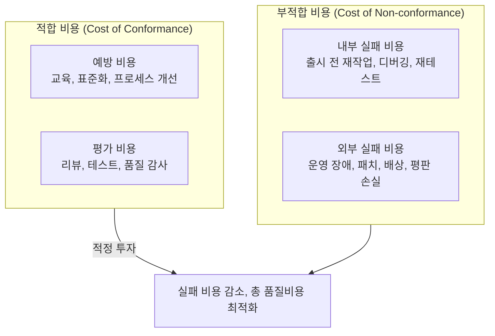

# SW 품질비용 (Software Cost of Quality, CoQ)

---

## I. 품질 투자와 결함 손실의 균형, SW 품질비용의 개요

### 가. 정의

- SW 품질 확보를 위해 투입하는 **적합 비용(예방·평가)** 과 품질 미달로 발생하는 **부적합 비용(내부·외부 실패)** 을 합한 총비용 (PAF 모델, Feigenbaum·Juran)

### 나. 특징

| 구분 | 내용 |
| --- | --- |
| PAF 분류 | 예방(Prevention)·평가(Appraisal)·실패(Failure) 비용 |
| 결함 비용 증가 | 늦게 발견할수록 수정 비용 급증, 조기 발견(Shift-Left) 중요 |
| 투자 판단 | 예방·평가 투자 대비 실패 비용 감소 효과로 품질 활동의 경제성 판단 |
| 숨은 비용 | 외부 실패 비용은 평판 손실 등 측정 어려운 비용 포함 |

---

## II. 구조와 구성요소

### 가. PAF 모델

- 예방·평가에 적절히 투자해 내부·외부 실패 비용을 줄이고 총 품질비용을 최소화

### 나. 구성요소

| 구분 | 요소 | 설명 |
| --- | --- | --- |
| 예방 비용 | 프로세스 표준화 | [[CMMI]], SP 등 프로세스 수립·개선 |
| | 교육·훈련 | 코딩 표준, [[시큐어코딩]], 테스트 기법 교육 |
| 평가 비용 | 정적 검토 | 동료 검토, 인스펙션, [[정적 분석 도구]] |
| | 동적 테스트 | 단위·통합·[[시스템 테스트]], 테스트 자동화 |
| 내부 실패 비용 | 재작업 | 출시 전 발견 결함 수정, 디버깅 |
| | 재테스트 | 수정 후 회귀 테스트, 재빌드 |
| 외부 실패 비용 | 장애 대응·패치 | 운영 중 긴급 수정, 배포 |
| | 배상·평판 | 고객 클레임, [[SLA]] 위약금, 신뢰 하락 |

---

## III. 비교 및 동향

### 가. 품질비용 관점 비교

| 비교 항목 | 전통적 모델 (Juran) | 현대적 모델 (무결점 지향) |
| --- | --- | --- |
| 최적점 | 적합 비용과 실패 비용이 교차하는 최적 품질 수준 존재 | 적합도 100%에 가까울수록 총비용 감소 |
| 예방 투자 | 일정 수준 이상은 비경제적 | 예방이 가장 경제적 (Crosby, "품질은 무료") |
| 운영 방식 | 검사 중심 | 프로세스 개선·자동화 중심 |

| 비교 항목 | 적합 비용 중심 운영 | 실패 비용 방치 |
| --- | --- | --- |
| 비용 흐름 | 초기 단계 비용 증가 | 운영 단계 비용 급증 |
| 결함 | 요구·설계 단계에서 차단 | 운영 환경 장애 확산 |
| 조직 | 예측 가능한 납기, 성숙도 향상 | 소방수식 대응 반복, [[기술 부채]] 누적 |

### 나. 동향

- **자동화로 평가 비용 절감**: CI 파이프라인의 정적 분석·자동 테스트로 평가 비용 단가 감소
- **AI 활용**: 결함 예측으로 테스트 자원을 위험 모듈에 집중 ([[위험 기반 테스트]])

---

### 🔗 연관 토픽

- **소속 도메인**: [[00_프로젝트관리_MOC|📋 프로젝트관리]]
- **세부 분류**: `3. 소프트웨어 원가 산정 & 성과 관리 (Cost & EVM)`
- **핵심 연관 토픽**:
  - [[품질관리]]
  - [[프로젝트 품질관리|프로젝트 품질관리 (Project Quality Management)]]
  - [[기술 부채]]
  - [[SDLC]]
  - [[CMMI]]
