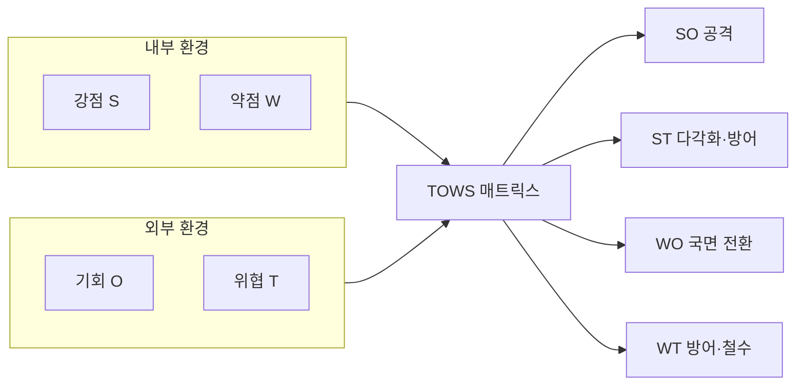

# SWOT분석

---

## I. 내부 역량과 외부 환경을 교차하는, SWOT 분석의 개요

### 가. 정의

- 내부 요인인 **강점(S)·약점(W)** 과 외부 요인인 **기회(O)·위협(T)** 을 식별하고, 이를 교차(TOWS 매트릭스)해 전략 대안을 도출하는 [[환경분석]] 기법

### 나. 특징

| 구분 | 내용 |
| --- | --- |
| 내·외부 통합 | 내부 역량과 외부 환경을 한 매트릭스에서 비교 |
| 교차 전략 | SO·ST·WO·WT 4가지 전략 도출 (TOWS, H. Weihrich 1982) |
| 선행 분석 활용 | 외부 요인은 [[PEST 분석]]·5 Forces, 내부 요인은 [[가치사슬]]·VRIO 결과 활용 |
| 한계 | 요인 선정이 주관적이고 우선순위·가중치가 없음 |

---

## II. SWOT 분석의 구조 및 구성요소

### 가. SWOT → TOWS 흐름

- 내·외부 요인을 짝지어 교차 전략을 만들고, 전략별 실행 과제와 우선순위로 구체화

### 나. 구성요소

| 구분 | 요소 | 설명 |
| --- | --- | --- |
| 내부 요인 | 강점 (Strengths) | 경쟁사 대비 우위 역량·자원 (기술력, 브랜드) |
| | 약점 (Weaknesses) | 내부 취약점 (자원 부족, [[기술 부채]]) |
| 외부 요인 | 기회 (Opportunities) | 유리한 환경 변화 (시장 성장, 신기술, 규제 완화) |
| | 위협 (Threats) | 불리한 환경 변화 (규제 강화, 경쟁 심화, 경기 침체) |
| 교차 전략 | SO (Maxi-Maxi) | 강점으로 기회를 극대화하는 공격 전략 |
| | ST (Maxi-Mini) | 강점으로 위협을 줄이는 다각화·방어 전략 |
| | WO (Mini-Maxi) | 약점을 보완해 기회를 살리는 국면 전환 전략 |
| | WT (Mini-Mini) | 약점·위협을 최소화하는 방어·축소·철수 전략 |

---

## III. 전통적 SWOT vs 데이터 기반 SWOT 및 동향

### 가. 비교

| 구분 | 전통적 SWOT | 데이터 기반 SWOT |
| --- | --- | --- |
| 요인 수집 | 워크숍, 전문가 의견 | 시장·경쟁사·고객 데이터 분석 |
| 주기 | 일회성 (연간 계획) | 주기적 갱신 |
| 객관성 | 주관·[[편향]] 개입 가능 | 근거 데이터 제시, 요인별 가중치 부여 |

### 나. 동향

- **정량화 보완**: 요인별 가중치·점수를 부여하는 IFE/EFE 매트릭스, AHP와 결합해 우선순위 설정
- **생성형 AI 활용**: 시장 보고서·뉴스를 요약해 SWOT 초안 작성, 최종 판단은 근거 검증 후 사람이 수행
- **ISP 연계**: 정보화 전략 수립 시 환경분석 결과를 SWOT로 종합해 정보화 과제 도출 ([[ISP (Information Strategy Plan)]])

---

### 🔗 연관 토픽

- **소속 도메인**: [[00_경영전략_MOC|📈 경영전략]]
- **세부 분류**: `1. 경영 환경 분석 & 전략 수립 프레임워크`
- **핵심 연관 토픽**:
  - [[환경분석]]
  - [[PEST 분석]]
  - [[3C 4C 분석|3C/4C 분석]]
  - [[ISP (Information Strategy Plan)]]
  - [[기술 부채]]
