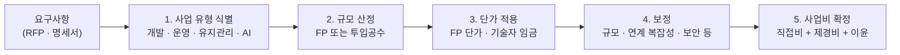

# SW사업 대가산정 가이드 ('25년 개정판 포함)

---

## I. 공공 SW사업의 적정 대가 산정 기준, SW사업 대가산정 가이드의 개요

### 가. 정의

- 공공부문이 SW사업의 **예산 수립·발주·계약 시 적정 대가를 산정하도록** 한국소프트웨어산업협회(KOSA)가 「소프트웨어 진흥법」에 근거해 공표하는 산정 기준

### 나. 목적 및 특징

| 구분 | 내용 |
| --- | --- |
| 목적 | 적정 대가 지급, 저가 발주·불합리한 과업 변경 방지, SW 산업 생태계 건전화 |
| 규모 기반 | 개발비는 기능점수(FP) 중심, 그 외 영역은 투입공수(M/M) 방식 |
| 단가 공표 | FP 단가와 SW 기술자 평균임금을 매년 공표 |
| 신기술 반영 | AI 도입, 개발·운영 통합 등 변화된 사업 유형을 개정판에 반영 |

---

## II. 산정 절차 및 구성 요소

### 가. 산정 절차

### 나. 구성 요소

| 구분 | 요소 | 설명 |
| --- | --- | --- |
| 개발비 | 기능점수 ([[Function Point]]) | 사용자 관점 기능 규모를 계량화, 개발비 = FP × FP 단가 × 보정계수 |
| | FP 단가 | KOSA 매년 공표 (예: 605,784원/FP) |
| 투입공수 | M/M 방식 | 컨설팅([[ISP (Information Strategy Plan)\|ISP]]·ITA), PMO, 운영 등 FP 적용이 어려운 사업 |
| | SW 기술자 평균임금 | 직무별(IT 아키텍트, 응용SW 개발자 등) 월·일 평균 임금 |
| 운영·유지관리 | 유지관리 · 운영비 | 개발비 대비 요율 또는 투입공수 방식, 일상운영 업무 정의 |
| 간접비 | 제경비 · 기술료 · 이윤 | 직접인건비 대비 비율로 간접 비용과 이윤 반영 |
| 계약 관리 | 과업 변경 조정 | 발주기관 요구 변경 시 과업 변경 심의와 계약금액 조정 절차 |

### 다. '25년 개정 주요 내용

| 구분 | 개정 내용 | 설명 |
| --- | --- | --- |
| AI 도입 사업 | 커스터마이징 작업비용 | 기존 '전문작업비'를 개칭하고 AI 솔루션 도입 시 데이터 정제·라벨링, 모델 조정, [[프롬프트 엔지니어링]] 등 특화 작업 항목 구체화 |
| 통합 사업 | SW 개발·운영 통합 사업 가이드 | 애자일·[[DevOps]] 환경에서 개발과 운영을 함께 발주하는 사업의 대가 산정 근거 신설 |
| 운영 사업 | 일상운영 '통합관리' 정의 | 운영 사업 내 총괄·조율 성격의 통합관리 업무 범위 명확화 |

---

## III. 비교 및 시사점

### 가. 투입공수 방식 vs 기능점수 방식

| 비교 항목 | 투입공수 (M/M) | 기능점수 (FP) |
| --- | --- | --- |
| 산정 기준 | 투입 인력 × 기간 | SW 기능 규모 (산출물 크기) |
| 생산성 반영 | 생산성이 높아도 비용 절감 반영 곤란 | 규모 기준이라 객관성 높음 |
| 적용 영역 | 컨설팅, PMO, 운영, 마이그레이션 | 신규 응용 SW 개발, 재개발 |
| 한계 | 인력 투입 과다·과소 논란 | 비기능·AI 작업 반영 한계 → 개정판에서 보완 |

### 나. 시사점

- **AX 예산의 현실화**: 생성형 AI·공공 LLM 도입 시 모호했던 비용 항목이 구체화되어 예산 수립과 계약 분쟁 소지 감소 ([[AX (AI Transformation)\|AX]])
- **발주 관행 선진화**: 개발·운영 통합 발주로 품질 책임 일원화와 지속적 개선 기반 마련, [[유지보수]] 품질 향상

---

### 🔗 연관 토픽

- **소속 도메인**: [[00_소프트웨어공학_MOC|🏗️ 소프트웨어공학]]
- **세부 분류**: `6. 소프트웨어 테스팅 & 품질 보증 (QA/QC)`
- **핵심 연관 토픽**:
  - [[Function Point]]
  - [[유지보수]]
  - [[ISP (Information Strategy Plan)|ISP]]
  - [[DevOps]]
  - [[프롬프트 엔지니어링]]
