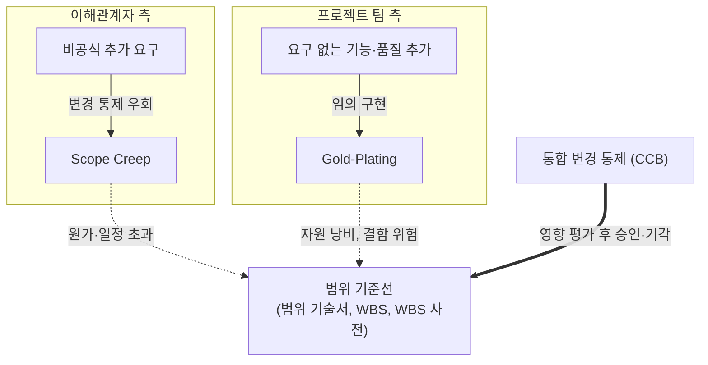

# Scope Creep vs Gold-Plating

---

## I. 통제되지 않은 범위 확장, Scope Creep과 Gold-Plating의 개요

### 가. 정의

- **Scope Creep (범위 팽창)**: 일정·원가·자원 조정 없이 제품·프로젝트 범위가 **통제되지 않은 채 확장**되는 현상, 주로 이해관계자의 비공식 추가 요구에서 발생
- **Gold-Plating (금도금)**: 프로젝트 팀이 **요구되지 않은 기능·품질을 임의로 추가**하는 현상

### 나. 특징

| 구분 | 내용 |
| --- | --- |
| 공통점 | 승인된 범위 기준선을 벗어나 통합 변경 통제를 우회 |
| 영향 | 일정 지연, 원가 초과, 검증되지 않은 기능에 따른 결함·유지보수 부담 |
| 오해 | 고객 만족을 위한 서비스로 여겨지나 PMBOK은 둘 다 피해야 할 행위로 봄 |
| 근본 원인 | 불명확한 범위 정의, 변경 통제 부재, 이해관계자 관리 미흡 |

---

## II. 발생 구조와 통제 수단

### 가. 개념도

- 모든 범위 변경은 변경 요청 → 영향 분석 → CCB 승인 → 기준선 갱신 순서를 거쳐야 함

### 나. 통제 수단

| 구분 | 요소 | 설명 |
| --- | --- | --- |
| 범위 정의 | 범위 기술서 | 포함 범위와 제외 범위(Out-of-Scope)를 명시 |
| | [[WBS]] 100% 규칙 | WBS에 없는 작업은 범위가 아님을 합의 |
| 추적 | 요구사항 추적 매트릭스 (RTM) | 설계·구현·테스트 산출물을 요구사항과 연결해 근거 없는 기능 식별 |
| 통제 | 통합 변경 통제 | 변경 요청서(CR), 영향 분석, CCB 승인 후 기준선 수정 |
| | 범위 확인·통제 | 인도물 공식 인수, 기준선 대비 편차 감시 |
| 검토 | 코드 리뷰, QA | 요구되지 않은 구현을 조기에 발견 |

---

## III. 비교 및 동향

### 가. Scope Creep vs Gold-Plating

| 비교 항목 | Scope Creep | Gold-Plating |
| --- | --- | --- |
| 주 발생 주체 | 고객, 스폰서 등 이해관계자 | 프로젝트 팀, 개발자 |
| 원인 | 요구사항 불명확, 변경 통제 부재, PM의 거절 실패 | 기술적 과시, 고객을 기쁘게 하려는 과잉 의욕 |
| 고객 관점 | 원했던 기능이나 대가 조정이 없음 | 요청하지 않은 기능 |
| 위험 | 일정·예산 초과, 핵심 기능 품질 저하 | 자원 낭비, 테스트 부족 기능의 결함 |
| PM 대응 | 공식 변경 요청 유도, 일정·원가 재협상 | 즉시 중단, 범위 내 작업에 자원 재배치 |
| 예방 도구 | RTM, WBS, 이해관계자 관리 | QA, 코드 리뷰, 완료 정의 |

### 나. 동향

- **애자일의 접근**: 변경을 제품 백로그로 흡수하고 PO가 우선순위로 조정해 Scope Creep을 투명한 범위 교환으로 전환
- **공공 SW 사업**: 과업 변경 시 과업심의위원회를 거쳐 계약 금액·기간을 조정하도록 제도화 ([[공공소프트웨어사업 과업심의 가이드]])

---

### 🔗 연관 토픽

- **소속 도메인**: [[00_프로젝트관리_MOC|📋 프로젝트관리]]
- **세부 분류**: `1. PMBOK 표준 & 프로젝트 거버넌스`
- **핵심 연관 토픽**:
  - [[범위관리]]
  - [[WBS|WBS (Work Breakdown Structure)]]
  - [[요구사항 명세서|요구사항 명세서 SRS]]
  - [[공공소프트웨어사업 과업심의 가이드]]
  - [[형상 관리]]
