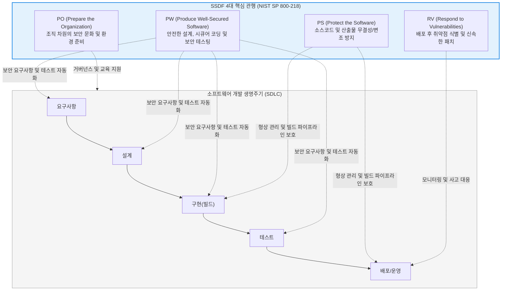

# SSDF (Secure Software Development Framework)

---

## I. 소프트웨어 공급망 보안의 글로벌 표준, SSDF의 개요

### 가. SSDF의 정의
- 소프트웨어 개발 생명주기([[SDLC]]) 전반에 걸쳐 취약점을 최소화하고 공급망 공격을 예방하기 위해 미국 NIST가 제정한 안전한 소프트웨어 개발 실천 관행(SP 800-218) 프레임워크.

### 나. SSDF의 등장 배경 및 주요 특징
| 구분 | 내용 |
| --- | --- |
| 공급망 공격 급증 | SolarWinds, Log4j 사태 등 개발 및 빌드 파이프라인 변조 공격에 대응한 범정부적 보안 표준 요구 |
| 美 행정명령(EO 14028) | 연방정부에 납품되는 모든 상용 소프트웨어에 대해 보안 개발 관행 준수 및 자기 증명 의무화 |
| 방법론 독립성 | 폭포수, 애자일, [[DevSecOps]] 등 특정 개발 방법론이나 프로그래밍 언어에 종속되지 않는 범용 지침 |
| 4대 관행 그룹 | 조직 준비(PO), 소프트웨어 보호(PS), 안전한 소프트웨어 생산(PW), 취약점 대응(RV)으로 구성 |

---

## II. SSDF의 아키텍처 및 4대 핵심 관행(Practices)

### 가. SSDF 핵심 구성 요소 및 SDLC 통합 개념도

### 나. SSDF의 4가지 주요 관행 그룹 (Practices Group)

| 관행 그룹 (약어) | 세부 실천 과제 (Tasks) 및 역할 | 구현 예시 (Implementation Examples) |
| --- | --- | --- |
| **조직 준비** (PO) | 경영진의 지원 확보, 보안 역할 정의, 개발자 시큐어 코딩 교육, 안전한 개발 도구(IDE, CI/CD) 환경 구축 | 연간 시큐어 코딩 교육 의무화, 승인된 공식 패키지 저장소만 사용 설정 |
| **소프트웨어 보호** (PS) | 소스코드 접근 통제, 승인되지 않은 코드 변경 차단, 릴리스된 소프트웨어의 [[무결성]] 검증 체계 마련 | 소스코드 저장소(Git) MFA 적용, 릴리스 바이너리에 대한 코드 서명(Code Signing) 적용 |
| **안전한 소프트웨어 생산** (PW) | 보안 요구사항 도출, [[위협 모델링]] 기반 아키텍처 설계, 컴포넌트(오픈소스) 검증, 정적/동적 보안 테스트([[SAST]]/[[DAST]]) 수행 | 아키텍처 설계 시 [[STRIDE]] 위협 모델링 수행, CI/CD 파이프라인에 취약점 스캐너 연동 |
| **취약점 대응** (RV) | 신규 위협 모니터링 체계 구축, 서드파티 라이브러리 취약점 추적, 취약점 패치 및 근본 원인 분석 | 취약점 공개 프로그램(VDP) 운영, NVD(국가 취약점 DB) 피드 실시간 연동 모니터링 |

---

## III. 유사 보안 프레임워크 비교 및 최신 산업 동향

### 가. 소프트웨어 보안 성숙도 모델 비교 (SSDF vs BSIMM vs SAMM)

| 비교 항목 | NIST SSDF | BSIMM (Building Security In Maturity Model) | OWASP SAMM (Software Assurance Maturity Model) |
| --- | --- | --- | --- |
| **목적** | 미국 정부 납품 요건 및 **필수 보안 관행 지침 제공** | 글로벌 선도 기업들의 **실제 보안 활동 데이터 관찰 및 통계** | 조직의 소프트웨어 보안 **성숙도 평가 및 로드맵 수립** |
| **주요 활용** | 규제 준수(Compliance) 및 공급망 보안 강화 기준 | 동종 업계 타 기업과의 보안 수준 비교(벤치마킹) | 사내 보안 프로세스의 점진적 개선 및 감사(Audit) |
| **특징** | 행정명령(EO 14028)에 따른 법적 강제성을 띰 | 규범적(Prescriptive)이 아닌 서술적(Descriptive) 모델 | 평가 템플릿과 체크리스트가 체계적으로 오픈소스로 제공됨 |

### 나. SSDF 기반 공급망 보안 패러다임 동향
- **SBOM(소프트웨어 자재 명세서) 연계 의무화**: 안전한 소프트웨어 생산(PW) 관행 준수를 위해 오픈소스 및 서드파티 의존성을 투명하게 명시하는 [[SBOM]](SPDX, CycloneDX) 생성·검증 자동화 파이프라인 필수 결합.
- **SLSA(Supply chain Levels for Software Artifacts) 프레임워크 융합**: 소스코드 체크아웃부터 빌드, 패키징에 이르는 전 과정의 무결성을 증명(Attestation)하기 위해 구글 주도의 SLSA 레벨 인증 체계와 SSDF 요건 연계.
- **클라우드 개발 환경(CDE) 기반 엔드포인트 격리**: 개발자 개인 PC의 악성코드 감염 및 코드 유출을 방지하기 위해 중앙 격리된 클라우드 개발 환경을 도입하여 조직 준비(PO) 및 소프트웨어 보호(PS) 관행을 시스템적으로 강제.

---

### 🔗 연관 토픽

- **소속 도메인**: [[00_보안_MOC|🛡️ 보안]]
- **세부 분류**: `3. 네트워크 & 엔드포인트 · 인프라 보안`
- **핵심 연관 토픽**:
  - [[공급망 공격|공급망 공격(Supply Chain Attack)]]
  - [[DevSecOps]]
  - [[위협 모델링|위협 모델링(Threat Modeling) - Secure SDLC]]
  - [[STRIDE]]
  - [[SDLC]]
