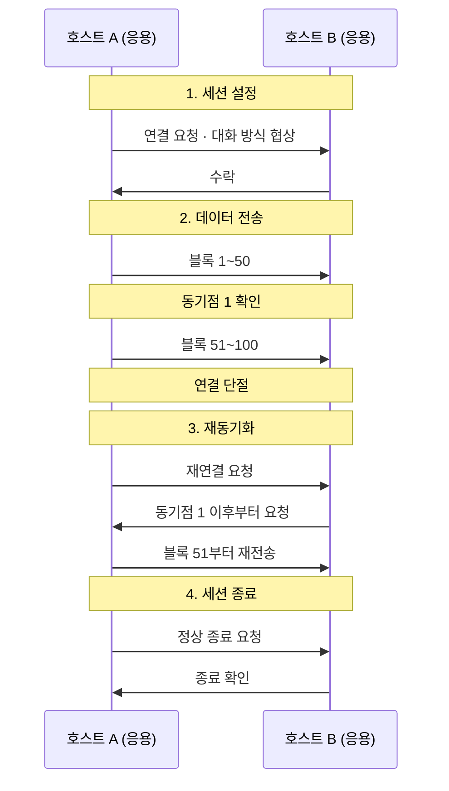

# 세션 계층 (Session Layer, OSI 5계층)

---

## I. 응용 간 대화를 관리하는, 세션 계층의 개요

### 가. 정의

- OSI 5계층으로, 서로 다른 호스트의 응용 [[프로세스]] 간 **대화(세션)를 설정·유지·동기화·종료하고 대화 방식과 복구 지점을 관리**하는 계층 (ITU-T X.215 / ISO 8326)

### 나. 특징 및 필요성

| 구분 | 내용 |
| --- | --- |
| 역할 구분 | L4가 종단 간 데이터 전달을 맡는다면, L5는 누가 언제 보낼지와 중단 후 재개 지점을 관리 |
| 대화 제어 | 양방향 교대(반이중)·양방향 동시(전이중) 방식 결정, 토큰으로 송신권 관리 |
| 동기화 | 동기점(Checkpoint)을 두어 장애 시 처음부터가 아닌 동기점부터 재전송 |
| 활동 관리 | 대화를 의미 단위(Activity)로 묶어 시작·중단·재개 |
| TCP/IP에서 | 별도 계층 없이 응용 계층이나 TLS 등이 기능 수행 |

---

## II. 구조 및 기능

### 가. 세션 수명주기와 동기점 복구

- 대용량 전송 중 장애가 나도 마지막으로 확인된 동기점 이후만 다시 보내 복구 비용 절감

### 나. 주요 기능

| 구분 | 요소 | 설명 |
| --- | --- | --- |
| 연결 관리 | 세션 설정·해제 | 매개변수 협상, 정상 종료(Orderly Release)·중단(Abort) |
| 대화 제어 | 반이중 · 전이중 | 데이터 토큰을 가진 쪽만 송신하는 교대 방식 지원 |
| 동기화 | 주 동기점 (Major) | 확인을 받아야 진행, 이전 데이터 확정 |
| | 부 동기점 (Minor) | 확인 없이 삽입, 재동기화 기준점 |
| 활동 관리 | Activity | 논리적 작업 단위의 시작·중단·재개 |
| 예외 보고 | Exception Reporting | 세션 중 오류 통지 |
| 해당 프로토콜 예 | RPC, NetBIOS 세션 서비스, SOCKS, PPTP | 관례적으로 L5로 분류 |

---

## III. 비교 및 동향

### 가. 전송 계층 vs 세션 계층

| 비교 항목 | L4 [[전송 계층\|전송 계층]] | L5 세션 계층 |
| --- | --- | --- |
| 목적 | 프로세스 간 신뢰성 있는 데이터 전달 | 응용 간 대화 흐름 관리 |
| 기능 | 분할, 오류·흐름·[[TCP 혼잡제어\|혼잡 제어]] | 대화 방식 협상, 동기점, 재동기화 |
| 연결 | 전송 연결 (TCP 연결) | 세션 (하나의 세션이 여러 전송 연결을 쓸 수 있음) |
| 예 | [[TCP]], UDP, [[SCTP (Stream Control Transmission Protocol)\|SCTP]] | RPC, NetBIOS |

### 나. 동향

- **TCP/IP 통합**: 세션·표현·응용 기능이 응용 계층으로 통합되어 응용 소프트웨어가 직접 구현
- **웹의 세션 관리**: HTTP는 무상태라 [[쿠키]]·[[세션]]·토큰(JWT)으로 상태 유지
- **TLS 세션 재개**: 세션 티켓·PSK로 핸드셰이크를 줄이는 기능이 동기화·재개 개념을 계승

---

### 🔗 연관 토픽

- **소속 도메인**: [[00_네트워크_MOC|🌐 네트워크]]
- **세부 분류**: `1. OSI 7계층 & 데이터링크 계층 (L1/L2)`
- **핵심 연관 토픽**:
  - [[OSI 7 Layer|OSI 7 Layer (ISO 7498)]]
  - [[세션]]
  - [[쿠키]]
  - [[전송 계층|전송 계층 (Transport Layer)]]
  - [[서비스 프리미티브]]
