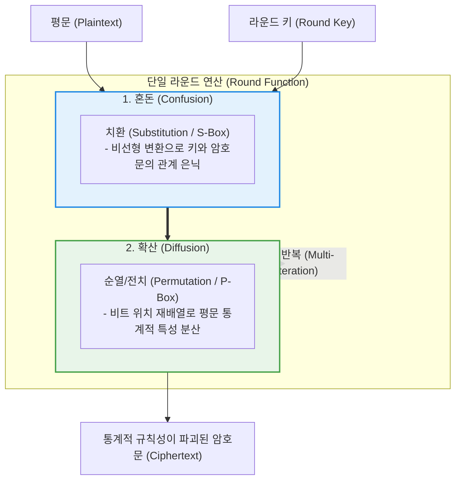

# Shannon의 암호 설계 원칙

---

## I. 현대 대칭키 암호 설계의 근간, Shannon의 원칙 개요

### 가. Shannon 암호 설계 원칙의 정의
- 암호문으로부터 평문과 암호화 키의 정보를 유추할 수 없도록 통계적 특성을 파괴하고 복잡성을 극대화하기 위해 클로드 섀넌이 제시한 대칭키 암호의 2대 필수 수학적 설계 원칙.

### 나. Shannon 암호 설계 원칙의 등장 배경 및 주요 특징
| 구분 | 내용 |
| --- | --- |
| 통계적 분석 방어 | 문자 발생 빈도 등 평문의 통계적 취약점을 악용한 빈도 분석 및 차분 분석 공격 원천 차단 |
| 2대 설계 원리 | 키와 암호문의 관계를 은닉하는 '혼돈(Confusion)'과 평문과 암호문의 관계를 분산시키는 '확산(Diffusion)' 제시 |
| 라운드 반복 적용 | 단일 치환/전치 취약점을 극복하기 위해 다중 라운드(Multi-Round)를 거치는 합성 암호(Product Cipher) 구조 채택 |
| 현대 블록 암호 표준 | DES, [[AES]], ARIA, SEED 등 현대의 모든 블록 암호 아키텍처(SPN, Feistel)의 기반 원리로 정착 |

---

## II. Shannon 암호 설계의 개념도 및 2대 핵심 원리

### 가. 혼돈과 확산 기반 합성 암호(Product Cipher) 개념도

- 평문과 라운드 키의 관계를 감추는 혼돈(S-Box)과 비트 위치를 뒤섞어 전파하는 확산(P-Box)을 하나의 라운드로 결합하여 다중 반복 수행함으로써 안전한 블록 암호를 구성함.

### 나. Shannon 2대 핵심 원리의 기술 요소 비교

| 구분 | 요소기술(키워드) | 세부 설명 |
| --- | --- | --- |
| **혼돈 (Confusion)** | 목적 및 은닉 대상 | **키(Key)와 암호문(Ciphertext) 간의 상관관계 은닉** (키 1비트 변경 시 암호문 예측 불가) |
| **혼돈 (Confusion)** | 수학적 원리 | 복잡한 비선형(Non-linear) 관계를 형성하여 대수적 방정식 해석 방어 |
| **혼돈 (Confusion)** | 구현 기법 및 요소 | **치환(Substitution)**, S-Box(Substitution Box), 역원 계산 및 바이트 대체 |
| **혼돈 (Confusion)** | 방어 공격 유형 | 암호문과 키 사이의 통계적 의존성을 악용하는 선형/차분 암호 분석(Linear/Differential Cryptanalysis) 차단 |
| **확산 (Diffusion)** | 목적 및 은닉 대상 | **평문(Plaintext)과 암호문(Ciphertext) 간의 통계적 관계 은닉** (눈사태 효과 극대화) |
| **확산 (Diffusion)** | 수학적 원리 | 평문 1비트의 변화가 암호문 전체의 절반 이상 비트에 파급되도록 패턴 분산 |
| **확산 (Diffusion)** | 구현 기법 및 요소 | **순열/전치(Permutation)**, P-Box(Permutation Box), ShiftRows, MixColumns |
| **확산 (Diffusion)** | 방어 공격 유형 | 특정 문자의 출현 빈도나 단어 구조를 악용하는 통계적 빈도 분석 공격(Frequency Analysis) 원천 무력화 |

---

## III. Shannon 원칙 기반 블록 암호 아키텍처 비교 및 발전 전망

### 가. 블록 암호 아키텍처 비교 (SPN vs Feistel)

| 비교 항목 | SPN (Substitution-Permutation Network) | Feistel Network |
| --- | --- | --- |
| **기본 구조** | S-Box(치환)와 P-Box(순열) 계층을 전체 블록에 교대로 병렬 적용 | 블록을 좌우 분할 후 라운드 함수(F) 연산 결과를 타 블록과 교차 XOR |
| **암·복호화 구조** | 암호화와 복호화 연산이 상이 (역함수 $S^{-1}$, $P^{-1}$ 구현 필요) | 라운드 키 역순 적용만으로 암호화와 복호화 하드웨어 구조 동일 |
| **연산 효율성** | 블록 전체를 일괄 병렬 처리하여 고속 소프트웨어 연산에 유리 | 한 라운드당 블록의 절반만 연산되므로 충분한 안전성을 위해 더 많은 라운드 소요 |
| **대표 알고리즘** | [[AES]], ARIA | [[DES]], 3DES, SEED, Blowfish |

### 나. Shannon 원칙 기반 현대 암호학의 발전 전망
- **초경량 암호(Lightweight Crypto) 최적화**: 저전력 IoT 기기 및 스마트 태그 환경을 위해 Shannon의 혼돈·확산 원리를 최소 하드웨어 게이트로 구현하는 비트 슬라이스(Bit-sliced) 경량 S-Box 설계 연구 가속화.
- **부채널 공격(SCA) 차단 설계 융합**: 수학적 혼돈·확산 보장을 넘어 암호 칩 구동 시 발생하는 전력 소모 패턴 및 전자기파 누출을 방어하기 위해 비선형 연산 구간 마스킹(Masking) 및 셔플링 기술 결합.
- **포스트 양자 시대의 대칭키 안전성 유지**: 공개키 암호와 달리 양자 그로버(Grover) 탐색 알고리즘에 대해서는 AES-256과 같이 키 길이를 256비트로 확장함으로써 Shannon의 정보이론적 안전 강도를 견고히 유지.

---

### 🔗 연관 토픽

- **소속 도메인**: [[00_보안_MOC|🛡️ 보안]]
- **세부 분류**: `2. 현대 암호학 & 키 관리 · 전자서명`
- **핵심 연관 토픽**:
  - [[AES]]
  - [[암호화|암호화 (Encryption)]]
  - [[DES]]
  - [[RSA (Rivest Shamir Adleman)]]
  - [[ECC|ECC(Elliptic Curve Cryptography)]]
