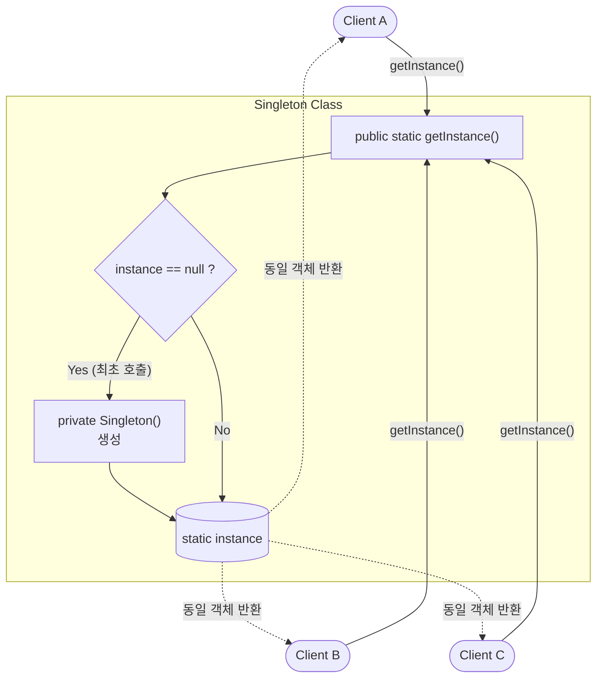

# Singleton Pattern (싱글턴 패턴)

---

## I. 단일 인스턴스 보장, 싱글턴 패턴의 개요

### 가. 정의

- 특정 [[클래스]]의 [[인스턴스]]가 **오직 하나만 생성되도록 보장하고 전역 접근점(Global Access Point)을 제공**하는 GoF 생성(Creational) [[디자인 패턴]]

### 나. 필요성 및 특징

| 구분 | 내용 |
| --- | --- |
| 자원 절약 | DB 커넥션 풀, 로거, 스레드 풀 등 생성 비용이 큰 객체의 중복 생성 방지 |
| 상태 공유 | 여러 모듈이 같은 객체 상태를 일관되게 공유 |
| 지연 초기화 | 실제 사용 시점에 생성해 초기 구동 부담 감소 |
| 동시성 고려 | 멀티스레드에서 인스턴스가 여러 개 생기지 않도록 Thread-Safe 구현 필요 |

---

## II. 구조 및 구현 기법

### 가. 동작 개념도

- 생성자를 `private`으로 막아 외부의 `new`를 차단하고, 정적 메서드로만 유일 인스턴스에 접근

### 나. 구현 기법

| 분류 | 기법 | 설명 |
| --- | --- | --- |
| 기본 구조 | private 생성자 | 외부 인스턴스화 차단 |
| | static 변수·메서드 | 유일 인스턴스 보관과 전역 접근점 제공 |
| 생성 시점 | Eager Initialization | 클래스 로딩 시 즉시 생성 (사용하지 않아도 생성) |
| | Lazy Initialization | 최초 `getInstance()` 호출 시 생성 |
| 동시성 | synchronized 메서드 | 단순하지만 매 호출 락으로 성능 저하 |
| | Double-Checked Locking | null 확인을 두 번 하여 락 최소화, `volatile` 필수 |
| 권장 | LazyHolder (Bill Pugh) | 정적 내부 클래스 로딩을 이용한 락 없는 Thread-Safe 지연 초기화 |
| | Enum Singleton | 리플렉션·직렬화 공격까지 방어 (Effective Java 권장) |

---

## III. 한계 및 현대적 대안

### 가. 전통적 싱글턴의 한계

| 문제 | 내용 |
| --- | --- |
| 높은 [[결합도]] | 구체 클래스의 정적 메서드에 직접 의존 → DIP·OCP 위배 ([[객체지향 설계 원리]]) |
| 테스트 어려움 | 전역 상태를 공유해 [[단위 테스트]] 간 간섭, Mock 대체 곤란 |
| 생명주기 부담 | 개발자가 동시성과 생명주기를 직접 관리 |

### 나. 전통적 싱글턴 vs DI 컨테이너 싱글턴

| 비교 항목 | GoF Singleton | Spring IoC 컨테이너 Bean (기본 scope) |
| --- | --- | --- |
| 생성 주체 | 클래스 내부 (`getInstance()`) | IoC 컨테이너 (ApplicationContext) |
| 구현 제약 | private 생성자, static 메서드 강제 | 일반 POJO |
| 생명주기 | 클래스 로더에 종속 | 컨테이너 Bean 생명주기 |
| 테스트 | Mock 주입 어려움 | 인터페이스 기반 DI로 용이 |

- 현대 엔터프라이즈 환경에서는 직접 구현보다 [[프레임워크]]의 싱글턴 레지스트리에 생명주기를 위임하는 방식이 표준 ([[디자인 패턴\|GoF 패턴]] 참고)

---

### 🔗 연관 토픽

- **소속 도메인**: [[00_소프트웨어공학_MOC|🏗️ 소프트웨어공학]]
- **세부 분류**: `4. 아키텍처 스타일 & 객체지향 설계 원리`
- **핵심 연관 토픽**:
  - [[디자인 패턴|디자인 패턴 (Design Pattern)]]
  - [[Factory Method (생성 위임)]]
  - [[객체지향 설계 원리]]
  - [[결합도]]
  - [[단위 테스트]]
